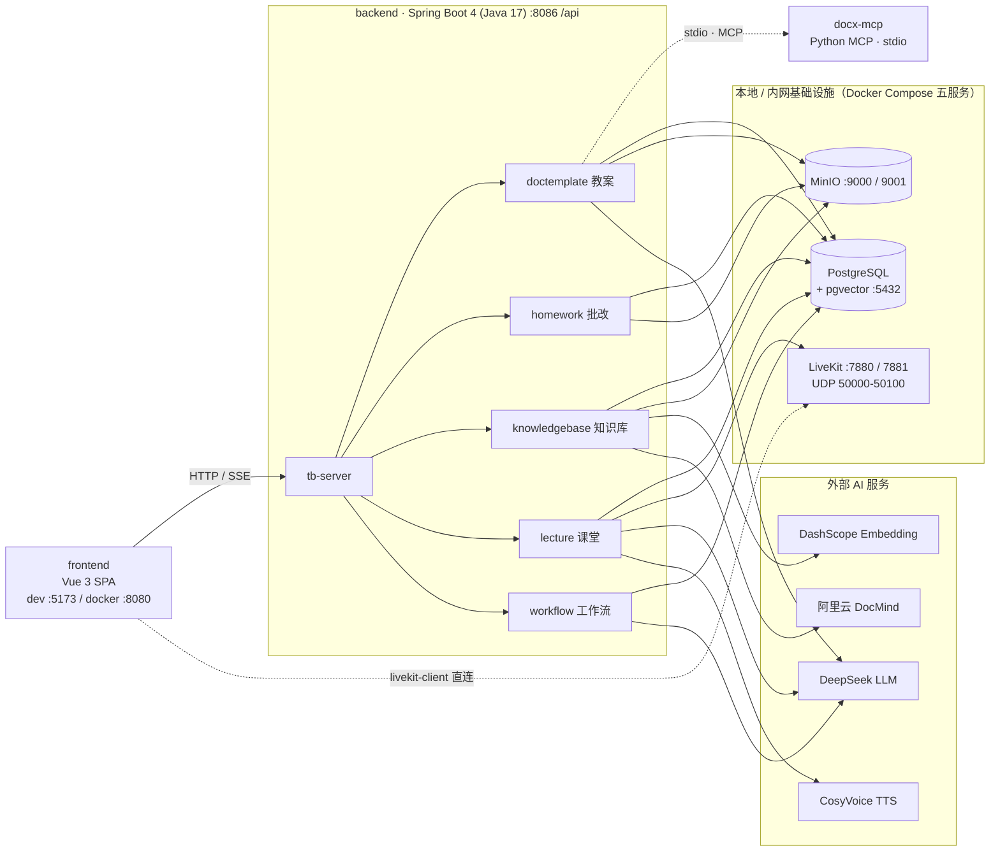

<div align="center">

# TrueBuddy · AI 驱动的教学辅助平台

**AI 驱动的教学辅助平台 —— 把 AI 能力落到教师每天真正要交的五类产物上**

`Java 17` · `Spring Boot 4` · `Vue 3` · `PostgreSQL + pgvector` · `MCP` · `LiveKit` · `Docker Compose`

</div>

---

> 面向一线教师的**本地 / 内网 Web 应用**:备课、批改、上课与资料整理,一站式完成 **Word 教案(模板复刻)、作业批改、PPT 智能课堂、可检索知识库**。

## ✨ 核心特性

| 模块 | 说明 |
| --- | --- |
| 📝 **教案模板复刻** | 上传学校模板 docx,AI 规划内容、MCP 工具逐段替换校验,产出与模板版式完全一致的 Word 教案;知识库 RAG 自动注入备课上下文 |
| ✅ **作业批改** | 作业文件上传与 AI 辅助批改,批改产物统一经对象存储管理 |
| 🖥️ **PPT 智能课堂** | 课件上传后分批生成讲稿;放映页逐页流式播报(CosyVoice TTS + 口型驱动),声音随屏幕共享轨直达学生端,无需任何额外进程;自托管 LiveKit 实时会议,媒体与聊天 DataChannel 全程不经过后端,学生"禁止发言"由令牌在服务端强制 |
| 📚 **知识库 RAG** | 阿里云 DocMind 解析 → AI 语义分片 → `text-embedding-v3` 向量化 → pgvector HNSW 余弦检索 |
| 🧩 **可视化工作流** | 拖拽式流程编排,LLM 节点接入 DeepSeek,SSE 实时回传执行过程 |

## 🏗️ 系统架构



## 🛠️ 技术栈

| 层 | 技术 |
| --- | --- |
| 后端 | Java 17 · Spring Boot 4.0 · Spring AI · MyBatis(注解 SQL) · Maven 多模块 |
| 前端 | Vue 3(`<script setup>`,纯 JS) · Vite 8 · Pinia 4 · Element Plus · Vue Flow · livekit-client |
| AI 工具 | docx-mcp(Python ≥3.12,uv 管理,MCP stdio 服务) |
| 数据 | PostgreSQL + pgvector(HNSW / 余弦) · MinIO 对象存储 |
| 实时 | LiveKit(自托管,媒体旁路) · SSE(长任务统一通道) |
| 外部服务 | DeepSeek · 阿里云百炼(Embedding / CosyVoice) · 阿里云 DocMind 文档智能 |

## 📂 项目结构

```
TrueBuddy/
├── backend/                     # Spring Boot 多模块后端
│   ├── tb-dependencies/         #   依赖版本 BOM
│   ├── tb-framework/            #   框架层:公共配置与组件
│   ├── tb-module-doctemplate/   #   教案模板复刻
│   ├── tb-module-homework/      #   作业批改
│   ├── tb-module-knowledgebase/ #   知识库 RAG
│   ├── tb-module-lecture/       #   智能课堂(会议 / PPT / 数字人)
│   ├── tb-module-workflow/      #   可视化工作流
│   ├── tb-module-infra/         #   文件与基础设施
│   ├── tb-server/               #   启动器(:8086,context-path /api)
│   └── sql/                     #   建表 SQL(手工执行,每表一文件)
├── frontend/                    # Vue 3 前端(Vite,:5173,/api 代理到 8086;Docker 下 nginx :80)
├── docx-mcp/                    # Python MCP 工具服务(uv,stdio 由后端拉起)
├── deploy/                      # Docker 一键部署(前后端 + MinIO + pgvector + LiveKit)
│   ├── backend.Dockerfile       #   Maven 构建 + Java 21 运行时(含 docx-mcp)
│   ├── frontend.Dockerfile      #   Vite 构建 + nginx 托管
│   ├── docker-compose.yml       #   五服务编排与白名单数据库初始化
│   ├── .env.example             #   容器部署环境变量模板
│   ├── deploy.sh / deploy.ps1   #   Linux/macOS/WSL 与 Windows 一键脚本
│   └── manage.sh / manage.ps1   #   start/stop/restart/recreate/logs/ps/pull/env-check
└── docs/                        # 文档体系:doc-*.md 规范 / adr 决策 / specs 变更规格
```

## 🚀 快速开始

### 前置条件

| 场景 | 必需依赖 | 说明 |
| --- | --- | --- |
| Docker 一键部署（推荐） | Docker Engine + Docker Compose 插件 | 不需要 JDK / Node / Python / Maven / psql;首次构建需联网拉基础镜像与依赖 |
| 本地开发 | JDK 17 · Node.js `^22.18.0 \|\| >=24.12.0` · Python ≥3.12 + uv · PostgreSQL + pgvector · MinIO | 后端 / 前端 / docx-mcp 分别以本机进程运行 |

### 方式 A:Docker 一键部署（推荐）

仅装 Docker 的服务器或本机按以下步骤执行:

```bash
cd <仓库根>
# 首次会生成根目录 .env;脚本自动补齐缺失键、探测 PUBLIC_HOST
bash deploy/deploy.sh
```

Windows(Docker Desktop):

```powershell
cd <仓库根>
powershell -ExecutionPolicy Bypass -File deploy/deploy.ps1
```

脚本会构建前后端镜像并启动五个服务:`db`(pgvector)、`minio`、`backend`(+ docx-mcp)、`frontend`(nginx)、`livekit`。数据库表与内置工作流会自动初始化。

部署前按 [deploy/.env.example](./deploy/.env.example) 填写真实外部服务密钥;数据库 / MinIO / LiveKit 的本地凭据由脚本在占位时自动生成且**不回显**。

默认端口:

| 端口 | 说明 |
| --- | --- |
| `8080/tcp` | 前端页面与 `/api` 反代 |
| `8086/tcp` | 后端 API(可选直连) |
| `9000/tcp` / `9001/tcp` | MinIO S3 API / 控制台 |
| `7880/tcp` / `7881/tcp` | LiveKit 信令 / TCP 兜底 |
| `50000-50100/udp` | LiveKit WebRTC 媒体通道(会议必须放行) |

日常管理:

```bash
bash deploy/manage.sh <start|stop|restart|recreate|logs|ps|pull|env-check|help>
```

`env-check` 只列出仍为占位的**键名**,不输出任何值。完整步骤、防火墙与排障见 [docs/doc-deployment.md](./docs/doc-deployment.md)。

### 方式 B:本地开发（不使用 Docker）

#### 1️⃣ 初始化数据库

手工执行 `backend/sql/` 下的建表脚本(`init.sql` 及各表 `.sql`,含 `vector_store.sql`;脚本均可重复执行)。`vector_store` 也可由 Spring AI 的 `initialize-schema` 自动创建,但先跑脚本能保证 `metadata` 直接是 `jsonb`。

#### 2️⃣ 准备环境变量

```bash
# 对照仓库根 .env.example 的变量名清单,填写真实值
# 注意:application.yml 只保留 ${VAR} 占位符,缺键会直接启动失败
cp .env.example backend/.env
```

| 变量 | 必填 | 用途 |
| --- | --- | --- |
| `SPRING_AI_OPENAI_API_KEY` 等 | ✅ | 对话模型(DeepSeek 兼容接口) |
| `OPENAI_EMBEDDING_API_KEY` | ✅ | 向量化(知识库 RAG,百炼兼容模式) |
| `DOCMIND_ACCESS_KEY_ID` / `_SECRET` | ✅ | 文档智能解析,**缺失时启动即失败** |
| `MINIO_SECRET_KEY` | ✅ | MinIO 凭据 |
| `SPRING_DATASOURCE_USERNAME` / `_PASSWORD` | ✅ | PostgreSQL 凭据 |
| `LIVEKIT_API_KEY` / `_SECRET` | 智能课堂(实时会议) | 与 LiveKit 服务端 `.env` 同一对值 |
| `DASHSCOPE_API_KEY` | 讲稿播报 | CosyVoice 流式语音合成 |
| `SPRING_MAIL_USERNAME` / `_PASSWORD` | 邮件功能 | 注册 / 验证码 / 找回密码 |

完整清单与默认值见 [`.env.example`](./.env.example) 与 [docs/doc-devops.md §2](./docs/doc-devops.md)。Docker 部署另用 [`deploy/.env.example`](./deploy/.env.example) 生成根目录 `.env`,两套配置互不影响。

#### 3️⃣ 调整 docx-mcp 路径

本地开发时,后端 `mcp-servers-config.json` 中以**绝对路径**引用 docx-mcp,换机器部署需按本机路径修改(详见 [docs/doc-integration.md §8](./docs/doc-integration.md))。Docker 部署无需手工改:`deploy/mcp-servers-config.json` 已覆盖为容器内 Linux 路径。

#### 4️⃣ 启动后端

```bash
cd backend
./mvnw clean install -DskipTests
java -jar tb-server/target/tb-server-0.0.1-SNAPSHOT.jar
```

#### 5️⃣ 启动前端

```bash
cd frontend
npm install
npm run dev        # http://localhost:5173,/api 代理到 8086
```

#### 6️⃣(可选)启动 LiveKit

本地开发时,实时会议仍需自托管 LiveKit(信令 7880 / TCP 兜底 7881 / UDP 50000-50100);方式 A 已把它纳入 Compose,无需单独处理。部署要点见 [docs/doc-devops.md §7](./docs/doc-devops.md)。

> 仅前端容器化仍可用 `frontend/docker-compose.yml`(`8080:80`,`/api` 反代宿主机 8086),但全栈一键部署请使用方式 A 的根 `deploy/docker-compose.yml`。

## ✅ 质量门禁

提交前需全过以下检查(当前无 CI,门禁为本地人工执行):

| 范围 | 命令 |
| --- | --- |
| 前端 | `cd frontend && npm run lint && npm test` |
| 后端 | `cd backend && ./mvnw clean install && ./mvnw test` |
| Docker 配置 | `docker compose -f deploy/docker-compose.yml --env-file .env config -q` |

## 📖 文档

完整文档以 `docs/` 为唯一权威来源,入口 [docs/doc.md](./docs/doc.md):

| 文档 | 内容 |
| --- | --- |
| [doc.md](./docs/doc.md) | 项目概述、模块地图、全局硬约束 |
| [doc-conventions.md](./docs/doc-conventions.md) | 编码 / 组件 / 路由 / 测试 / 文档书写规范 |
| [doc-api.md](./docs/doc-api.md) | 接口约定与清单 |
| [doc-database.md](./docs/doc-database.md) | 全部表结构(事实源 `backend/sql/`) |
| [doc-integration.md](./docs/doc-integration.md) | 第三方集成(LLM / TTS / 解析 / 存储 / LiveKit / MCP) |
| [doc-devops.md](./docs/doc-devops.md) | 配置、环境变量、启动、容器化 |
| [doc-deployment.md](./docs/doc-deployment.md) | Docker 一键部署:五服务编排、端口、密钥生成、管理脚本、排障 |
| [adr/](./docs/adr/) | 不可逆决策记录(append-only) |
| [specs/](./docs/specs/) | 单次变更规格与验收口径 |

## 🤝 贡献

本项目采用 **git flow** 分支模型:

1. 从 `develop` 拉出功能分支:`feat/<topic>` / `fix/<topic>` / `docs/<topic>`
2. 提交信息遵循 Conventional Commits,如 `feat(home): xxx`
3. 通过上述质量门禁后推送,向 **`develop`** 发起 PR
4. 不可逆决策先落 `docs/adr/NNNN-*.md`,多步变更先落 `docs/specs/YYYY-MM-DD-*.md`

## 🗺️ 已知限制

如实记录(详见 docs),欢迎 Issue / PR:

- 无 CI 流水线,门禁为本地人工执行;数据库无迁移工具(SQL 手工执行)
- Docker 一键部署已覆盖五服务,但未实现自动升级与 HTTPS/TLS 终止;外部 AI / 邮件密钥仍需手工填写
- 演示用的管理员口令校验未接入 BCrypt,上线前需整改(docs/doc-devops.md §3)
- 历史提交中含旧密钥,对外发布前建议全部轮换

## 📄 License

暂未设置开源许可证,如需复用请联系作者。
