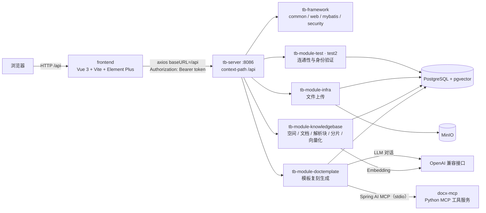

# 01 - 项目概述

> 项目：TrueBuddy
> 生效日期：2026-09-18 ｜ 规范入口：[README.md](./README.md)
> 适用范围：项目定位、核心功能、技术栈与整体架构
> 相关：[03-项目结构.md](./03-项目结构.md)（目录细节）、[05-API规范.md](./05-API规范.md)（接口细节）

---

## 1. 项目概述

TrueBuddy 是一个 **AI 驱动的教学辅助平台**，面向一线教师的备课、批改与资料整理场景。项目以「AI 直接产出可用教学材料」为目标，把大模型能力落到四类真实产物上：Word 教案、批改结果、PPT 演示与可检索的知识库。

工程整体由三部分组成：

| 组成 | 技术 | 职责 |
| --- | --- | --- |
| `backend/` | Spring Boot 4 多模块 Maven | 提供 REST API、承载 AI 编排、数据持久化 |
| `frontend/` | Vue 3 + Vite 单页应用 | 全部交互界面，按业务模块拆分 views |
| `docx-mcp/` | Python + MCP（`uv` 管理） | docx 读写工具服务，由后端以 **stdio 子进程** 拉起 |

---

## 2. 项目定位

- **使用者**：以教师为主，无需理解 AI 细节即可得到成品文档与批改结果。
- **形态**：本地/内网部署的 Web 应用（后端 `8086`、前端 Vite dev server）。
- **技术定位**：毕业设计级别的**工程化实践项目**——追求真实可运行，而非演示原型；因此规范强调分层、可维护性与「现状与规划分离」。
- **能力边界**：AI 负责内容规划、改写与自检修复；模板结构、格式复刻与最终校验由确定性工具（MCP docx 工具 + 校验规则）保证。

---

## 3. 核心功能

| 功能 | 输入 | 产出 | 关键技术 |
| --- | --- | --- | --- |
| **文档 / 教案模板生成** | 词汇 Word 模板 + 需求描述（可选知识库空间、质量档位） | 与模板同格式的教案 docx | Spring AI ChatClient + MCP docx 工具（`docx_open/get_text/get_tables/replace/validate/fill_fields`）+ 知识库检索 |
| **作业批改** | 作业文件夹/压缩包 + 批改配置（工作流、并发度、导出格式） | 逐份评分与反馈、可导出结果 | 前端演示态（mock + localStorage），后端接口待建设 |
| **PPT 生成与放映** | `.pptx` 或 PPTist JSON | 可预览、可全屏放映的幻灯片 | `pptx-to-pptist` 解析 + 自研 SVG 元素渲染 + 动画/翻页 |
| **知识库** | 空间 → 文档上传 → 解析落块 → AI 语义分片校对 | 向量化后的可检索语料 | 阿里云文档智能解析 + LLM 语义分片 + pgvector（1024 维、hnsw、cosine）+ Spring AI OpenAI Embedding |

---

## 4. 技术栈

### 4.1 前端 — `frontend/`

| 类别 | 技术 | 版本 |
| --- | --- | --- |
| 框架 | Vue 3（Composition API，`<script setup>`） | ^3.5.40 |
| 构建 | Vite | ^8.1.5 |
| 路由 | Vue Router | ^5.2.0 |
| 状态管理 | Pinia | ^4.0.2 |
| UI | Element Plus（`main.js` 全量注册） | ^2.14.5 |
| 图标 | @element-plus/icons-vue | ^2.3.2 |
| HTTP | Axios | ^1.19.0 |
| 存储 | js-cookie | ^3.0.8 |
| 动效 | GSAP（+ ScrollTrigger） | ^3.15.0 |
| 平滑滚动 | Lenis | ^1.3.26 |
| 节点画布 | @vue-flow/core | ^1.48.2 |
| PPT 解析 | pptx-to-pptist | ^1.0.2 |
| Word 预览 | docx-preview | ^0.4.0 |
| 压缩包解压 | jszip | ^3.10.2 |
| 数字人 | pixi.js / pixi-live2d-display | ^6.5.10 / ^0.4.0 |
| 代码检查 | oxlint / ESLint | ~1.74.0 / ^10.7.0 |
| 运行时 | Node.js（`package.json` 的 `engines`） | `^22.18.0 \|\| >=24.12.0` |

> **已声明但未使用**：`pptxtojson` ^2.0.6、`@vue-flow/background` ^1.3.2；`vite-plugin-vue-devtools` 在 `vite.config.js` 中被注释未启用。
> 语言：**纯 JavaScript，无 TypeScript**。

### 4.2 后端 — `backend/`

| 类别 | 技术 | 版本 |
| --- | --- | --- |
| 框架 | Spring Boot（父工程 `spring-boot-starter-parent`） | 4.0.1 |
| Java | 17 | — |
| ORM | MyBatis Plus（`mybatis-plus-spring-boot3-starter`） | 3.5.7 |
| 数据库 | PostgreSQL（含 `vector` 扩展） | — |
| AI | Spring AI（`spring-ai-bom`） | 2.0.0-M3 |
| 文档解析 | 阿里云文档智能（文档解析大模型版）SDK `docmind_api20220711`；Apache POI | 2.0.15 / 5.2.5 |
| 安全 | Spring Security（自定义 `TokenAuthenticationFilter`，JWT 未引入） | — |
| 对象存储 | MinIO | 8.5.10 |
| 工具 | Lombok、Hutool、Guava | — / 5.8.47 / 33.6.0-jre |

> 版本统一由 `tb-dependencies`（无 parent 的独立 BOM）管理，内部模块版本统一走 `${revision}`（`0.0.1-SNAPSHOT`），由 `flatten-maven-plugin` 解析。
> Lombok 版本由 Spring Boot 父工程统一管理，未单独声明。

### 4.3 服务与脚本

| 项 | 值 |
| --- | --- |
| 后端端口 / 上下文路径 | `8086` / `/api` |
| 数据库 | `jdbc:postgresql://127.0.0.1:5432/tb`（凭据经环境变量注入） |
| MinIO | `http://localhost:9000`，桶 `test-bucket`（默认值，可经环境变量覆盖） |
| docx-mcp 启动方式 | Spring AI MCP Client（stdio），`uv run --directory docx-mcp mcp run docx-mcp/main.py` |
| 环境变量模板 | 项目根 `.env.example` |
| 上传上限 | `spring.servlet.multipart` 单文件 / 单请求均为 `50MB` |

---

## 5. 整体架构

---

## 6. 关键技术决策

| 决策 | 说明 |
| --- | --- |
| 无 TypeScript | 前端纯 JS，降低毕业设计的类型维护成本；用 `jsconfig.json` 提供 `@/*` 编辑器提示 |
| 芋道式多模块 Maven | BOM（`tb-dependencies`）+ 框架 starter + 业务模块 + 启动模块，业务模块保持**单模块**（不拆 api/biz） |
| 统一 `CommonResult<T>` | 所有 Controller 统一包装，`code = 0` 成功；前端 axios 响应拦截器自动解包 |
| MyBatis Plus | DO 继承 `BaseDO`、Mapper 继承 `BaseMapperX`，使用 `Wrappers` 条件构造器，**全项目无 MyBatis XML** |
| MCP stdio 通信 | docx 工具以本地子进程方式接入，无网络开销；`mcp-servers-config.json` 中不内联凭据 |
| 敏感信息环境变量化 | `application.yml` 只保留 `${VAR}` 占位符（当前存在待整改项，见 [08](./08-通用约束.md)） |
| Element Plus 全量注册 | 启动简单、开发直观；代价是包体偏大（按需引入为可选优化） |
| 前端按业务模块拆分 views | 每个业务模块自带 `components/`、`mock/`、`utils/`，模块内部自治 |

---

## 7. 现状与规划

| 能力 | 现状 | 规划 / 待开发 |
| --- | --- | --- |
| 文档 / 教案模板生成 | 后端链路完整（LLM 规划 → MCP 改写 → 校验修复 → 落库）；前端 `DocTemplateView.vue` + `DocxPreview.vue` 可用 | `AiChatPanel.vue` 目前为**模拟回复**，规划接入真实 SSE 流式对话 |
| 作业批改 | 仅前端演示态（`views/homework/` + mock + localStorage）；`api/homework.js` 已定义但**未被页面调用**；后端**无对应模块** | 补齐后端批改模块与接口 |
| PPT | 前端解析 / 预览 / 放映完整；后端仅 `test2` 有 pptx 读取验证接口 | 「AI 生成 PPT 结构化数据」尚未实现 |
| 知识库 | 后端「空间 / 文档 / 解析落块 / AI 语义分片 / 向量化」链路完整；前端「上传 → 分段校对 → 向量化」三步页面完整 | 检索增强接入对话链路 |
| 工作流编排 | 仅前端 Vue Flow **示例画布**（`views/workflow/test/{StartNode,ForNode,FunNode}.vue`，数据写死）；`api/workflow.js` **未被调用** | 与后端 schema 打通、保存 / 详情接口落地 |
| 数字人 | `views/ppt/index.vue` 已加载 Live2D Haru 模型（右侧占位区） | 抽为独立组件并封装 Pixi 生命周期 |
| 实时通信 | 未引入 | 后端 SSE（`text/event-stream`）+ 前端 `EventSource` |
| 鉴权 | Token 校验过滤器已就绪，`@PermitAll` 与 `tb.security.permit-all-urls` 可放行 | JWT 签发、前端路由守卫与 401 跳转未实现 |

---

> 上表「现状」部分以实际代码为准；标注为规划的能力在落地前不得被其它模块依赖。
