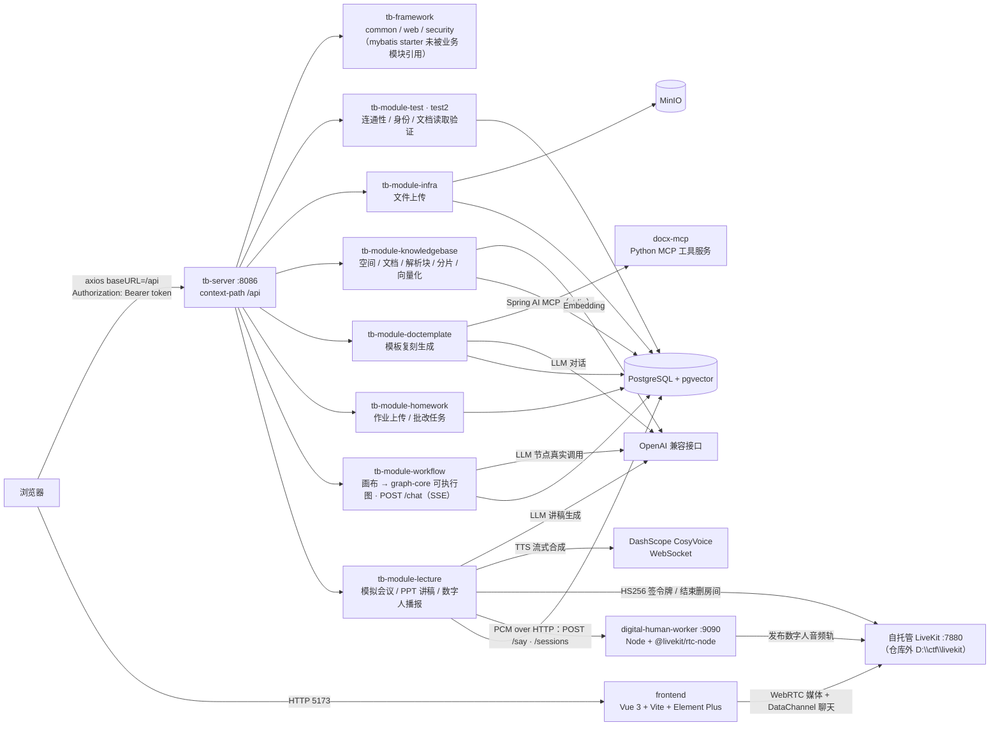

# 01 - 项目概述

> 项目：TrueBuddy
> 生效日期：2026-09-18 ｜ 最近核对代码现状：2026-10-10 ｜ 规范入口：[README.md](./README.md)
> 适用范围：项目定位、核心功能、技术栈与整体架构
> 相关：[03-项目结构.md](./03-项目结构.md)（目录细节）、[05-API规范.md](./05-API规范.md)（接口细节）、[16](./16-PPT演讲与模拟会议方案.md)/[17](./17-AI数字人语音链路方案.md)（会议与数字人落地记录）

---

## 1. 项目概述

TrueBuddy 是一个 **AI 驱动的教学辅助平台**，面向一线教师的备课、批改、上课与资料整理场景。项目以「AI 直接产出可用教学材料」为目标，把大模型能力落到五类真实产物上：Word 教案、批改结果、PPT 演示与演讲稿、可检索的知识库、模拟会议里的实时播报。

工程整体由四部分组成：

| 组成 | 技术 | 职责 |
| --- | --- | --- |
| `backend/` | Spring Boot 4 多模块 Maven | 提供 REST API、承载 AI 编排、数据持久化 |
| `frontend/` | Vue 3 + Vite 单页应用 | 全部交互界面，按业务模块拆分 views |
| `docx-mcp/` | Python + MCP（`uv` 管理） | docx 读写工具服务，由后端以 **stdio 子进程** 拉起 |
| `digital-human-worker/` | Node ESM（`.mjs`）+ `@livekit/rtc-node` | 数字人音频注入器：收后端推来的裸 PCM，发布成 LiveKit 房间音频轨（见 [17](./17-AI数字人语音链路方案.md)） |

---

## 2. 项目定位

- **使用者**：以教师为主，无需理解 AI 细节即可得到成品文档与批改结果。
- **形态**：本地/内网部署的 Web 应用（后端 `8086`、前端 Vite dev server）。
- **技术定位**：毕业设计级别的**工程化实践项目**——追求真实可运行，而非演示原型；因此规范强调分层、可维护性与「现状与规划分离」。
- **能力边界**：AI 负责内容规划、改写与自检修复；模板结构、格式复刻与最终校验由确定性工具（MCP docx 工具 + 校验规则）保证。

---

## 3. 核心功能

| 功能 | 输入 | 产出 | 关键技术 |
| --- | --- | --- | --- |
| **文档 / 教案模板生成** | 词汇 Word 模板 + 需求描述（可选知识库空间、质量档位） | 与模板同格式的教案 docx | Spring AI ChatClient + MCP docx 工具（`docx_open/get_text/get_tables/replace/validate/fill_fields`）+ 知识库检索 |
| **作业批改** | 作业文件夹/压缩包 + 批改配置（工作流、并发度、导出格式） | 逐份评分与反馈、可导出结果 | `tb-module-homework` 的 `/homework/upload`（multipart，MinIO/本地清单）+ `/homework/grade`（复用 workflow 执行链）；前端 `HomeworkGradingView.vue` 已接线，历史与导出仍走本地 |
| **PPT 生成与放映** | `.pptx` 或 PPTist JSON | 可预览、可全屏放映的幻灯片 + 逐页演讲稿（写回 `remark`） | `pptx-to-pptist` 解析 + 自研 SVG 元素渲染 + 动画/翻页；讲稿走 `tb-module-lecture` 的 `ppt` 包 |
| **知识库** | 空间 → 文档上传 → 解析落块 → AI 语义分片校对 | 向量化后的可检索语料 | 阿里云文档智能解析 + LLM 语义分片 + pgvector（1024 维、hnsw、cosine）+ Spring AI OpenAI Embedding |
| **模拟会议** | 老师建会 → 会议号 / 入会链接 → 学生入会 | 屏幕共享 + 聊天 + 在线名单 + 数字人播报 | 自托管 **LiveKit**（媒体与聊天 DataChannel 都不经过本服务）+ 后端签发 HS256 令牌、结束会议删房间 |

---

## 4. 技术栈

### 4.1 前端 — `frontend/`

| 类别 | 技术 | 版本 |
| --- | --- | --- |
| 框架 | Vue 3（Composition API，`<script setup>`） | ^3.5.40 |
| 构建 | Vite | ^8.1.5 |
| 路由 | Vue Router | ^5.2.0 |
| 状态管理 | Pinia | ^4.0.2 |
| UI | Element Plus（`main.js` 全量注册） | ^2.14.5 |
| 图标 | @element-plus/icons-vue | ^2.3.2 |
| HTTP | Axios | ^1.19.0 |
| 存储 | js-cookie | ^3.0.8 |
| 动效 | GSAP（+ ScrollTrigger） | ^3.15.0 |
| 平滑滚动 | Lenis | ^1.3.26 |
| 节点画布 | @vue-flow/core + @vue-flow/background | ^1.48.2 / ^1.3.2 |
| Markdown 编辑/预览 | bytemd（+ `@bytemd/vue-next`、`plugin-gfm`、`plugin-highlight`、`plugin-mermaid`） | ^1.22.0 |
| PPT 解析 | pptx-to-pptist | ^1.0.2 |
| Word 预览 | docx-preview | ^0.4.0 |
| 压缩包解压 | jszip | ^3.10.2 |
| 实时通信 | livekit-client（模拟会议：屏幕共享轨 + 聊天 DataChannel） | ^2.22.3 |
| 数字人 | pixi.js / pixi-live2d-display | ^6.5.10 / ^0.4.0 |
| 代码检查 | oxlint / ESLint / eslint-plugin-vue | ~1.73.0 / ^10.7.0 / ~10.9.2 |
| 测试 | Node 内置 `node:test` + `node:assert/strict`（**无 Vitest/Jest**），脚本 `npm test` = `node --test "tests/*.test.js"` | Node 22/24 |
| 任务串联 | npm-run-all2（`lint` = `run-s lint:oxlint lint:eslint`） | ^9.0.2 |
| 运行时 | Node.js（`package.json` 的 `engines`） | `^22.18.0 \|\| >=24.12.0` |

> **已声明但未使用**：`pptxtojson` ^2.0.6（只出现在 `vite.config.js` 的 `optimizeDeps.include`，`src` 内无导入）；`vite-plugin-vue-devtools` 在 `vite.config.js:5` 中被注释未启用。
> 语言：**纯 JavaScript，无 TypeScript**。

### 4.2 后端 — `backend/`

| 类别 | 技术 | 版本 |
| --- | --- | --- |
| 框架 | Spring Boot（父工程 `spring-boot-starter-parent`） | 4.0.1 |
| Java | 17 | — |
| ORM | **实际用的是 MyBatis 原生 starter**（`org.mybatis.spring.boot:mybatis-spring-boot-starter`，Mapper 全部走注解 SQL）；workflow 模块用 `spring-boot-starter-jdbc` + `JdbcTemplate` | 4.0.0 |
| ORM（未接线） | `tb-spring-boot-starter-mybatis`（MyBatis Plus，提供 `BaseMapperX` / `BaseDO`）仍在 `tb-framework/` 里，但**当前没有任何业务模块依赖它**，`BaseMapperX` / `BaseDO` 零子类 | 3.5.7 |
| 数据库 | PostgreSQL（含 `vector` 扩展） | — |
| AI | Spring AI（`spring-ai-bom`，OpenAI 兼容接口 + pgvector store + MCP client） | 2.0.0-M3 |
| 语音 | DashScope Java SDK（CosyVoice 流式合成，走原生 WebSocket） | 2.22.7 |
| 文档解析 | 阿里云文档智能（文档解析大模型版）SDK `docmind_api20220711`；Apache POI（在 `tb-module-test2` 内显式钉版本，避免与 Tika 冲突） | 2.0.15 / 5.4.1 |
| 工作流引擎 | Spring AI Alibaba Graph（`com.alibaba.cloud.ai:spring-ai-alibaba-graph-core`） | 2.0.0-M1.1 |
| 安全 | Spring Security（自定义 `TokenAuthenticationFilter`，JWT 未引入） | — |
| 实时通道 | SSE（workflow 模块的 `POST /chat`）+ 自托管 **LiveKit**（模拟会议：媒体与聊天，经 JWT 令牌鉴权；后端只签发令牌与删房间，**JVM 侧无法发布音频轨**，数字人音频由 Node worker 发布） | LiveKit 是独立运行时（`D:\ctf\livekit`），不进后端依赖 |
| 对象存储 | MinIO | 8.5.10 |
| 工具 | Lombok、Hutool、Guava | — / 5.8.47 / 33.6.0-jre |

> 版本统一由 `tb-dependencies`（无 parent 的独立 BOM）管理，内部模块版本统一走 `${revision}`（`0.0.1-SNAPSHOT`），由 `flatten-maven-plugin` 解析。
> Lombok 版本由 Spring Boot 父工程统一管理，未单独声明。

### 4.3 服务与脚本

| 项 | 值 |
| --- | --- |
| 后端端口 / 上下文路径 | `8086` / `/api` |
| 前端 dev server | `5173`（Vite 代理 `/api` → `http://localhost:8086`；LiveKit 信令不走代理，直连 `livekitUrl` 的 7880） |
| 数据库 | `jdbc:postgresql://127.0.0.1:5432/tb`（凭据经环境变量注入） |
| MinIO | `http://localhost:9000`，桶 `test-bucket`（默认值，可经环境变量覆盖） |
| 自托管 LiveKit | 仓库外 `D:\ctf\livekit`，信令/媒体端口 `7880`，凭 `LIVEKIT_API_KEY` / `LIVEKIT_API_SECRET` 签发令牌 |
| 数字人 worker | `digital-human-worker/`，默认 `WORKER_PORT=9090`（只应指向环回）；与后端共享 `AGENT_SHARED_SECRET` ↔ `TB_AGENT_SHARED_SECRET`，未配置时除 `/healthz` 外一律 503 |
| docx-mcp 启动方式 | Spring AI MCP Client（stdio），`mcp-servers-config.json` 里是 `uv run --directory <机器绝对路径>\docx-mcp mcp run <绝对路径>\main.py` + `UV_CACHE_DIR`；**换机器需改该文件**，凭据不内联 |
| 环境变量模板 | 项目根 `.env.example`（worker 另有 `digital-human-worker/.env.example`） |
| 上传上限 | `spring.servlet.multipart` 单文件 `50MB`、单请求 `1024MB`（整包/多文件场景靠请求上限放行） |

---

## 5. 整体架构

---

## 6. 关键技术决策

| 决策 | 说明 |
| --- | --- |
| 无 TypeScript | 前端纯 JS，降低毕业设计的类型维护成本；用 `jsconfig.json` 提供 `@/*` 编辑器提示 |
| 芋道式多模块 Maven | BOM（`tb-dependencies`）+ 框架 starter + 业务模块 + 启动模块，业务模块保持**单模块**（不拆 api/biz） |
| 统一 `CommonResult<T>` | Controller 统一包装，`code = 0` 成功；前端 axios 响应拦截器自动解包并把 `code != 0` 抛成 `Error`。例外：`POST /chat` 返回 `SseEmitter`、`GET /workflow/text` 返回 `void`（联调用） |
| MyBatis 注解 SQL | 业务 Mapper 一律 `@Mapper` + `@Select/@Insert/@Update` 注解 SQL，**全项目无 MyBatis XML**；DO 是普通 POJO（不继承 `BaseDO`），主键回填靠 `@Options(useGeneratedKeys = true)`。框架里的 `tb-spring-boot-starter-mybatis`（MyBatis Plus + `BaseMapperX`）目前无人依赖，workflow 模块另走 `JdbcTemplate` |
| MCP stdio 通信 | docx 工具以本地子进程方式接入，无网络开销；`mcp-servers-config.json` 中不内联凭据 |
| 敏感信息环境变量化 | `application.yml` 只保留 `${VAR}` 占位符（当前存在待整改项，见 [08](./08-通用约束.md)） |
| 在线状态只认房间事件 | 「在线成员」唯一真相源是 LiveKit `ParticipantConnected/Disconnected`，数据库台账只表示「入会过」；刷新页面不补写 `leaveTime`（见 [adr/0002](./adr/0002-在线状态唯一真相源为房间事件.md)） |
| 数字人音频必须经 Node worker | LiveKit 没有 JVM 服务端媒体 SDK，后端只能签令牌与调 RoomService；发布音频轨需要一个实时媒体客户端进程（见 [17](./17-AI数字人语音链路方案.md) §2） |
| 讲稿不落库 | 演讲稿就是 PPTist 页面的 `remark`，优化接口无状态，采纳后由前端写回本地画布 JSON（见 [16](./16-PPT演讲与模拟会议方案.md) §12） |
| Element Plus 全量注册 | 启动简单、开发直观；代价是包体偏大（按需引入为可选优化） |
| 前端按业务模块拆分 views | 每个业务模块自带 `components/`、`hooks/`、`stores/`、`utils/`（画布类模块另有 `node/`、`configs/`、`styles/`），模块内部自治；跨模块复用的纯函数才上升到 `src/lib/`、`src/composables/` |

---

## 7. 现状与规划

| 能力 | 现状 | 规划 / 待开发 |
| --- | --- | --- |
| 文档 / 教案模板生成 | 后端链路完整（LLM 规划 → MCP 改写 → 校验修复 → 落库）；前端 `DocTemplateView.vue` + `DocxPreview.vue` 可用 | `views/doctemplate/components/AiChatPanel.vue` 仍是**模拟回复**（前端回复池按顺序循环），规划接入真实 SSE 流式对话 |
| 作业批改 | `tb-module-homework` 已落地：`POST /homework/upload`（multipart 收整包，返回文件清单）+ `POST /homework/grade`（批改任务提交，走 workflow 执行链）；前端 `HomeworkGradingView.vue` 已调用 `uploadHomeworkFiles` / `submitGrading`，`views/homework/HomeworkWorkflowView.vue` 已删除 | 批改结果导出、历史记录落库（当前仍靠本地） |
| PPT | 前端解析 / 预览 / 放映完整；后端 `test2` 有 pptx 读取验证接口、`lecture/ppt` 有讲稿优化接口 | 「AI 生成 PPT 结构化数据」尚未实现 |
| 知识库 | 后端「空间 / 文档 / 解析落块 / AI 语义分片 / 向量化」链路完整；前端「上传 → 分段校对 → 向量化」三步页面完整 | 检索增强接入对话链路 |
| 工作流编排 | 前端 Vue Flow 画布在 **`views/workflow2/`**，已接线全部接口：节点库拖拽新增 / 保存 / 打开 / 试运行（**SSE 实时推送**，节点状态、输出与人工确认卡片都直接画在节点上，**无弹窗**；暂停在人工确认节点时该节点正下方出现勾选清单，提交后同一条流继续）。后端 `tb-module-workflow`（包根 `org.example.textflow`）：定义**已持久化**（`workflow` 表，画布 JSON 整存、软删、不做版本管理）→ `spring-ai-alibaba-graph` 编译为可执行图；执行入口是 **`POST /chat`**（`text/event-stream`，只接受已落库的 `workflow_id`，不内联画布），首轮与人工确认续跑合并为同一端点；会话与执行实例**已落库**（`workflow_conversation` / `workflow_run`）；LLM 节点注入真实 `ChatClient`。`POST /workflow/run` 与 `GET /workflow/get_process`（轮询兜底）**已不存在** | 可选：工作流版本管理、按空间 / 用户隔离、执行中主动取消 |
| 数字人 | **阶段一已落地（2026-10-09）**：后端 `lecture/digital` 用 DashScope CosyVoice 流式合成裸 PCM，经 HTTP（`POST /say`、`/sessions`）推给 `digital-human-worker/`，由 worker 发布成 LiveKit 音频轨；会议室里的 `views/meeting/components/DigitalHumanAvatar.vue` 已挂 Live2D 形象，`GET /meeting/digital/status` + `POST /meeting/digital/say` 对外。**跟页播报 A 段已落地（2026-10-10）**：演讲台 `/meeting/:meetingNo/present` 翻一页就念该页 `remark`（串行队列、按句切段），并新增取消（`POST /meeting/digital/say/cancel` → worker `DELETE /say/{id}`）、同房间单飞闸门、**本机试听通路**（`POST /ppt/speech/speak` 回 `audio/wav`，不进房间、不依赖 worker）。整条语音链路默认**关闭**（`tb.digital-human.enabled=false`，需 `DASHSCOPE_API_KEY` + `TB_AGENT_SHARED_SECRET` + worker 进程） | AI 现场讲词（`narrate` + 现场上下文 + 预取，B 段）、形象与口型两份实现合并（C 段）、ASR 上行（阶段三）、数字人挂 `@Tool`（D 段，需先出 ADR），见 [17](./17-AI数字人语音链路方案.md) §9 与 [18](./18-放映与会议演讲体系方案.md) |
| 模拟会议 | 后端 `tb-module-lecture` 的 `meeting`：会议 / 参会人 / 消息三张表 + **9 个 REST 接口**（`create` / `join` / `leave` / `detail` / `state` / `message` / `close` / `digital/status` / `digital/say`）+ LiveKit 令牌签发（Hutool HS256）与房间管理（结束会议删房间）；实时媒体与聊天由**自托管 LiveKit**（`D:\ctf\livekit`）承担，前端 `views/meeting/hooks/useLiveKitRoom.js` 连接房间；页面为老师控制台 + 学生会议室（学生在独立路由免登录入会）。在线名单**只取房间事件**，不由台账计算（[adr/0002](./adr/0002-在线状态唯一真相源为房间事件.md)） | 会中 AI 答疑；共享画面发起权搬到演讲台（需先新增 `presenter` 令牌身份，见 [18](./18-放映与会议演讲体系方案.md) §5.7、Q7） |
| PPT 讲稿优化 | 前端 `views/ppt/`：备注区右上角星形按钮（本页）+ 工具栏「AI 优化全部备注」与「本场时长」；结果先进**对比弹窗**（整篇可逐页勾选），采纳后写回该页 `remark`。后端 `tb-module-lecture` 的 `ppt` 包：**无状态**接口 `POST /ppt/speech/optimize`（不落库、不做 pptx 上传解析），内部按 `batch-size` 分批调用对话模型以避免输出被 token 上限截断，部分失败返回 `failedIndexes` | 讲稿落库与会议联动（会中按页播报）；逐页目标时长精调 |
| 实时通信 | 两条通道并存：①工作流用 **SSE** `POST /chat`，事件帧为 `conversation.chat.in_progress` / `conversation.message.completed` / `conversation.chat.requires_action` / `.completed` / `.failed` / `done`（终态看帧不看流），前端用 `fetch` + `ReadableStream` 读取（`src/utils/workflow-sse.js`），未引入 `EventSource`（仅支持 GET）；②会议用 **自托管 LiveKit**（媒体走音视频轨、聊天走 DataChannel，JWT 令牌鉴权、权限在服务端强制；数字人音频轨由 Node worker 发布） | 对话流式回复；把事件流客户端与统一错误语义复用到其它进度类接口 |
| 鉴权 | Token 校验过滤器已就绪，`tb.security.permit-all-urls` 由 `application.yml` 注入白名单；`@EnableMethodSecurity(securedEnabled = true)` 已开但全仓尚无 `@PreAuthorize` / `@Secured` 用法 | JWT 签发（现为 `IdUtil.fastSimpleUUID()` 生成的不透明令牌）、前端路由守卫与 401 跳转未实现 |

---

> 上表「现状」部分以实际代码为准；标注为规划的能力在落地前不得被其它模块依赖。
