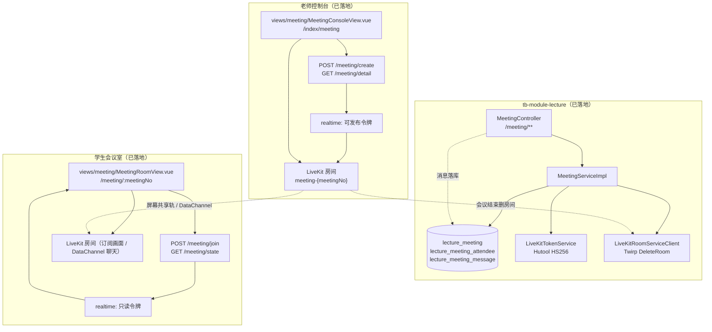

# 16 - PPT 演讲与模拟会议方案

> 项目：TrueBuddy
> 生效日期：2026-10-08 ｜ 规范入口：[README.md](./README.md)
> 适用范围：**本期只做「模拟会议」**；PPT 演讲稿优化与 AI 数字人配音/口型列为后续阶段（见 §1.3、§9）
> 实时通道实现：**自托管 LiveKit**（部署在仓库外的 `D:\ctf\livekit`），媒体与聊天都不经过本服务
> 相关：[03-项目结构.md](./03-项目结构.md)、[05-API规范.md](./05-API规范.md)、[06-路由规范.md](./06-路由规范.md)、[08-通用约束.md](./08-通用约束.md)、[../backend/AGENT - 后端技术规约.md](../backend/AGENT%20-%20后端技术规约.md)、[../frontend/AGENT - 前端技术规约.md](../frontend/AGENT%20-%20前端技术规约.md)

---

## 1. 背景与目标

### 1.1 需求来源

| # | 需求原话（摘要） | 处置 |
| --- | --- | --- |
| 1 | 备注区 `remark` 优化：依据 PPT 数据做 AI 演讲稿优化 | **移到后续阶段**（见 §1.3） |
| 2 | AI 数字人：添加 AI 语音返回以及对口型 | **移到后续阶段**（见 §1.3） |
| 3 | 模拟会议：开启会议、生成会议链接、学生入会并可发消息提问 | **本期范围** |

### 1.2 本期范围（会议 MVP）

| 端 | 功能 |
| --- | --- |
| 老师控制台 | 创建会议（填标题）、结束会议、复制入会链接、在线学生名单、学生聊天、**共享屏幕** |
| 学生端 | 入会（点链接 → 弹窗输名字）、观看老师共享的画面、右侧聊天框、在线人数、会议结束提示 |
| 实时能力 | 一条 **LiveKit 房间连接**同时承载「屏幕共享视频轨」与「聊天 DataChannel」；成员与在线数取自房间事件 |
| 持久化 | 会议、参会人、消息落库；房间内的实时状态不落库（以 LiveKit 为准） |

### 1.3 后续阶段（本期不做，但已被确认要做的）

| 阶段 | 能力 | 与本期关系 |
| --- | --- | --- |
| 后续一 | PPT 演讲稿优化：上传 pptx → 后端解析落库 → 按页生成演讲稿（支持目标时长/字数、`remark` 优化与直接采用双模式） | 不依赖本期；本期预留 `lecture_meeting.document_id` 空列 |
| 后续二 | AI 数字人：TTS 配音 + Live2D 口型 + 会议内播报 + 数字人挂 `@Tool` 工具（翻页 / 播报 / 开关语音答疑 / 读学生反馈） | **依赖本期**的 LiveKit 房间；数字人语音可直接发布为 LiveKit 音频轨（不必再走 PCM over WS） |

### 1.4 范围外（本期明确不做）

| 能力 | 不做的理由 |
| --- | --- |
| 共享音频（老师麦克风 / 系统声音） | 本期只做屏幕共享；LiveKit 加音频轨是后续一步（见 §1.3 后续二），现在不做以免与数字人语音冲突 |
| 学生自主翻页 / 老师屏幕标注 | 学生看的是老师共享的画面，翻页天然跟随；标注按需再加 |
| 会中语音提问（ASR） | 学生端默认无语音能力；随数字人阶段一起做 |
| 会议录制回放 / 字幕导出 | 属会议产品完整形态；LiveKit 的 egress 本期不启用 |
| 踢人 / 禁言 / 主持转让 | 单机小规模演示场景，收益低 |

### 1.5 已确认决策

> 本表是后续设计与实现的约束。带「已作废」的条目表示被更晚的决策取代，避免按旧口径实现。

| 编号 | 议题 | 决策 |
| --- | --- | --- |
| Q8（首轮） | 参会方式 | 学生点链接后**弹窗输入名字**即入会，**免登录匿名** |
| Q14（首轮） | 学生端形态 | 同屏画面 + 右侧聊天框；**默认无语音能力** |
| Q19 / Q31（首轮） | 同屏方式 | **真·同屏**（同步老师画面），不做「只同步页码」 |
| Q22（首轮） | 老师端形态 | 老师**不参会**，是**控制台**：创建/结束会议、复制链接、在线名单、看聊天、发起共享 |
| Q30（首轮） | 模块落点 | 新建 `tb-module-lecture`，本期只实现其 `meeting` 包 |
| Q1（LiveKit） | 替换范围 | **媒体 + 聊天 + 成员状态全部搬到 LiveKit**；后端退化为「落库 + 签发令牌 + 删房间」 |
| Q2（LiveKit） | 部署形态 | **自托管 Docker**（`livekit/livekit-server`），不用 LiveKit Cloud（要求 wss + 外网） |
| Q3（LiveKit） | 演示网络 | **手机热点**（教师机 IP 每次可能变，因此地址一律运行时推导） |
| Q4（LiveKit） | 旧实现 | **删除**自建 WebSocket 媒体 / 聊天链路，不做双通道 |
| Q5（LiveKit） | 音频 | **先只做屏幕共享**；音频轨留给后续数字人阶段 |
| Q6（LiveKit） | 令牌签发 | 用项目已有的 Hutool **手写 HS256 JWT**，不引入官方 Kotlin SDK |
| Q7（LiveKit） | 房间与权限 | `room = meeting-{meetingNo}`；identity = `host` / `attendee-{id}`；老师 `canPublish=true`、学生 `false`、双方 `canPublishData=true`（**权限在服务端强制**） |
| Q8（LiveKit） | 聊天落库 | **前端双写**：DataChannel 负责实时，`POST /meeting/message` 负责历史 |
| Q9（LiveKit） | 成员/在线真相 | **以 LiveKit 房间事件为准**；DB 的 `online` 字段退化为历史，仅入会时置真、结束会议时统一置假 |
| Q10（LiveKit） | 结束会议 | 后端调 **`RoomService/DeleteRoom`** 删房间 → 房间内客户端立刻 `Disconnected`；学生端 10s 轮询 `/meeting/state` 兜底 |
| Q11（LiveKit） | 地址与令牌下发 | 新增配置 `tb.lecture.meeting.livekit-url`（留空按局域网 IP 推导）；`join`、`detail`、`state` **都返回** `realtime: { livekitUrl, livekitToken }`；令牌 6 小时、**不续期** |
| Q12（LiveKit） | 测试资产 | 删除三条自研分片断言；新增**后端 JUnit** 令牌签发回归（前端 `tests/` 不适合承载 JWT 逻辑） |
| Q13（LiveKit） | 部署落地 | 部署文件放仓库外的 `D:\ctf\livekit`；`node_ip` 走 `.env` 注入；UDP 收敛 `50000-50100`；镜像**钉版本** |
| Q14（LiveKit） | 可用性风险 | **接受**「会议全部实时能力押在 LiveKit 上」，但要求 ①动手前先过 5 分钟可行性试验 ②保留 `/meeting/state` 轮询作为降级残留 |
| ~~Q4（首轮）~~ | 同屏技术形态 | 已作废（被 LiveKit 取代） |
| ~~Q15（首轮）~~ | 模块命名 | 已作废（以 Q30 为准） |

---

## 2. 现状盘点

### 2.1 可复用资产

| 资产 | 位置（现状） | 用途 |
| --- | --- | --- |
| 统一返回与异常 | `tb-framework/tb-common` 的 `CommonResult<T>`、`ServiceExceptionUtil.exception(...)` | 全部 REST 接口 |
| 鉴权与放行 | `tb-spring-boot-starter-security`；`application.yml` 的 `tb.security.permit-all-urls` | 学生入会页与会议接口免登录 |
| 工具库 | `tb-common` 依赖 `cn.hutool:hutool-all` 5.8.47（含 `cn.hutool.jwt.JWT`） | 手写 LiveKit 令牌、Twirp HTTP 调用 |
| 前端 axios 层 | `frontend/src/api/index.js`（`baseURL: /api`、自动解包 `CommonResult`） | `api/meeting.js` |
| 前端布局与菜单 | `views/IndexView.vue` 的 `menuGroups`、`views/index/components/SidebarIcon.vue` | 控制台入口与图标 |
| 前端路由 | `src/router/index.js` | `/index/meeting`、`/meeting/:meetingNo` |
| 数据库规范 | `sql/` 一表一脚本、注解 Mapper 无 XML | 三张会议表 |
| **LiveKit 部署** | 仓库外 `D:\ctf\livekit`（`docker-compose.yml` / `livekit.yaml.template` / `start.ps1` / `make-token.mjs` / `gate/` 验证页） | 实时通道运行时 |

### 2.2 缺口矩阵

| 能力 | 现状 | 缺口 |
| --- | --- | --- |
| 会议模型 | 三张表 + 6 个接口已落地 | 无 |
| 访问令牌签发 | `livekit/LiveKitTokenService`（Hutool HS256） | 无（9 条 JUnit 用例锁定） |
| 房间管理 | `livekit/LiveKitRoomServiceClient`（Twirp `DeleteRoom`） | 无（已在真实服务端验证） |
| 屏幕共享 | 老师端 `setScreenShareEnabled` / 学生端订阅 attach（`hooks/useLiveKitRoom`） | **尚未在真实浏览器联调**（见 §9.1 状态列） |
| 聊天实时 | LiveKit DataChannel（RELIABLE） | 同上 |
| 聊天历史 | `POST /meeting/message` + 双写重试一次 | 前后不一致只影响历史（已知取舍） |
| 学生端「会议已结束」 | 房间被删 → `Disconnected` + 10s 轮询 `/meeting/state` | 无 |

### 2.3 现状 / 规范要求 / 待整改

| # | 位置 | 现状 | 规范要求 | 待整改动作 |
| --- | --- | --- | --- | --- |
| 1 | 错误码分段 | `1_001`–`1_006` 已占用；`1_004` 被 `homework` 与 `doctemplate` 重复使用 | 各模块独占分段 | 本模块取 `1_007_000_xxx`；`1_004` 冲突作为既有问题记录，不在本期修 |
| 2 | 前端路由守卫 | `docs/06` §4 规划了 `meta.requiresAuth`，代码未落地 | 同左 | 学生入会页 `/meeting/:meetingNo` 必须免登录；引入守卫时需把它列入白名单 |
| 3 | 前端数字人描述 | `frontend/AGENT` §12 记为「源码尚未接入，数字人为占位」 | 同左 | 与实际不符（`views/ppt/index.vue` 已初始化 Live2D）；属后续阶段 |
| 4 | `/test2/read-pptx` | 硬编码本地路径的验证接口 | 无 | 属后续「演讲稿」阶段：迁到 `tb-module-lecture` 的 `ppt/` 包 |
| 5 | 明文密钥 | 对话 / 向量化 `api-key` 仍为明文默认值 | `docs/08` §1.1 | 既有待整改项；本次新增的 `LIVEKIT_*` 一律 `${VAR}` 注入，不引入新明文 |

---

## 3. 总体架构

> 下图是当前形态。**后端不参与实时转发**：媒质与聊天都在 LiveKit 上，后端只签发令牌与删房间。



---

## 4. 数据模型

| 表 | 关键字段 | 说明 |
| --- | --- | --- |
| `lecture_meeting` | `id` / `meeting_no`(6 位，唯一) / `title` / `host_token` / `status`(1 进行中 / 2 已结束) / `start_time` / `end_time` / `planned_minutes`(空列) / `document_id`(空列) / 公共列 | 后两列为后续演讲稿阶段预留 |
| `lecture_meeting_attendee` | `id` / `meeting_id` / `nickname` / `attendee_token` / `role` / `online` / `join_time` / `leave_time` / 公共列 | `online` 已退化为历史口径（实时在线以 LiveKit 房间为准） |
| `lecture_meeting_message` | `id` / `meeting_id` / `attendee_id` / `nickname` / `role` / `content` / `kind`(1 文字) / 公共列 | `kind` 为后续语音转写 / 数字人发言预留 |

脚本：`sql/lecture_meeting.sql`、`sql/lecture_meeting_attendee.sql`、`sql/lecture_meeting_message.sql`（需手工执行）。

---

## 5. LiveKit 集成

### 5.1 部署（仓库外 `D:\ctf\livekit`）

| 文件 | 作用 |
| --- | --- |
| `.env` | `LIVEKIT_API_KEY` / `LIVEKIT_API_SECRET`（**必须与仓库根 `.env` 同一对**）、`LAN_IP`（可留空自动探测）、`LIVEKIT_IMAGE`、`GATE_PORT` |
| `livekit.yaml.template` | 配置模板：`rtc.node_ip` 显式注入、`use_external_ip: false`、UDP 收敛 `50000-50100`、TCP 兜底 `7881`、`room.auto_create/empty_timeout=300/max_participants=20` |
| `start.ps1` | 读 `.env` → 探测 WLAN 网卡 IP（排除 WSL/VMware 虚拟网卡）→ 生成 `livekit.generated.yaml`（**无 BOM**，否则 YAML 解析失败）→ `docker compose up -d` → 打印手机访问地址；`-Stop` 停止 |
| `docker-compose.yml` | `livekit-server:v1.9.12`（**钉版本**；Docker Hub 直连不可用，镜像走 `docker.m.daocloud.io`） |
| `make-token.mjs` | 手动签发令牌（Node 内置模块），**同时是后端 Java 实现的参照口径** |
| `gate/` | 5 分钟可行性验证页（老师共享 / 手机观看）与一个静态服务器（`serve.mjs`，含 `/token` 代签端点） |

> 演示前必做：重跑 `start.ps1`（热点 IP 每次可能变），它会把新的手机访问地址打印出来。

### 5.2 访问令牌（后端签发）

`livekit/LiveKitTokenService`（Hutool `JWT.create()` 手写 HS256），claims 口径：

| claim | 值 | 说明 |
| --- | --- | --- |
| `iss` / `sub` / `jti` | API Key / 身份 / 身份 | 身份为 `host`、`attendee-{id}`、`server` |
| `name` | 昵称 | LiveKit 的显示名，前端直接可用 |
| `metadata` | `{"role":1\|2,"nickname":"…"}` | 前端据此区分师生 |
| `nbf` / `exp` | 当前 −10s / +6h | 允许时钟偏差；**不续期** |
| `video` | `roomJoin` / `room` / `canPublish` / `canSubscribe` / `canPublishData` | 老师可发布、学生只能订阅；聊天需 `canPublishData` |
| `video`（服务端令牌） | `roomAdmin` / `roomList` / `roomCreate` | 供 `DeleteRoom`（`roomList` 用于诊断） |

**已在真实服务端验证**：`ListRooms` + Java 令牌 → 200；`DeleteRoom` + Java 令牌 → 404（房间不存在，非 401，说明授权通过）；学生级令牌调 `ListRooms` → 401。

### 5.3 接口与响应变化

| 方法 | 路径 | 变化 |
| --- | --- | --- |
| `POST` | `/meeting/create` | 不变（返回会议号、入会链接、主持人凭据） |
| `POST` | `/meeting/join` | 新增 `realtime`（学生只读令牌）；**LiveKit 未配置时直接拒绝**（错误码 `1_007_000_010`） |
| `GET` | `/meeting/detail` | 新增 `realtime`（老师可发布令牌）；未配置时为 `null`（控制台仍可看历史） |
| `GET` | `/meeting/state` | 新增 `realtime`（学生只读令牌）——刷新后仍能连上房间 |
| `POST` | `/meeting/message` | **新增**：聊天落库（`meetingNo` + `attendeeToken`/`hostToken` + `content`） |
| `POST` | `/meeting/close` | 行为扩展：置为已结束 → **删 LiveKit 房间**（best-effort，404 视为成功） |

### 5.4 前端房间客户端

`views/meeting/hooks/useLiveKitRoom.js`（老师端与学生端共用，差异只在令牌）：

| 能力 | 实现 |
| --- | --- |
| 连接 | `connect(realtime)` → `new Room({adaptiveStream, dynacast})` + `room.connect(url, token)` |
| 屏幕共享（老师） | `localParticipant.setScreenShareEnabled(true, { audio: false, selfBrowserSurface: 'exclude', surfaceSwitching: 'include' })`；本端预览由 `LocalTrackPublished` attach。候选里排除控制台自身，使共享目标收敛到自动打开的放映页（见 §5.6） |
| 观看（学生） | `TrackSubscribed`（source = ScreenShare）→ `track.attach(videoEl)`；`TrackUnsubscribed` → `detach()` |
| 聊天 | `publishData(bytes, { reliable: true })`；接收 `DataReceived` → 归一化事件；**发送方本地先渲染**（DataChannel 不回包给自己） |
| 成员与在线 | `ParticipantConnected/Disconnected/MetadataChanged` → 由 `remoteParticipants` 重建名单 |
| 事件契约 | **与旧自建通道同名**（`chat.message` / `attendee.joined` / `attendee.left` / `screen.start` / `screen.stop`），因此 `stores/meeting.js` 的 `applyEvent` 与展示组件未改动 |

聊天**双写**：`sendChat()` 对两条路**各自记账**，返回 `{ delivered, persisted }`；DataChannel 广播失败（房间没连上 / 数据通道未就绪）**不再吞成静默失败**，照旧尝试 `POST /meeting/message` 落库（失败重试一次），由两页共用的 `describeChatSend()` 译成一句提示。历史落库失败只提示「未写入历史」，不影响实时。

### 5.5 结束会议的通知路径

1. 老师点「结束会议」→ `POST /meeting/close` → 后端置 `status=2` 并 `DeleteRoom`；
2. 房间被删 → 房间内所有学生立刻收到 `Disconnected`；
3. 兜底：学生端每 10s 轮询 `GET /meeting/state`，`status=2` 即展示「会议已结束」。

**学生端这条轮询的取用口径**（它不是聊天通道，聊天走 DataChannel）：

| 情况 | 行为 |
| --- | --- |
| 老师端 | **不轮询**：会议是老师自己结束的；万一被别处结束，房间被删后客户端会收到 `Disconnected`，此时 `syncEndedState()` 调一次 `/meeting/detail` 确认 |
| 学生端 / 实时通道在线 | 轮询只读 `meeting.status` 兜底「已结束」；**不**用返回值覆盖成员与消息（那是 LiveKit 的事实），也不触发 `loading`（否则聊天面板每 10s 闪一次骨架） |
| 学生端 / 实时通道不在线 | 轮询降级成聊天与成员的通道：把库里的最近消息铺回来。宁可晚 10s 看到，也不要「什么都不更新」 |
| 学生端 / 轮询失败 | **不静默**：页面顶部给出「会议状态同步失败」提示（静默失败会让现象变成「聊天不更新且没有结束提示」，无从排查） |

### 5.6 共享动线：建会 → 自动打开放映页 → 自动尝试共享

老师端的角色分工是「控制台讲 + 放映页放」，因此创建会议这一步把放映页的打开与共享一并串起来：

1. 点「创建会议」时，在**点击的同步流程里**先 `window.open('about:blank', '_blank')` 占位一个空闲页签（`await` 之后再 `window.open` 会被浏览器弹窗拦截器拦掉）；已存在的放映页签直接复用，避免每建一次会就多开一个页签；
2. 建会 + 拉详情成功后，把占位页签导航到 `/index/ppt?screen=1`：PPT 页 `onMounted` 与 `watch(() => route.query.screen)` 命中即 `enterScreeningFromStart()` 进入放映（固定从第一页开始），同时把 `document.title` 改成「PPT 放映页」——共享选择框里靠它认页面；
3. 紧接着自动调一次 `startScreenShare()`：`selfBrowserSurface: 'exclude'` 把**控制台自身**从候选去掉，共享目标收敛到放映页标签页；`surfaceSwitching: 'include'` 留一条中途换画面的退路。**这一步的成功率不由我们决定**（见下），失败只弹一条提示；
4. 老师补一次真实手势：点右上角「开始共享」→ 在选择框里选「PPT 放映页」→ 学生端订阅到屏幕共享轨后 attach 到 `<video>`。

**硬约束（不要试图绕过）**：

- 浏览器规定 `getDisplayMedia` 必须由**用户手势**触发，而第 1 步的 `window.open` 已经用掉一次手势 → 第 3 步的自动尝试**多半会被拒绝**；且「选择共享源」这一步在任何浏览器里都不能由脚本代选，**共享必然包含一次用户点击**。
- 放映页在首屏同样没有用户手势 → **自动全屏也会被拒绝**（`enterFullscreen` 已吞掉该 Promise 拒绝），需要真全屏时点放映工具条上的全屏按钮或按 F11。
- 若共享的是**整个屏幕**而不是放映页标签页，学生看到的会带上控制台/桌面；因此控制台的占位提示与失败提示都写明「选中『PPT 放映页』标签页」。

---

## 6. 屏幕共享：为什么是 LiveKit

原先评估过三种自研传输方案（WebRTC 点对点 / MediaRecorder+WS 中转+MSE / 逐帧抓图），并实现过第二种。实测结论：**自研链路在「分片顺序」与「延迟」上都要自己兜**（分片必须严格按序交付，否则花屏；播放器要主动追平直播边缘，否则延迟越积越大）。

改用 LiveKit（Apache-2.0 SFU）后：

| 项 | 自研（已删除） | LiveKit |
| --- | --- | --- |
| 传输 | WS 二进制帧 + 服务端转发 + 初始化段缓存 | SFU 转发（UDP/TCP 自适应） |
| 顺序 | 自己保证（交付链 FIFO） | 框架保证 |
| 延迟 | 需三档追边（微加速 / 跳帧） | 百毫秒级，无需干预 |
| 权限 | 前端自觉 | **令牌在服务端强制**（学生 `canPublish=false`） |
| 音频 | 未做 | 加一条轨即可（后续数字人复用） |
| 代价 | 零新增依赖 | 多一个运行时进程（Docker）+ 依赖 UDP 可达 |

**换来的删除量**：前端 `utils/meeting-ws.js`、`utils/screen-share.js`（约 150 行）与后端 WebSocket 四件套 + `spring-boot-starter-websocket`（约 40 行），以及全部三档延迟调参。

---

## 7. 前端落点

| 落点 | 说明 |
| --- | --- |
| `views/meeting/MeetingConsoleView.vue` | 老师控制台（`/index/meeting`）：建会、复制链接、成员、聊天、共享、结束会议。**地址栏会议号 `?meetid={会议号}` = 「管理这一场」**：建会成功后 `router.replace` 写入，刷新 / 复制 / 另开标签页都能恢复（`watch` + `restoreFromQuery`）；不带参数是建会态，并列出本机还留着主持人凭据的会议作为入口。主持人会话按会议号切分存 `localStorage`（`tb-meeting-host:{会议号}`，**结束会议即删**；旧键 `sessionStorage:tb-meeting-host` 会在首次进入时一次性迁移），代价是**同一场会议不要同时开两个控制台标签页**——LiveKit identity 相同，后连的会把前一个踢掉。**建会成功后自动打开 `/index/ppt?screen=1` 放映页并自动尝试共享它**（`reserveScreeningTab` / `openScreeningTab` / `tryAutoShare`，详见 §5.6） |
| `views/meeting/MeetingRoomView.vue` | 学生会议室（`/meeting/:meetingNo`，独立路由、无布局、免登录）：弹窗输名字入会、看画面、右侧聊天；10s 轮询兜底会议结束 |
| `views/meeting/hooks/useLiveKitRoom.js` | 房间客户端（见 §5.4） |
| `views/meeting/components/` | `NicknameDialog`、`AttendeeList`、`ChatPanel`、`ScreenStage`（纯展示 + `defineExpose({videoRef})`，轨的 attach 由 hook 驱动） |
| `views/meeting/stores/meeting.js` | Pinia store：会议信息、成员、消息、共享与连接状态、`applyEvent` |
| `src/api/meeting.js` | REST 封装（含 `sendMeetingMessage`） |
| 路由与菜单 | `src/router/index.js` 两条路由；`views/IndexView.vue` 菜单「模拟会议」；`SidebarIcon` 的 `meeting` 图标 |

---

## 8. 影响面与文档同步清单

### 8.1 代码影响面

| 改动点 | 内容 |
| --- | --- |
| `backend/pom.xml` / `tb-server/pom.xml` | 新增 `tb-module-lecture` |
| `application.yml` | 白名单加 `/meeting/**`；新增 `tb.lecture.meeting.*`（含 LiveKit 四项）；**不引入** WebSocket starter |
| 仓库根 `.env` / `.env.example` | 新增 `LIVEKIT_API_KEY` / `LIVEKIT_API_SECRET`（与 `D:\ctf\livekit\.env` 同一对） |
| 前端依赖 | 新增 `livekit-client`（cnpm 安装）；`vite.config.js` 的 `optimizeDeps.include` 同步加入 |
| 前端路由 / 菜单 / 图标 | 2 条路由、1 个菜单项、1 个图标 |
| 删除 | 后端 WebSocket 四件套 + `MeetingWebSocketConfig`；前端 `utils/meeting-ws.js`、`utils/screen-share.js`；`tests/repro-meeting-screen-share-order.test.js` |

### 8.2 文档同步清单（本次已执行）

| 变更 | 已同步 |
| --- | --- |
| 接口增删与白名单 | [05-API规范.md](./05-API规范.md)（接口清单、放行规则、前端 API 层表） |
| 路由与安全对应 | [06-路由规范.md](./06-路由规范.md)（路由表、映射前缀、安全对应） |
| 模块与目录 | [03-项目结构.md](./03-项目结构.md)（模块表、前端目录） |
| 环境变量 | [08-通用约束.md](./08-通用约束.md) §4（实时通信改为 LiveKit）、根 `.env.example` |
| 依赖 | [01-项目概述.md](./01-项目概述.md) §4（前端加 `livekit-client`；后端实时通道一行改写） |
| 子规约 | [../backend/AGENT - 后端技术规约.md](../backend/AGENT%20-%20后端技术规约.md)（技术栈、模块、接口表、实时通信） |

---

## 9. 落地情况

### 9.1 本期四步

| 步骤 | 内容 | 状态 |
| --- | --- | --- |
| 门禁 | `D:\ctf\livekit` 起服务 + 手机连上看到画面 | **已通过**（实测：手机热点下画面正常，延迟可接受） |
| M1 | 新模块 + 三张表 + `create/join/detail/state/close` 五个 REST + 错误码 + 白名单 | 已落地，待联调（需先执行建表脚本） |
| M2 | LiveKit 令牌签发 + 房间管理（`DeleteRoom`）+ `/meeting/message` | 已落地；**令牌与房间管理已在真实服务端验证** |
| M3 | 前端房间客户端、屏幕共享、聊天 DataChannel、成员取自房间事件 | 已落地，**待真实浏览器联调** |
| M4 | 删除自建 WS / MSE 链路与过时测试 | 已完成（14 模块编译通过、后端 9/9 测试通过、前端 ESLint 干净） |

### 9.2 后端测试

`backend/tb-module-lecture/src/test/java/.../LiveKitTokenServiceTest.java`（9 条）：JWT 结构（三段 / base64url 无 padding / HS256 头）、**用独立实现的 HMAC 复算签名**、老师/学生/服务端三类令牌的字段级断言、有效期与时钟偏差、未配置时的行为、信令地址推导；另有 `-DlivekitProbe=true` 探针用于对着真实服务端验收。

```bash
cd backend && ./mvnw.cmd -pl tb-module-lecture test        # 9/9
cd frontend && npm test                                    # 153/154（1 条既有 workflow 用例失败，与本期无关）
```

### 9.3 后续阶段（占位）

| 阶段 | 目标 | 依赖 |
| --- | --- | --- |
| 后续一 | PPT 演讲稿优化 | 无 |
| 后续二 | AI 数字人（TTS + Live2D 口型 + 会议内播报 + `@Tool` 工具）；数字人语音发布为 LiveKit 音频轨 | 本期 |

---

## 10. 风险与降级策略

| # | 风险 | 影响 | 降级 / 缓解 |
| --- | --- | --- | --- |
| 1 | **手机热点开客户端隔离** | 学生与教师机互相不可达 → 整个实时能力失效 | 已过门禁试验（当前热点可用）；换环境需重跑 `gate/` 验证页 |
| 2 | **热点 IP 变化** | 学生打开的链接与 LiveKit 地址失效 | 地址一律运行时推导；演示前重跑 `start.ps1`（会打印新地址） |
| 3 | **Windows 防火墙未放行 UDP 50000-50100** | 连上信令但黑屏 | 以管理员执行 `New-NetFirewallRule`（命令见 `start.ps1` 输出）；`7881/TCP` 为兜底 |
| 4 | Docker Desktop 的 WSL2 NAT 转发 UDP 异常 | 同上 | 退路：改用 GitHub 的 Windows 原生二进制（`livekit_1.13.9_windows_amd64.zip`）直接跑，绕开容器网络 |
| 5 | `getDisplayMedia` 需安全上下文 | 老师端无法共享 | 老师端固定用 `http://localhost` 打开控制台（学生端只订阅，不受限） |
| 6 | LiveKit 未启动 / Key 不匹配 | 入会被明确拒绝（`1_007_000_010`）或连不上房间 | 错误码与日志给出原因；`.env` 两处凭据必须同值 |
| 7 | `DeleteRoom` 失败 | 学生端不会立刻收到结束通知 | best-effort + 10s 轮询 `/meeting/state` 兜底；房间也会被 `empty_timeout` 回收 |
| 8 | 聊天双写不一致 | 实时看到但历史缺一条 | 失败重试一次 + 页面提示；历史以 `state` 为准 |
| 9 | 令牌 6 小时过期、不续期 | 长会议中途断连 | 本场景不存在；`state` / `detail` 每次返回新令牌 |
| 10 | 学生昵称重名 | 名单混乱 | 后端同会议内自动加后缀 `(2)`；LiveKit identity 用 `attendee-{id}` 保证唯一 |
| 11 | 消息表增长 | 单库体积与查询变慢 | 消息随会议删除级联；历史条数有上限 |

---

## 11. 验收方式

### 11.1 质量门禁

```bash
cd backend && ./mvnw.cmd clean install          # 全模块编译打包
cd backend && ./mvnw.cmd -pl tb-module-lecture test
cd frontend && npm run lint                     # 注意：既有 tests/repro-iteration-reattach.test.js 有一条未使用变量告警
```

### 11.2 手工联调步骤

| # | 步骤 | 通过标准 |
| --- | --- | --- |
| 0 | 执行三张建表脚本；启动 LiveKit（`D:\ctf\livekit\start.ps1`）；启动后端与前端（学生端需局域网可达，`npm run dev -- --host`） | LiveKit 日志显示 `nodeIP` 为本机 WLAN 地址 |
| 1 | 老师登录 → 控制台创建会议 | 返回 6 位会议号与入会链接；`lecture_meeting` 落库；连接状态变「已连接」 |
| 2 | 老师点「开始共享」并选 PPT 窗口 | 老师端有本地预览；日志提示已开始共享 |
| 3 | 手机打开入会链接 → 输名字 → 进入 | 左侧看到老师画面 |
| 4 | 手机再开一个窗口用另一个名字入会 | 成员列表实时增加；超上限被拒 |
| 5 | 双方各发一条消息 | 双向实时到达；刷新后从历史仍能看到（双写生效） |
| 6 | 学生刷新页面 | 自动重新入会并看到画面（`state` 下发了新令牌） |
| 7 | 老师停止共享 | 学生端回到「等待主持人开始共享」占位 |
| 8 | 老师结束会议 | 学生端立即提示「会议已结束」；`lecture_meeting.status = 2`；房间被删除 |
| 9 | 未配置 `LIVEKIT_API_KEY` 时启动后端再入会 | 返回可读错误（错误码 `1_007_000_010`），不是 500 |

### 11.3 回归重点

- 现有模块（`test` / `test2` / `infra` / `knowledgebase` / `doctemplate` / `homework` / `workflow`）接口不受影响。
- `tb.security.permit-all-urls` 新增项不得覆盖既有路径语义（`/ws/meeting` 已随自建通道一并移除）。
- 前端 `npm run lint`（除上述既有告警）与后端 `./mvnw clean install` 必须通过。

---

> 本文件为**方案 + 落地记录**：§5 起描述的是已落地实现，凡标「规划 / 待开发」者仍未实现；改动时按 [10-文档规范.md](./10-文档规范.md) §4.1 同步受影响文件。
