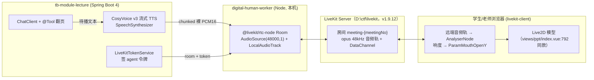

# 17 - AI 数字人语音链路方案

> 项目：TrueBuddy
> 生效日期：2026-10-09 ｜ 规范入口：[README.md](./README.md)
> 适用范围：`tb-module-lecture` 后续二「AI 数字人」的**语音链路**选型、组件边界与落地路线
> 相关：[16-PPT演讲与模拟会议方案.md](./16-PPT演讲与模拟会议方案.md)、[../CONTEXT.md](../CONTEXT.md)、[docs/adr/](./adr/)

> **状态：阶段一已落地（2026-10-09，见 §9.1 实测记录）；阶段二～四仍是规划。**
> 按 [10-文档规范.md](./10-文档规范.md) §2.4 第 1 条，标注「规划 / 待开发」的能力不得作为依赖代码的依据；动工前先复核本文的假设是否仍成立。

---

## 1. 问题陈述

`docs/16` §1.3 把「AI 数字人：TTS 配音 + Live2D 口型 + 会议内播报 + `@Tool` 工具」列为后续二，并写下「数字人语音可直接发布为 LiveKit 音频轨（不必再走 PCM over WS）」（`docs/16:35`）。这句话**隐含了一个当前实现不了的前提**：由 Java 后端发布。

| 项 | 现状 | 规范要求（docs/16 原口径） | 待整改 |
| --- | --- | --- | --- |
| 音频轨发布方 | LiveKit **没有 JVM 服务端媒体 SDK**；`io.livekit:livekit-server` 只能签令牌与调 RoomService，项目已因此手写 HS256（`LiveKitTokenService.java:18`） | 数字人语音发布为房间音频轨 | 必须引入一个具备实时媒体客户端的进程（Node worker）或浏览器发布器 → 本文 §3 |
| 语音依赖 | 全仓无 `dashscope` / `paraformer` / `cosyvoice` 命中，根 `backend/pom.xml` 仅 104 行 | 语音走 DashScope | 新增依赖与配置，见 §7 |
| 会中音频源 | 学生令牌 `canPublish=false`（`LiveKitTokenService.java:86`）、前端全仓无 `getUserMedia` / `AudioContext` / PCM 播放代码、`useLiveKitRoom.js:86` 只订阅 ScreenShare 视频轨 | ASR 随数字人阶段一起做（`docs/16:43`） | ASR 不是一块 SDK 能解决的，需要先建上行链路 → §9 阶段三 |
| Live2D 渲染 | 已可用：`views/ppt/index.vue:792` 初始化 Cubism4 模型，`public/live2d/` 有 7 个模型；但**不在会议页**，也没有任何口型参数驱动 | 数字人出现在演讲场景 | 复用现有初始化逻辑，落到会议页 → §5.4 |

一句话：**DashScope SDK 只解决「合成与识别」，不解决「谁把声音送进房间、谁播给谁听」。** 后者才是本阶段的架构决策点。

---

## 2. 方案选择（已定）

四条候选通道里选 **A**。理由与被否掉的路径都记在这里，避免后续翻案。

| 编号 | 通道 | 结论 | 关键理由 |
| --- | --- | --- | --- |
| **A** | Java 合成 PCM → 本机 HTTP 流式送 Node worker → worker 发布 LiveKit 音频轨 | **采用** | 一次合成全场可听；守住 docs/16 的既有决策；ASR 阶段 worker 天然能订阅学生麦克风轨，不必另建上行 |
| B | 老师那个浏览器 tab 兼职发布器（`AudioContext` destination → `publishTrack`） | 否 | 关掉/刷新页面数字人就哑；浏览器重采样与缓冲不可控。只适合临时验证 |
| C | 照搬参考项目：SSE 推 base64 PCM 到浏览器播 | 否 | 声音不进房间，N 个学生 = N 份合成费 + N × ≈58.8 KB/s（22050×2×1.33）的重复流量，且无会议级同步。与「会议」语义错位 |
| D | worker 自己做 LLM + TTS（Java 退化为只签令牌） | 否 | 与「`@Tool` 翻页留在 Java」「LLM 走 DeepSeek + Spring AI ChatClient」冲突，等于把业务逻辑复制到第二种语言 |

---

## 3. 架构总览



### 3.1 接缝（测试就钉在这两处）

| 接缝 | 形态 | 稳定性理由 |
| --- | --- | --- |
| **J1 播报任务契约** | Java → worker 的本机 HTTP（`/say`、`/say/{id}` DELETE、`/sessions`） | 与媒体格式解耦：换 TTS 厂商、换 LiveKit 版本都不动这一层；可离线 mock |
| **J2 房间音频轨** | worker → LiveKit → 浏览器远端轨 | 前端只认「identity 为 `digital-human` 的音频轨」，不关心谁合成、怎么传进来 |

**刻意复用的既有接缝**（不新建）：令牌仍只由 `LiveKitTokenService` 签发；数字人发言仍落 `lecture_meeting_message`（`kind` 列已为此预留，见 `docs/16:171`）；聊天仍走 DataChannel；房间生命周期仍由「结束会议 = DeleteRoom」收口。

---

## 4. 组件职责边界

| 组件 | 负责 | **不负责**（写清楚防蔓延） |
| --- | --- | --- |
| `tb-module-lecture`（Java） | LLM 决策与 `@Tool` 翻页、待播文本生成、CosyVoice 流式合成、PCM 分片推送、签 agent 令牌、播报内容落库、会话生命周期（建会开 / 结束关） | 不碰 WebRTC、不持有房间连接、不做重采样 |
| `digital-human-worker`（Node，新目录） | 连房间、维护一条常驻 `LocalAudioTrack`、把收到的 PCM 按 20ms 帧喂进 `AudioSource`、打断时清空队列、暴露 `/healthz` | 不调 LLM、不查数据库、不含业务规则、**不持有 DashScope Key** |
| 浏览器（`views/meeting/`） | 订阅数字人音频轨、AnalyserNode 取响度驱动 `ParamMouthOpenY`、Live2D 挂载与销毁、worker 掉线时的可见降级 | 不做端到端重采样、不自行拉取音频（与 C 方案的本质区别） |

worker 目录落点建议：仓库根 `digital-human-worker/`，与 `docx-mcp/`（同为「后端以子进程/伴随进程调用的外部能力」）平级。落地时需同步 [03-项目结构.md](./03-项目结构.md)。

---

## 5. 接口契约（J1）

### 5.1 会话管理

```text
POST   /sessions                 {"room":"meeting-123456","url":"ws://192.168.43.1:7880","token":"<agent JWT>"}
DELETE /sessions/meeting-123456  结束会议时由后端调用；worker 断开房间并销毁轨
GET    /healthz                  {"status":"ok","sessions":["meeting-123456"],"rtcNodeVersion":"1.1.0"}
```

- 监听 `127.0.0.1:9090`，**只绑环回地址**（演示走热点，不能让同网段任何人驱动房间）。
- 每个请求带 `X-Agent-Token: ${TB_AGENT_SHARED_SECRET}`；后端侧同值校验。**唯一例外：`GET /healthz` 免鉴权**（要能被运维直接 `curl` 探活），因此它只返回 `status` / 会话**数量** / 版本，不含房间名与任何凭据。
- worker 侧口令缺失时（`AGENT_SHARED_SECRET` 未配）除 `/healthz` 外一律 503：宁可拒绝服务，也不做裸奔的房间注入器。

### 5.2 播报（一次合成 = 一个请求）

```text
POST /say?requestId={uuid}&room=meeting-123456&sampleRate=48000&channels=1
Content-Type: application/octet-stream
Transfer-Encoding: chunked          # 请求体就是裸 PCM16，随合成进度分块写入

202 {"requestId":"...","queuedMs":120}      # worker 收下即返回，不等播完
DELETE /say/{requestId}                      # 打断：丢弃未播部分
GET  /say/{requestId}                         # 进度：{"state":"synthesizing|playing|done|cancelled","playedMs":...}
```

- **请求体不 base64、不封 WAV**：裸 PCM 直连 `AudioFrame`，省 33% 字节与一次解码。这是对参考项目「SSE + base64」的一处刻意改动。
- Java 侧用 JDK `HttpClient`（`BodyPublishers.ofInputStream`）而非 Hutool，因为后者会整体缓冲请求体，拿不到「边合成边推」的效果。
- `requestId` 幂等：worker 收到重复 `requestId` 直接返回已有状态，不重复播。

### 5.3 令牌：新增一类身份

`LiveKitTokenService` 增 `createAgentToken(String meetingNo)`，claims 相对 host 令牌的差异：

| claims | host（现状） | agent（新增） |
| --- | --- | --- |
| `sub` / `name` | `host` / 老师 | `digital-human` / 数字人 |
| `canPublish` | `true` | `true` |
| `canPublishData` | `true` | `false`（只出声音，不出数据帧） |
| `metadata` | `{"role":1\|2,...}` | `{"role":3}` —— 新增**数字人**角色值，前端据此区分渲染 |

> 「谁能发布」继续由服务端强制（现有口径），worker 拿不到屏共享以外的能力扩张。

### 5.4 前端识别口径

`useLiveKitRoom.js:86` 的轨过滤当前**只留 ScreenShare 视频**。改为按 `participant.identity === 'digital-human' && track.kind === 'audio'` 分支处理：挂到隐藏 `<audio>` → `createMediaStreamSource` → `AnalyserNode` → 每帧 `getByteTimeDomainData` 取 RMS → 线性映射到 `ParamMouthOpenY`。口型不引入任何额外信令，音频到即嘴动。

---

## 6. 音频参数（必须成对，别照抄参考项目）

| 环节 | 取值 | 依据 |
| --- | --- | --- |
| TTS 输出格式 | `SpeechSynthesisAudioFormat.PCM_48000HZ_MONO_16BIT` | LiveKit 内部工作速率 48kHz；选 22050 会在 worker 侧多一次重采样。参考项目用 22050 是因为它直供浏览器 `PCMPlayer`，我们不需要 |
| worker 音源 | `new AudioSource(48000, 1)` + `LocalAudioTrack.createAudioTrack('digital-human-audio', source)` | 与上行 `sampleRate` 参数严格一致，不一致时 worker 直接 400 而不是静默变速 |
| 送帧粒度 | 每帧 20ms = 960 样本 = 1920 字节 | 与 `AudioFrame` 期望的 `samplesPerChannel` 对齐；帧太小放大 FFI 开销，太大首帧延迟上升 |
| 打断 | `AudioSource.clearQueue()` + `SpeechSynthesizer.streamingCancel()` | 两端都要：只清队列不取消合成，DashScope 会继续计费并推流 |
| ASR（阶段三） | `paraformer-realtime-v2` @ 16000Hz / `format("pcm")` | **不要**照抄参考项目的 `paraformer-realtime-8k-v2` + 16k 上行（那是事实性错误，见其 `数字人技术介绍.md` §3.1） |

---

## 7. 依赖与配置（版本已核对，落地时同步更新本表）

### 7.1 后端

```xml
<dependency>
    <groupId>com.alibaba</groupId>
    <artifactId>dashscope-sdk-java</artifactId>
    <version>2.22.7</version>
    <exclusions>
        <!-- 与 spring-ai 2.0.0-M3 在用版本冲突（本机 m2 同时存在 4.31.1 与 4.37/4.38/5.0.0） -->
        <exclusion><groupId>com.github.victools</groupId><artifactId>jsonschema-generator</artifactId></exclusion>
        <exclusion><groupId>com.github.victools</groupId><artifactId>jsonschema-module-jackson</artifactId></exclusion>
        <!-- 关键：该 SDK 的 slf4j-simple 是 compile 作用域，不排会与 Logback 抢 SLF4J provider -->
        <exclusion><groupId>org.slf4j</groupId><artifactId>slf4j-simple</artifactId></exclusion>
    </exclusions>
</dependency>
```

- `slf4j-simple` 这条**参考项目没排**（它只排了 victools 两项），照抄会踩坑，故在此显式列出。
- `gson` / `lombok` 由 Boot 4.0.1 BOM 统一抬到 2.13.2 / 1.18.42，无需处理。
- `okhttp 4.12.0` + `kotlin-stdlib-jdk8 1.8.21` + `rxjava 2.2.21` 是 BOM 不管的净新增，与现有 Hutool HTTP 并存但不冲突；接受「两套网络栈」的代价。
- 放置模块：`tb-module-lecture`（数字人语音属该模块职责，不下沉 framework）。

### 7.2 worker

| 依赖 | 版本 | 说明 |
| --- | --- | --- |
| `@livekit/rtc-node` | `1.1.0`（`engines.node >= 18`） | 官方 Node 实时媒体 SDK，自带 Rust FFI 原生绑定。**不选** `@livekit/agents`（1.9.1）：它假设 worker 自己拥有对话与 TTS 管线，与「Java 当脑子」冲突；代价是要手写约 120 行房间管理，可接受 |

风险：原生二进制在 Windows 的可用性需阶段一首先验证（退路见 §11）。

### 7.3 配置项（`application.yml` 只写占位符，真实值进 `.env`）

```yaml
tb:
  lecture:
    digital-human:
      enabled: ${TB_DH_ENABLED:false}
      worker-base-url: ${TB_DH_WORKER_URL:http://127.0.0.1:9090}
      agent-shared-secret: ${TB_AGENT_SHARED_SECRET:}
      tts-model: ${TB_DH_TTS_MODEL:cosyvoice-v3-flash}
      tts-voice: ${TB_DH_TTS_VOICE:}          # 默认音色或复刻音色 id
      dashscope-api-key: ${DASHSCOPE_API_KEY:}
      max-concurrent-say: ${TB_DH_MAX_SAY:2}
```

`MeetingProperties`（现 8 个字段）不动，新增 `DigitalHumanProperties`，前缀 `tb.lecture.digital-human`，避免把语音配置混进会议配置。

> **待整改（既有问题，与本方案无关但被 §7.3 照出）**：`application.yml:31` 与 `:46` 把 DeepSeek 与 DashScope 的真实 Key 直接写在 yml 里，违反 [08-通用约束.md](./08-通用约束.md) 的「敏感信息一律环境变量注入」，且项目已有 `.env` 自动加载机制（`application.yml:5-7`）。新增的 `DASHSCOPE_API_KEY` 不得重蹈覆辙，并建议在同一批改动里收口这两处。

---

## 8. 时延与流量预算

| 指标 | 目标 | 实测（2026-10-09，同机环回） | 怎么量 |
| --- | --- | --- | --- |
| 首包（TTS 首帧到达 worker） | ≤ 800ms | **884–1392ms**（冷连接 2180ms） | `SpeechSynthesizer.getFirstPackageDelay()` + 后端日志 `firstChunkMs` |
| 端到端（Java 发起 → 学生听到） | ≤ 1.5s | 未单独取点（首包已接近目标上限） | worker `202` 时间戳 vs 前端首个非零 RMS 帧 |
| 房间下行带宽 | 一条 48k mono opus，与人数无关 | 3 个订阅端收到完全一致的逐帧 RMS，未见按人复制流 | LiveKit 服务端统计 |
| 单场合成字符数 | 记录并报警 | 一条 24 字播报 ≈ 5.4s 音频 / 520320 字节 PCM | `lecture_meeting_message` 按 `kind=2` 聚合 |

首包实测比目标高一档，**说明 §9 阶段二的「逐 token 边生成边合成」不是可选项而是达标路径**（短句先出声能显著压低感知延迟）。计费单价以 DashScope 官方为准，**不在本文钉死数字**（版本与价格会变，违反 [10-文档规范.md](./10-文档规范.md) §2.4 第 5 条）。

---

## 9. 分期路线

| 阶段 | 交付 | 依赖 | 验收（可独立验证） |
| --- | --- | --- | --- |
| **一** 最小可演示 | 固定文本 → CosyVoice 流式 → worker → 房间音频轨 → 两个浏览器同时听到 + 口型随响度动 | DashScope Key、`D:\ctf\livekit` 真跑起来 | ①`/healthz` 为 ok；②两台设备同房间同时可听；③断 worker 后前端明确显示「数字人不可用」而非静默白屏 |
| **二** 会中播报 + `@Tool` | LLM 决定「翻页 + 播报本页讲稿」，讲稿来源仍是页面 `remark`（口径见 `docs/16` §12 与 `CONTEXT.md`「讲稿」） | 阶段一 | 老师点「开始播报」后自动翻页，且翻页与语音顺序一致；停止播报能立即静音 |
| **三** 语音提问 ASR | 学生端麦克风轨 + worker 订阅 → `Recognition.sendAudioFrame` → 转写回后端 | **需要改学生令牌 `canPublish=true`**（现 `LiveKitTokenService.java:86`） | 先出一份 ADR 再动手：这与「学生只能订阅」的既有服务端强制口径直接冲突 |
| **四** 打断（barge-in） | 播放期上行门控或能量 VAD + §6 的双端取消 | 阶段三 | 数字人说话时用户开口，1.5s 内停止播放且 DashScope 流被取消 |

阶段一/二即可支撑答辩演示；三、四是范围扩张，不在「补齐已排除范围」里（见 `docs/16:43`）。

### 9.1 阶段一落地情况（2026-10-09 实测）

**状态：已落地并跑通端到端**，不再是规划。验收逐条结果：

| # | 验收项 | 结果 | 证据 |
| --- | --- | --- | --- |
| ① | `/healthz` 为 ok | **通过** | `{"status":"ok","sessions":0,"version":"0.0.1"}`；无口令写操作 401、口令缺失 503 |
| ② | 同房间多端同时可听 | **部分通过** | 1 个真实浏览器（`livekit-client@2.22.3`，隐藏 audio 的 `currentTime` 持续推进）+ 2 个 headless `rtc-node` 订阅端，三者收到**同一串逐帧 RMS**（48000Hz/单声道，peak 0.551）。**未做**：两台物理设备（含手机热点下 iOS Safari 的自动播放解锁） |
| ③ | worker 掉线后明确提示 | **通过** | 杀进程后 ≤10s 学生页出现「数字人不可用」告警、形象消失、在线人数回落 |
| 附 | 口型随响度动 | **通过（间接）** | 5.5s 播报期间 `level > 0.05` 命中 46 帧（约 2.3s，词间低于门限属预期）；Live2D 画布有实际绘制（15.6% 像素非透明）。**未做**：直接断言 `ParamMouthOpenY` 改变了渲染结果 |
| 附 | 播报内容落库 | **通过** | `lecture_meeting_message`：`kind=2` / `role=3` / `nickname=数字人`，学生聊天区可见 |

实测时延（同机环回，非热点）：`firstChunkMs` **884–1392ms**，5.5s 音频的 `POST /meeting/digital/say` 整趟 **7.3s**（同步语义：返回即代表全部字节已交给 worker，不代表播完）。§8 的目标值据此校准。

---

## 10. 测试决策

| 层 | 做法 | 位置 |
| --- | --- | --- |
| 后端纯逻辑 | 把 `SpeechSynthesizer` 包一层 `TtsSynthPort` 接口（唯一让合成可 mock 的接缝），测 PCM 分片边界（不足一帧的余数、空文本、超长文本）、agent 令牌 claims | `src/test/.../lecture/`，沿用现有 JUnit + `MeetingServiceImplTest` 风格 |
| 令牌回归 | 扩 `LiveKitTokenServiceTest`，断言 `canPublish=true` / `canPublishData=false` / `metadata.role=3` | 已有该测试类 |
| worker | 只做 J1 契约测试（HTTP 状态码、幂等、参数不匹配 400、`clearQueue` 被调），房间用 fake；`node --test`（与前端 `package.json` 的 `test` 脚本口径一致） | `digital-human-worker/test/` |
| 端到端 | **无法自动化**（要真 LiveKit + 真 Key + 真麦克风），用 §9 阶段一的三条人工清单 | 演示前逐条勾 |

「完成」的定义：一条 48kHz 音频轨在两个浏览器里同时可听、口型随响度变化、worker 掉线有可见降级。**「后端单测通过」不等于完成。**

---

## 11. 明确不做

| 不做的项 | 理由 |
| --- | --- |
| 视频型 / 3D 数字人（wav2lip、MuseTalk、SadTalker） | 本项目数字人 = Live2D 皮 + 响度口型，与本仓库既有依赖一致；引入推理模型会把演示拖进 GPU 依赖 |
| 在 worker 里做 LLM / RAG / 知识库检索 | 职责越界（§4）；问答能力已在 `tb-module-knowledgebase` |
| Python worker（`livekit-agents`） | 项目已有 JVM + Node + Python 三种运行时，不再加第四种部署面；`docx-mcp` 已经证明了 Python 子进程的运维成本 |
| 老师麦克风 / 系统声音入轨 | `docs/16:41` 已排除，且会与数字人音频轨混音冲突 |
| 复刻音色管理界面 | 阶段外；先用官方默认音色，`tts-voice` 留配置位 |
| 录制 / egress / 拉流 | LiveKit 服务端配置当前刻意未开（`livekit.yaml.template` 注释 4） |
| 多语言、字幕推送 | 口播文本已是中文；字幕属 ASR 阶段副产物，届时另议 |
| 双通道并存（Java WebSocket + LiveKit） | 既有决策：自建 WS 链路已删除，不恢复 |

---

## 12. 风险与待确认

| # | 风险 / 待确认 | 影响 | 退路 |
| --- | --- | --- | --- |
| 1 | ~~`@livekit/rtc-node` 原生绑定在 Windows 是否可加载~~ **已排除**（2026-10-09 spike 实测，见 §13） | — | 退路（Go/Rust worker、B 方案）不再需要，保留备查 |
| 2 | **数字人要占一个参会席位**：`livekit.yaml.template` 的 `room.max_participants: 20` 是**房间总人数**，worker 入场后学生实际可用降到 19 | 满员会议进不来人 | 落地前把该值改为 22 并同步 `docs/16` 的人数口径；注意 ADR-0001 已作废「入会人数上限闸门」，但服务端 `max_participants` 仍在生效 |
| 3 | DashScope CosyVoice 单连接并发能力、以及 `streamingCall` 的逐 token 推送节流未实测 | 首包延迟与卡顿 | 阶段一先做「整段文本一次性 `streamingCall`」，不做逐 token；把「外包分句给提示词」（参考项目 §2 的技巧）留到阶段二验证 |
| 4 | 热点环境下 UDP 50000-50100 每人占一口，加 worker 后共约 22 口 | 端口不足时媒体失败 | 范围够用；若扩人数需同步改 `livekit.yaml.template` 与防火墙规则 |
| 5 | 学生页 Live2D 的资源体积与移动端性能（7 个模型在 `public/live2d/`） | 手机参会可能掉帧 | 阶段一只在桌面端开数字人，移动端仅收声音 |

---

## 13. Spike 实测结论（2026-10-09）

在仓库外的一次性探针目录里跑了一次最小验证（脚本已随验证结束删除，只留结论），只回答一个问题：**rtc-node 能不能把音频送进房间并被浏览器收到**。不含 DashScope、不含 Java、不含 Live2D。

### 13.1 环境（版本可核对）

| 项 | 值 |
| --- | --- |
| Node | v22.18.0（nvm4w；`@livekit/rtc-node` 要求 ≥18，满足） |
| `@livekit/rtc-node` | 1.1.0 |
| `livekit-client` | 2.22.3 —— 直接取 `frontend/node_modules` 里的 ESM 产物，与项目实际发版同版本 |
| LiveKit Server | v1.9.12，`D:\ctf\livekit`（容器 `livekit-server`） |
| 令牌 | `D:\ctf\livekit\make-token.mjs <room> <identity> --publish` |

### 13.2 结论

| # | 结论 | 证据 |
| --- | --- | --- |
| 1 | 原生 Rust FFI 绑定在 Windows 直接可加载，**无需额外安装 VC++ 运行时** | `AudioSource` / `AudioFrame` / `LocalAudioTrack` / `Room` 全部构造成功 |
| 2 | 音频真的穿过了 LiveKit 往返（编码 + 转发 + 解码） | headless 订阅端收到 **981 帧 / 9810ms / 48000Hz / 单声道**，`rms=0.1202` `peak=0.2132`，与注入的 440Hz 颤音一致 |
| 3 | 浏览器能订阅并解码这条由 Node 发布的轨 | `TrackSubscribed from=dh-agent kind=audio source=microphone name=digital-human-audio sid=TR_…` |
| 4 | §5.4 的口型驱动路径成立 | 远端轨经 `createMediaStreamSource` → `AnalyserNode`，持续拿到非零 RMS，换算出口型值 0.34–0.48 |
| 5 | 自动播放策略不构成阻塞 | 在用户点击「连接」的事件里建 `AudioContext` → 直接 `running`，`sampleRate=48000`，无需二次解锁 |

### 13.3 由 spike 产生的实现约束（写代码时必须遵守）

| # | 实测发现 | 对实现的要求 |
| --- | --- | --- |
| 1 | `room.disconnect()` 之后 **Node 进程不退出**（四个 spike 进程全部挂住，只能 kill） | worker 的退出路径必须显式调用 rtc-node 导出的 `dispose()`，并配一个 idle 超时兜底；否则「结束会议 → 关会话」会漏进程 |
| 2 | 第一次订阅时 `AnalyserNode` 连续 12s 拿到 **0 帧**，第二次订阅立刻有数据 | `AudioContext` 在页面生命周期内**只建一次并复用**，不要在 `TrackSubscribed` 回调里 `new`；断线重连复用同一个 context |
| 3 | `Track.Kind` 在 rtc-node **运行时是 undefined**（只存在于类型声明） | worker 侧一律用 `TrackKind.KIND_AUDIO`（值 1）、`TrackSource.SOURCE_MICROPHONE`（值 2），不要写 `Track.Kind.*` |
| 4 | 累计 RMS 与按采样数估算的 `played` 在流停后仍持续增长 | 口型与「播放结束」判定必须用**逐帧瞬时响度 + 衰减**，以及 `AudioSource.queuedDuration` / `waitForPlayout()`；不能用累计平均值或采样时长估算（参考项目正是栽在这里） |
| 5 | `publishTrack` 返回对象上的 `trackName` / `trackKind` 为 undefined，只有 `trackSid` 可靠 | §5.4 的前端识别口径（按 `participant.identity`）是对的，**不要**改成按轨名匹配 |
| 6 | **阶段一实现时补测**：只把远端轨的 `mediaStream` 接进 `AnalyserNode`、不 `attach()` 到媒体元素时，浏览器既不出声、分析器也一直拿到静音帧（`level` 恒 0） | 前端必须先 `track.attach(隐藏 audio)`，再用同一条 `mediaStream` 建 source 做响度分析；`detach()` 与元素回收一起放在取消订阅与断开路径里 |
| 7 | **阶段一实现时补测**：WebGL 画布（PIXI/Live2D）默认不保留绘制缓冲，验收时用 `drawImage` 读像素会恒为 0，误判成「模型没渲染」 | 需要像素级自检时给 `PIXI.Application` 传 `preserveDrawingBuffer: true`；`Live2DModel.from()` 传 `width/height` 不生效，缩放要按 `internalModel.width/height` 自己算 |
| 8 | **已发生的线上缺陷（2026-10-09 电音）**：`AudioFrame.protoInfo()` 取指针时用 `new Uint8Array(this.data.buffer)`，**忽略 `byteOffset`**。把 `FrameSlicer` 产出的 `subarray` 视图直接包成 `Int16Array(buf.buffer, off, n)` 交给它，原生层就从 ArrayBuffer 开头读，送出去的是错位字节 | 交给 `AudioFrame` 的 `Int16Array` **必须独占自己的 ArrayBuffer**（`buffer.slice(...)` 拷贝，见 `toInt16Frame`）。回归锁在 `digital-human-worker/test/audio.test.mjs`：断言 `byteOffset === 0` 且 `buffer.byteLength === byteLength` |

### 13.4 音频正确性的度量方法（别再走弯路）

电音这类「波形被破坏但听感仍在」的问题，**能量包络与频谱平坦度都不敏感**——本次误判过一次。有效判据是**样本级对齐后的波形相关**：

| 链路 | 包络相关 | 波形相关 | 结论 |
| --- | --- | --- | --- |
| 源 vs 源（对照） | 1.0000 | 1.0000 | 度量有效 |
| 修复后（独占 buffer） | 0.9921 | **0.9704** | 穿过 LiveKit 往返后波形基本无损 |
| 修复前（视图 + 忽略 byteOffset） | 0.7269 | **0.0393** | 响度节奏正常、内容是垃圾 = 电音 |

做法：把已知 PCM 直接 `POST /say` 推给 worker（绕开 TTS 的随机性），用 `rtc-node` 订阅端把音频录回文件，先按 20ms 包络找粗对齐、再在 ±10ms 内做单样本精搜取最高相关。度量脚本是一次性探针，验证完即删，因此上面的表格就是它留下的全部产物。

### 13.5 顺带修掉的一个既有故障

spike 首次连不上房间，根因不在 worker：`livekit.generated.yaml` 的 `node_ip` 停在早已失效的 `172.16.209.195`（当前 WLAN 为 `192.168.245.217`），而 `start.ps1` 只 `docker compose up -d`、容器在跑时不会重载配置。已重跑脚本 + `docker compose restart` 修复，`nodeIP` 现与 WLAN 一致。**这意味着模拟会议的实时链路此前也处于「信令通、媒体不通」状态**，缺陷与处置已记入 [16-PPT演讲与模拟会议方案.md](./16-PPT演讲与模拟会议方案.md) §5.1。

---

> 落地时需要同步的规范文件：[03-项目结构.md](./03-项目结构.md)（新目录 + 新模块配置类）、[05-API规范.md](./05-API规范.md)（worker 属服务间调用，不列入对外 REST 清单，但阶段三的 `/meeting/digital/*` 要）、[08-通用约束.md](./08-通用约束.md)（新增环境变量）、[README.md](./README.md)（本文件已登记）。
