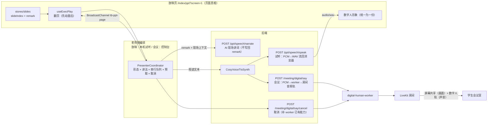

# 18 - 放映与会议演讲体系方案

> 项目：TrueBuddy
> 生效日期：2026-10-10 ｜ 规范入口：[README.md](./README.md)
> **状态：方案，未落地。** 本文出现的接口、组件、配置一律是规划，不得据此写依赖代码（[10-文档规范.md](./10-文档规范.md) §2.4 第 1 条）；落地后再同步 [05](./05-API规范.md)、[06](./06-路由规范.md)、[03](./03-项目结构.md)。
> **2026-10-10 现状更新**：本文的三个前提已按其实施——①**会议入口搬进了 PPT 页**（`/index/ppt` 工具栏「创建会议」→ 本页进放映 → 控制台另开标签页，见 [docs/16](./16-PPT演讲与模拟会议方案.md) §5.6），因此「被共享的那一屏 = 放映页」不再是假设；②「编排层放前端」（§12 Q4 的推荐）成了既定前提；③**声音链路也已落地，但形态变了**：`POST /ppt/speech/speak`（SSE + base64 PCM）由放映页**本页播放**、口型跟本页播放驱动，声音随屏幕共享到学生端（docs/16 §5.7）。G7「放映页不能动嘴」因此**已完全消除**（形象与口型都只有一份实现）。**因此本文里的 `digital-human-worker`、`POST /meeting/digital/say`、`say/cancel`、`presenter` 这些画法一律作废。其余仍是规划**：页码总线、`PresenterCoordinator` 串行队列、翻页自动照读（A 段）、AI 现场讲词（B 段）、`narrate`。
> 适用范围：把「PPT 放映」与「模拟会议」收敛成同一套演讲体系——两种播放形态 × 两种讲述方式
> 相关：[16-PPT演讲与模拟会议方案.md](./16-PPT演讲与模拟会议方案.md)、[17-AI数字人语音链路方案.md](./17-AI数字人语音链路方案.md)、[../CONTEXT.md](../CONTEXT.md)、[adr/0002](./adr/0002-在线状态唯一真相源为房间事件.md)

---

## 1. 需求复述（我对原话的理解）

PPT 编辑完成、讲稿优化完成后，应当有**两个出口**，而不是现在这样两条互不相通的路：

| 维度 | 取值 | 含义 |
| --- | --- | --- |
| 播放形态 | **放映**（≈ 试听 / 彩排） | 只有老师自己。目的是先听效果，不影响任何学生 |
| 播放形态 | **会议** | 有学生。画面继续走 LiveKit 屏幕共享，声音走数字人音频轨 |
| 讲述方式 | **照读** | 完全按本页 `remark` 逐字念 |
| 讲述方式 | **AI 现场讲** | `remark` 只是资料，由模型现场产出这一段口播文本 |

会议形态的 AI 讲述要携带**更多现场信息**（当前会议时间等）；放映形态同样支持这两种讲法，只是"听众只有老师"。四格组合共用一套播报编排，差别只在**声音往哪儿送**和**上下文带多少**。

---

## 2. 关键假设

| # | 假设 | 依据 / 若不成立的后果 |
| --- | --- | --- |
| A1 | 放映形态 = 老师独自试听，画面不出房间 | 你说"放映方式类似于（试听）"。若放映也要给别人看，就直接走会议形态 |
| A2 | 会议形态的画面**继续走屏幕共享**（本轮已定） | 因此不需要给学生同步页码、不需要把 PPT/讲稿数据落库；学生看到的 = 老师共享的那个标签页 |
| A3 | 「照读」= 本页 `remark` 全文，允许按句切段后连续播 | `remark` 单页上限 1500 字（`PptProperties.maxRemarkChars`），而播报接口上限 1000 字（`max-text-length`），整页直接送会被拒 → 必须切段 |
| A4 | AI 现场产出的口播文本是**一次性派生物，不写回 `remark`** | `CONTEXT.md` 已定「讲稿就是 remark」。若写回，AI 每次现场讲述都会覆盖老师辛苦优化好的稿子 |
| A5 | 现场信息 = 会议标题、当前时间、会议已进行时长、在线人数、第几页/共几页，（可选）最近几条学生提问 | 这些全在**前端**：在线人数按 ADR-0002 只能由房间事件得出，后端现在拿不到（§4 G8） |
| A6 | 两种讲法是**一个开关**，不是两套页面 | 否则放映/会议各做一遍编排，四份代码 |
| A7 | 老师手动翻页就是推进节奏的唯一真相（阶段 A） | "念完自动翻页"要不要做，列为待拍板 Q5 |
| A8 | 数字人形象与口型在两种形态下都该有，且只留一份实现 | 现在有两条重复实现（§4 G9） |

---

## 3. 为什么现在"接不起来"—— 缺口矩阵

| 组合 | 现状 | 证据 |
| --- | --- | --- |
| 放映 + 照读 | **听不到**。TTS 的 PCM 只有一条出路：推给 worker 发进 LiveKit 房间；放映页没有房间 | `CosyVoiceTtsSynth.java:40`（只往入参 `OutputStream` 写）、`useLiveKitRoom.js:133-138`（音频只在会议室里被订阅） |
| 放映 + AI 讲 | 不存在 | 无 |
| 会议 + 照读 | **不跟页**。播报只收老师手输的文本，放映页翻页与它零联动 | `MeetingConsoleView.vue:230-258`（手输 → `sayDigital`） |
| 会议 + AI 讲 | 不存在，且现有生成接口没有"现场上下文"的位置 | `PptSpeechServiceImpl.java:59-101`（语义是"改写 remark 并返回"，无状态、不接现场信息） |

### 3.1 必须先补的硬缺口

| # | 缺口 | 证据 |
| --- | --- | --- |
| G1 | 放映页与控制台是**两个互不相通的标签页**：全仓没有 `BroadcastChannel` / `postMessage`，翻页这件事只有放映页自己知道 | 检索无命中；`?screen=1` 只在 `index.vue` 的一次性触发处。**2026-10-10**：两者的分工已改为「PPT 页放 / 控制台讲」，但**互不相通**这一点没变 |
| G2 | 没有试听通路；但补一条很便宜 —— TTS 已把 PCM 交给调用方指定的流，写进 HTTP 响应即可，**不需要碰 DashScope SDK，也不需要 worker 在线** | `CosyVoiceTtsSynth.java:40,71` |
| G3 | **没有取消**：`DigitalHumanService` 只有 `status` / `say` / `leaveRoom`，后端从不调 worker 的 `DELETE /say/{id}`，而 worker 早就实现了取消与清队列 | `DigitalHumanService.java:20,30,37` vs `server.mjs:119-127`、`session.mjs:77,202` |
| G4 | **并发会混播**：一个房间一条常驻音频轨，两次 `say` 的帧会交错进同一个队列；后端只靠线程池 2 兜着，没有串行队列 | `session.mjs:39-55,150-176`、`DigitalHumanServiceImpl.java:76` |
| G5 | `say` 同步阻塞到整段 PCM 交给 worker（≈ 播完才返回），编排层拿不到进度，也就无法"边播边预取下一页" | `DigitalHumanServiceImpl.java:127` |
| G6 | 现场信息在后端不全：响应里只有**台账累计** `attendeeCount`，没有在线数；`LiveKitRoomServiceClient` 只有 `deleteRoom`（无 ListParticipants） | `MeetingInfoVO.java:16-26`、`LiveKitRoomServiceClient.java:51`、`utils/attendees.js:62` |
| G7 | 形象与口型两份实现，放映页那份**不能动嘴**（`model` 是局部变量，从不调 `setParameterValueById`） | `index.vue:792-826` vs `DigitalHumanAvatar.vue:24,38-42,59-62`。**2026-10-10 部分修复**：放映页已补 `writeMouthOpen`（写法照抄 `DigitalHumanAvatar`）并由 `presenter` 房间的音频轨驱动响度；**仍然是两份实现**，合并留给 C 段 |
| G8 | 没有"按讲稿时长推进"的机制：唯一的推进时钟是硬编码 2500ms；后端算好的每页 `seconds` 只用来显示 | `useExecPlay.js:157-161`、`PptSpeechServiceImpl.java:151`、`AiRemarkDialog.vue:11` |
| G9 | 数字人说了什么，学生端不实时（只老师本端回显；学生靠 `detail` 铺底） | `MeetingConsoleView.vue:242`、`MeetingRoomView.vue:222` |
| G10 | 放映页的声音**不随屏幕共享走**：共享轨显式 `audio:false`，所以老师在自己标签页里播的东西，学生即使在会议里也听不到 | `useLiveKitRoom.js:275-276` |

### 3.2 可以直接复用的资产

| 层 | 可复用 | 证据 |
| --- | --- | --- |
| 页状态 | `stores/slides.js` 的 `slides` / `slideIndex` / `currentSlide`，`remark` 就在 slide 顶层键上 | `slides.js:8-17`、`index.vue:406-419` |
| 翻页 | `useExecPlay.js` 的「先动画后翻页」`execNext/execPrev`（9 条翻页入口都收敛到它） | `useExecPlay.js:122-154` |
| 页面文本 | `utils/slide-text.js` 已会把一页拆成 `{index,title,text,remark}` 送给后端 | `slide-text.js:121-128` |
| 语音合成 | `CosyVoiceTtsSynth`：48kHz 单声道 16bit 流式 PCM，产出统计（首包耗时/字节） | `CosyVoiceTtsSynth.java:40,55,118` |
| 播报编排 | `DigitalHumanServiceImpl` 的校验链与降级（未启用 / 超长 / 会议未进行 / LiveKit 未配 / worker 掉线 / TTS 失败不落库） | `DigitalHumanServiceImpl.java:104-133` + 9 个单测 |
| 音频进房 | worker 的 `AudioSource` 队列与背压、20ms 分帧、尾帧补静音、`interrupt()=clearQueue` | `session.mjs:58,76`、`audio.mjs:46,78` |
| 口型 | `agentAudio.js` 的 `rmsOf` / `mouthLevel`（已有 5 条单测）与 `DigitalHumanAvatar` 的 `ParamMouthOpenY` | `agentAudio.js:26-37`、`DigitalHumanAvatar.vue:38-42` |
| 长请求控制 | 讲稿优化那套 `AbortController` + 快照回填（等待期翻页不写错页）模式 | `index.vue:454,475-477,548,604` |
| 提示词与字数 | `SpeechScriptUtils`（语速 4.0 字/秒、`perPageChars`、`secondsOf`、`buildUserPrompt`） | `PptSpeechServiceImpl.java:59-101,151` |

---

## 4. 方案总览



四条原则：

1. **页面真相只有一个**：正在共享的那个放映标签页是唯一权威。翻页由老师在那里操作，编排层只跟随、不指挥（阶段 A）。
2. **画面继续走屏幕共享，声音走数字人轨**：因此 `remark` / PPT 数据**不需要落库**，学生端也不需要知道页码——这条把你选的"继续走共享"变成整个方案的最小改动来源。
3. **试听不占用正式通路**：放映形态的声音走后端新开的「PCM→WAV→浏览器」，不进房间、不起 worker 依赖、不占 LiveKit 席位（`docs/17` §12 风险 2），worker 没起来也能彩排。
4. **播报是串行队列 + 可取消**：一次演讲会话内，同一时刻只有一段在响；翻到下一页时先取消上一段再播新页。这两条是 G3/G4 的直接修补，缺一条就会混播或"停不下来"。

---

## 5. 通道设计

### 5.1 页码总线（补 G1）

同源两个标签页用 `BroadcastChannel('tb-ppt-page')`，消息只带编排需要的最小集：

```js
{ type: 'page', index: 7, total: 20, title: '二次函数', remark: '…本页讲稿…' }
```

- 发布方：放映页在 `execNext/execPrev/updateSlideIndex` 之后（即 `useExecPlay.js` 的收敛点），不在 store 里塞总线，保持 store 纯数据。
- 订阅方：编排层。拿到 `remark` 全文，**照读**模式即可直接合成，无需再回问放映页。
- 为什么不"把放映搬进控制台"：那等于重写放映 UI 与共享动线（`docs/16` §5.6 的手势约束仍在），收益只有省一条总线。列为 Q4 备选。

### 5.2 讲述方式开关（A6）

`mode = 'verbatim' | 'ai'` 只影响**文本从哪来**，不影响后面的所有环节：

| mode | 文本来源 | 新增依赖 |
| --- | --- | --- |
| `verbatim` | 本页 `remark`（按句切成 ≤ `max-text-length` 的片段，连续入队） | 无 |
| `ai` | `POST /ppt/speech/narrate` 现场生成 | 新端点 + 上下文注入 |

拿到文本后，两个形态的分岔只在送出方式：

| 形态 | 送出 | 谁能听到 |
| --- | --- | --- |
| 放映（试听） | `POST /ppt/speech/speak` → `audio/wav` 流 → 放映页 `<audio>` / WebAudio | 只有老师 |
| 会议 | `POST /meeting/digital/say` → worker → 房间音频轨 | 老师 + 所有学生 |

### 5.3 试听通道（补 G2）

后端新增 `POST /ppt/speech/speak`：请求体 `{ text, voice? }`，响应 `audio/wav`（48kHz / 单声道 / 16bit，先写 WAV 头再 chunked 推 PCM）。

- 复用点：`CosyVoiceTtsSynth.synthesize(text, outputStream)` 原样可用，把 `OutputStream` 换成响应的输出流；降级链与 `digital/say` 同构（未启用 / 超长 / 合成失败各自的错误码）。
- 取消：前端 `AbortController.abort()`（讲稿优化那套已有同款），连接断 = 合成侧按现有 60s 超时与 `cancelQuietly` 收口。
- 口型：试听路径没有 LiveKit 轨，`agentAudio` 现在只吃 `MediaStream`。因此把"响度→口型"改为**两条来源共用一个 meter**：会议走轨、试听走本地 `<audio>` 的 `MediaStreamSource`。这是 C 段的事，A 段先只保证能听到。

### 5.4 会议通道（补 G3/G4/G5）

不新造通路，只把现有 `digital/say` 补齐三件事：

1. **取消**：新增 `POST /meeting/digital/say/cancel`（`meetingNo` + `hostToken` + `requestId`），后端调 worker 的 `DELETE /say/{id}`；`requestId` 已经在 `DigitalSayRespVO` 里返回，前端手里有。
2. **单飞闸门**：同一会议同时只允许一段在推（`DigitalHumanServiceImpl` 按 room 加锁，第二段直接返回"播报忙"错误码），把 G4 的混播从"偶发事故"变成"明确拒绝"。
3. **队列在编排层**：串行由前端 PresenterCoordinator 维护（播完一段再取下一段），后端保持"一次 say = 一段文本"的简单语义，不引入服务端会话状态 —— 这与 `docs/17` §11「不在 worker 里做 LLM/编排」的边界一致。

### 5.5 AI 现场讲词（补"更多现场信息"）

新增 `POST /ppt/speech/narrate`，与 `optimize` 明确分工：

| | `optimize`（已有） | `narrate`（新） |
| --- | --- | --- |
| 语义 | 改写讲稿并**写回** `remark` | 把讲稿当资料，现场产出**这一段口播**，不落库不写回 |
| 范围 | 整篇 / 单页，分批 | 一次一页 |
| 上下文 | `targetSeconds` + 页数据 | 额外接 `context`：会议标题、`startedAt`、已进行秒数、在线人数、当前页/总页、上一页结尾 |
| 返回 | `{remark, chars, seconds}` | `{speechText, chars, seconds}` |

`context` 由**前端随请求带上**，理由见 A5/G6：在线人数的真相只在房间事件里（ADR-0002），后端要自己算就得新增 `ListParticipants` 调用 —— 那是新依赖 + 与新决策打架。放映形态下 `context` 的会议字段为空，只有时长与页码，天然就是"低配上下文"，不需要为形态写分支。

### 5.6 预取（补 G5）

播第 N 页期间并行准备第 N+1 页：`verbatim` 预取合成、`ai` 预取文本。实现为编排层的 `prefetchNext()`，失败不报错（降级为"到页再生成"，多等 1–2 秒）。这条决定了体感是否"跟手"，是 B 段的验收重点。

---

## 6. 编排状态机

```
idle → preparing → speaking(page N) ─┬─ 老师翻到 N+1 → cancel(当前) + enqueue(N+1) → speaking
                                     ├─ 老师退回 N-1 → 同上（照读模式）/ 询问是否重讲（AI 模式）
                                     ├─ pause         → cancel(当前) + 冻结队列
                                     └─ stop          → cancel(当前) + 清队列 + idle
```

- **取消必须穿透**：编排层取消 = 试听断流 / 会议调 `say/cancel` + worker `clearQueue`。任一环不响就变成"点了停还在念"。
- 队列元素是一段文本（一页可能被切成多段），段与段之间无缝，页与页之间由翻页事件驱动。
- 形态切换（放映 ↔ 会议）不允许在 `speaking` 中发生：先 `stop`，避免同一段文本从两个出口各念一遍。

---

## 7. 分期（每段可独立验收、独立提交）

| 段 | 交付 | 打通的格子 | 验收 |
| --- | --- | --- | --- |
| **A 跟页照读 + 能停** | 页码总线、编排状态机 + 串行队列、`speak` 试听端点、`say/cancel` + 单飞闸门、remark 按句切段 | 放映+照读、会议+照读 | ①放映页翻一页，本机立刻念该页 remark，随时按「停」立即静音；②同一操作在会议里做，学生同时听到且不混播；③worker 停掉时放映形态仍能试听 |
| **B AI 现场讲词** | `narrate` 端点 + 上下文注入 + 预取下一页 | 放映+AI、会议+AI | ①会议里念出的内容含"现在是第 N 页 / 会议已进行 X 分钟"这类现场话；②放映里念的是同一页但不带会议字段；③翻到下一页 1s 内开口（预取命中） |
| **C 形象与口型统一** | 抽一份共用 Live2D 组件（补 G7）、试听本地 meter、学生端实时看到数字人说了什么（补 G9） | 观感 | 两份实现合并为一份；试听时嘴巴跟着动；学生端有数字人文本 |
| **D 会中 `@Tool` 编排** | LLM 决定翻页 / 播报 / 开关答疑（`docs/17` 阶段二原口径） | 自主化 | 与 `WorkflowToolCallbacks` 同构的注册方式，先出 ADR |

阶段三/四（ASR、barge-in）维持 `docs/17` §9 的判断：**不在本方案范围内**，且 ASR 需先出 ADR（学生令牌 `canPublish` 要改，与既有服务端强制口径冲突）。

---

## 8. 最小改动清单

| 段 | 新增 | 修改 |
| --- | --- | --- |
| A | `frontend/src/views/ppt/utils/presenter-page.js`（总线消息，纯函数）、`frontend/src/views/ppt/hooks/usePresenter.js`（队列/状态机，逻辑尽量纯）、`frontend/tests/presenter-*.test.js`；后端 `PptSpeechController.speak` + `PptSpeechServiceImpl.speak`、`MeetingController` 的 `say/cancel`、`HttpDigitalHumanWorkerClient.cancel`、错误码 2 个 | `useExecPlay.js`（翻页后发总线）、`MeetingConsoleView.vue`（播报对话框换成"开始/暂停/停止 + 讲法开关"）、`DigitalHumanServiceImpl`（单飞闸门、透传 requestId）、`api/meeting.js` + `api/ppt.js`（各 1 个函数） |
| B | `PptSpeechController.narrate` + Req/Resp VO + `PptContextBuilder`（现场上下文→prompt 段，纯函数 + 单测）、前端 `api/ppt.js.narrateSpeech` | `PptSpeechServiceImpl`（复用批次与语速常数但走新 prompt 骨架）、`usePresenter.js`（`mode` 分岔 + 预取）、`PptProperties`（narrate 独立超时/字数上限） |
| C | `frontend/src/components/DigitalHumanStage.vue`（唯一一份形象 + 口型），`agentAudio` 支持本地 `<audio>` 源 | `index.vue`（删掉自带的 `initLive2D/destroyLive2D` 两份逻辑）、`MeetingRoomView.vue`、`MeetingConsoleView.vue` 改为挂同一组件；`docs/04` §1.6 追加一条待整改完成记录 |
| D | 后端 `@Tool` 回调（翻页 / 播报 / 答疑开关） | 需先出 ADR：`@Tool` 触发翻页等于把"页面真相"从老师手里交给模型，与原则 1 冲突，得写清边界 |

**不动的东西**（刻意）：`lecture_meeting*` 三张表结构、讲稿 `remark` 的"不落库"口径、屏幕共享动线与 `docs/16` §5.6 的手势约束、worker 的分帧与独占 `ArrayBuffer` 约束、ADR-0001/0002/0003。

---

## 9. 风险与取舍

| # | 风险 | 影响 | 退路 |
| --- | --- | --- | --- |
| 1 | 试听与会议是两条通路（WAV 流 vs 房间轨），行为不完全一致（延迟、口型来源、打断方式） | "彩排很好，正式变样" | A 段就把两边收敛到同一个 `usePresenter`，只允许"送出"一层分岔；C 段统一口型 |
| 2 | 取消语义跨进程：后端调 worker `DELETE /say/{id}` 失败时，前端已经静音 | 学生端还在响 | worker 已返回 204/404，幂等；后端取消失败要记 WARN 并在 `status` 里暴露"取消未确认" |
| 3 | AI 现场生成有秒级延迟 | 翻页后静默尴尬 | B 段的预取下一页；预取失败退化为"到页再生成 + 先播上一页尾音" |
| 4 | 整页 `remark` 常超 `max-text-length=1000` | 照读被后端拒 | 按句切段（A 段），并考虑把上限调到 1500 与 `max-remark-chars` 对齐（属配置决策，不硬改） |
| 5 | DashScope 并发与配额：预取 + 当前页可能同时两路合成 | 限流 / 首包变慢 | 编排层串行发、预取只在"当前段已过中点"才触发；必要时加 `narrate` 与 `speak` 的并发开关 |
| 6 | 数字人占一个参会席位，`livekit.yaml` 的 `max_participants: 20` | 满员进不来人 | 沿用 `docs/17` §12 风险 2 的结论：调到 22 并同步口径；**试听不占席位**正是把它的影响限制在正式会议 |
| 7 | 浏览器手势与标签页限制不变：共享仍需老师手点选「PPT 放映页」 | 动线体验 | 已有约束（`docs/16` §5.6），本方案不试图绕过 |
| 8 | 不落库 → 换设备/刷新后演讲会话状态丢 | 彩排记录不可回看 | 明确不做（§11），刷新后从当前页重新开始是接受的成本 |
| 9 | `BroadcastChannel` 只同源同浏览器；跨设备彩排不覆盖 | 双机演示需真开会议 | 放映形态定位就是"本机试听"，跨设备一律走会议形态 |

---

## 10. 测试计划

| 目标 | 手法 |
| --- | --- |
| 总线消息、按句切段、队列与取消状态机、`narrate` 的上下文→prompt 组装 | 模块 `utils/` 纯函数 + `frontend/tests/*.test.js`（`node:test` + `node:assert/strict`），沿用现有三种「不挂 SFC」手法（见 [11-测试规范.md](./11-测试规范.md) §3.1） |
| `speak` 的降级（未启用 / 超长 / 合成失败 / WAV 头正确）、`say/cancel` 真的调 worker、单飞闸门拒绝第二段 | 后端 Mockito 单测，镜像 `DigitalHumanServiceImplTest` 现有 9 条分支的写法 |
| worker | 不改则不补；若 `DELETE /say/{id}` 语义有变，扩 `test/server.test.mjs`（现 7 例） |
| 口型统一 | `agent-audio.test.js`（现 5 例）加"本地 MediaStream 源"一例 |
| 手工验收 | 见 §7 每段验收列；A 段必须两台设备实测（老师 + 学生各听见/听见同一句、不混播） |

---

## 11. 明确不做

| 不做 | 理由 |
| --- | --- |
| 给学生同步页码 / 学生自主翻页 | 本轮已定"画面继续走屏幕共享"；同步页码要先把讲稿与 PPT 数据落库，成本与收益不匹配 |
| 讲稿 / 口播文本落库、版本历史 | `CONTEXT.md` 已定讲稿 = `remark` 且接口无状态 |
| 老师麦克风 / 系统声音入轨 | `docs/16` §1.4 与 `docs/17` §11 两次排除，且会与数字人轨混音 |
| ASR 语音提问、barge-in | `docs/17` 阶段三/四，且 ASR 需先出 ADR 推翻"学生只订阅" |
| 录制 / egress / 字幕导出 | 维持 `docs/16` §1.4 |
| 多数字人 / 视频型数字人 | 维持 `docs/17` §11 |

---

## 12. 需要你拍板的问题

| # | 问题 | 选项 | 我的推荐 |
| --- | --- | --- | --- |
| Q1 | 试听怎么出声 | ① 后端 WAV 流回浏览器（不依赖 LiveKit/worker）② 放映页自己进一个"彩排房间"复用现有音频轨 | **①**：不占席位、worker 挂了也能彩排、代码只多一个端点；② 更"复用现链路"但把彩排绑死在 LiveKit 上 |
| Q2 | AI 现场讲词是否写回 `remark` | ① 不写回（一次性派生）② 写回并可回滚 | **①**：写回等于每次现场讲述都覆盖老师定稿，术语也得改 |
| Q3 | 现场信息由谁组装 | ① 前端随请求带 ② 后端新增 `ListParticipants` 自己算在线数 | **①**：符合 ADR-0002（在线只认房间事件），且不给后端加新依赖 |
| Q4 | 编排层放哪 | ① 前端（放映页 + 控制台，跟随翻页）② 后端演讲会话（刷新可恢复） | **①**：改动最小、页面真相天然在放映页；② 要新建会话表与状态机，属另一期工程 |
| Q5 | 翻页由谁驱动 | ① 老师手动翻，数字人跟随（阶段 A）② 念完本页自动翻下一页（要引入按 `seconds` / 播放结束的推进，现有只有 2500ms 定长） | **先 ①**，把 ② 作为 A 段之后的小增量：②依赖"播完回调"，试听侧靠 `<audio>` 的 `ended` 可做，会议侧只能靠 worker 的 `GET /say/{id}` 轮询，成本明显更高 |
| Q6 | 要不要保留 `optimize` 的"整篇"入口不动 | ① 不动，`narrate` 只管单页现场讲述 ② 合并成一个端点带 mode | **①**：`optimize` 的语义（改写并写回、分批、失败页重试）已经落地并有 UI，合并会把两条不同的 UI 流搅在一起 |
