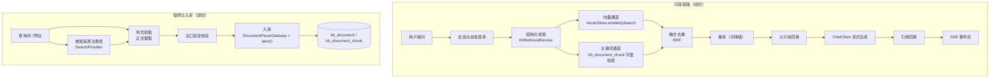

# doc-knowledgebase · 知识库业务逻辑

> 项目：TrueBuddy ｜ 规范入口：[doc.md](./doc.md) ｜ 最近核对代码现状：2026-11-16
> 适用范围：知识库模块的**已实现链路**（§2 现状盘点，含 §2.4 归属与共享）与后续能力的**规划方案**（§3 起）
> 相关：[doc-api.md](./doc-api.md)（接口清单）、[doc-database.md](./doc-database.md)（kb_* 表）、[doc-conventions.md](./doc-conventions.md)、[doc-doctemplate.md](./doc-doctemplate.md)（检索增强的唯一消费方）、[adr/0006-知识库与工作流归属与共享模型.md](./adr/0006-知识库与工作流归属与共享模型.md)（归属与共享模型的决策依据）、[../backend/AGENT - 后端技术规约.md](../backend/AGENT%20-%20后端技术规约.md)

> ⚠️ **落地状态（2026-11-16 逐项核对）**：**§2 现状盘点**描述的入库-检索底座链路已实现——空间 / 文档 / 分块 / 分片管理 + DocMind 解析 + AI 语义分片（失败回退逐块）+ DashScope 向量化 + pgvector 单路向量检索（`searchBySpace`，唯一消费方是 doc-template 的 RAG 上下文）；**§2.4 归属与共享（creator 过滤 / 公有私有 / fork 深拷贝 / 公有库浏览区）已实现**（ADR 0006）。**§3 起的规划全部未实现**——代码中不存在：关键词检索通道、多路召回融合去重、重排降级、父子分块、引用回填、问答会话与消息表（无 `kb_qa_*` 表）、问答接口与 SSE 流式回答、联网搜索与 SSRF 出口控制。规划内容落地前不得被其它模块依赖。

---

## 1. 背景与目标

### 1.1 需求来源

参考材料是外部知识管理平台（下称「参考平台」）的模块级技术文档集，位于仓库外的 `D:\USE\桌面\dooooos`，共索引 + 10 篇：

| 篇目 | 本次是否参考 |
| --- | --- |
| `01-文档入库流程` | 参考（入口分类、判重、状态机） |
| `02-检索问答全流程` | 参考（管道阶段、流式事件） |
| `03-分块机制` | 参考（父子分块、切分参数） |
| `06-网络搜索与网页抓取` | 参考（搜索来源、正文提取、出口安全） |
| `10-检索流程详解` | 参考（参数、融合、重排、合并） |
| `04` / `05` / `07` / `08` / `09` | 本次不采用（见 §1.3） |

两点必须先行明确：

1. 该目录**只有文档、没有源码**，且**不在本仓库内**，因此它只能作为「能力参照」，不能成为构建依赖、运行时依赖或代码来源。
2. 参考平台的默认值是**多租户、多向量引擎、多消费池**架构下的取值，直接照搬会引入远超本项目需要的复杂度，本方案只取其**语义与量级**，落地形态按 TrueBuddy 现状裁剪。

### 1.2 本次范围

| # | 能力 | 一句话目标 | 主要落点 |
| --- | --- | --- | --- |
| 1 | 检索链增强 | 把召回从「单一向量检索」升级为「向量 + 关键词双通道 → 融合 → 重排（可降级）→ 父子块上下文回填 → 引用来源」 | `tb-module-knowledgebase` |
| 2 | 知识库问答对话 | 新增会话与消息持久化；提供「只召回不生成」的纯检索与「带引用的流式问答」两类接口，并配套问答界面 | `tb-module-knowledgebase` + `frontend/src/views/knowledgebase/` |
| 3 | 联网与入库入口 | 新增可插拔的搜索来源与网页正文抓取，把「网址」直接变成知识库文档；对外访问统一过出口安全校验 | 新增后端模块 + `tb-module-knowledgebase` |

### 1.3 范围外（本轮明确不做）

| 能力 | 不做的理由 |
| --- | --- |
| 跨会话长期记忆 | 记忆归「人」不归「空间」，需要独立向量存储、抽取任务与三级开关；与本项目「教师单机/内网使用」的定位不匹配 |
| 外部数据源定期同步（云盘 / 知识库） | 依赖外部平台的企业应用凭据与增量游标，属于运维型能力，无法在本项目环境内闭环演示 |
| 代码执行沙箱与技能 | 需要容器 / 微虚机与宿主级权限，安全边界远大于本项目需要 |
| 多租户、多向量引擎、存储 provider 抽象、配额计量 | 参考平台为 SaaS 形态设计；本项目为单实例单租户，引入只会增加维护面 |

### 1.4 术语对齐

| 术语 | 含义 |
| --- | --- |
| 向量通道 | 用 `VectorStore.similaritySearch` 做的语义召回 |
| 关键词通道 | 按字面词命中的召回，与向量通道结果并列参与融合 |
| 融合 | 把多通道结果按名次合成一个 0–1 分并去重（本方案用倒数排名融合 RRF） |
| 重排 | 用交叉编码模型对候选重新排序；无模型时必须能降级为原顺序 |
| 父子分块 | 子块用于向量匹配、父块用于返回更完整上下文；父块**不进向量索引** |
| 引用回填 | 回答生成后，把本轮实际命中的原文片段与所属文档结构化返回 |

---

## 2. 现状盘点

> 本章所有「现状」均以实际代码为准；与规范文件描述不一致的项，按 §2.3「现状 / 规范要求 / 待整改」三段式记录。

### 2.1 可复用资产

| 资产 | 位置（现状） | 现有能力 | 本次用途 |
| --- | --- | --- | --- |
| 解析网关 | `backend/tb-module-knowledgebase/src/main/java/org/example/backend/module/knowledgebase/service/parse/DocumentParseGateway.java` | 接口四方法：`String submit(InputStream, String)`、`ParseTaskStatus query(String)`、`List<Map<?,?>> fetchMarkdown(String)`、`default void release(String)`；由同目录 `ParseGatewayConfiguration` 以 `@Bean` 手工装配 `docmind/DocMindParseGateway`（AK/SK 缺失时**启动即失败**） | 「网址入库」复用同一抽象新增来源分支 |
| 分块策略 | `backend/tb-module-knowledgebase/src/main/java/org/example/backend/module/knowledgebase/service/chunk/DocumentChunkService.java`（接口）、同目录 `AiDocumentChunkService.java`（实现） | 接口只有一个方法：`List<String> chunk(List<String> blocks)`；实现用 `ChatClient` 只让模型输出**块区间**，正文由后端按区间拼接；模型异常 / 输出不可解析 / 拼接为空三处均回退为「逐块分片」 | 父子分块的改造点 |
| 检索入口 | `backend/tb-module-knowledgebase/src/main/java/org/example/backend/module/knowledgebase/service/Impl/KbDocumentServiceImpl.java` 的 `searchBySpace(Long spaceId, String query, int topK)` | 构造 `SearchRequest.builder().query(q).topK(max(1,topK)).filterExpression("spaceId == '<id>'")` 调 `vectorStore.similaritySearch`；把命中拼成 `【片段N】<正文>\n` 字符串返回；异常时**吞掉并返回空串** | 改造为薄封装，另增结构化检索方法 |
| 向量存储 | Spring AI `VectorStore`（pgvector） | `application.yml`：`index-type=hnsw`、`distance-type=COSINE_DISTANCE`、`dimensions=1024`、`initialize-schema=true`；**向量表由 Spring AI 自动建**，`sql/vector_store.sql` 只建扩展 | 保留不换库；关键词通道与它按 `chunkId` 关联 |
| 向量化写入 | `KbDocumentServiceImpl#vectorize` | 先 `chunkMapper.deleteByDocumentId` 覆盖式重建分片，再为每片建 `org.springframework.ai.document.Document`，metadata 写入 `chunkId` / `documentId` / `spaceId`（**均为字符串**）；旧向量按 `documentId == '..'` 清理后分批 `add`（批大小 10） | 引用回填直接依赖 `chunkId` metadata |
| 文件存储 | `tb-module-infra` 的 `MinioFileStorageService` + `infra_file` 表 | 只有 `bucket` / `path` / `url` / `size` / `type`，**无 provider 抽象** | 抓取到的正文与图片转存 |
| SSE 基建 | `tb-module-workflow` 的 `ChatController`（SSE 发布器 `ChatSsePublisher`）+ `frontend/src/utils/event-stream.js` | 后端 `SseEmitter` 推事件帧（协议见 [doc-workflow.md](./doc-workflow.md) §2.2）；前端导出 `readEventStream(url, { body, signal, onEvent })`，用 `fetch` + `ReadableStream` 手工切分 SSE（未用 `EventSource`，因其只支持 GET 且带不了请求体） | 问答流式直接复用（见 §5.3） |
| 现有数据表 | `backend/sql/` | `kb_space`、`kb_document`、`kb_document_parse_block`、`kb_document_chunk`、`infra_file`、`doc_template_generation`、`doc_template_file`、`workflow` | 扩展基础 |
| jsoup 文档读取器 | `tb-module-test2/pom.xml` | `spring-ai-jsoup-document-reader` 2.0.0-M3 **已声明但代码中未使用** | 网页正文提取的候选依赖 |
| 解析编排细节 | `KbDocumentServiceImpl` | 文档状态常量：`0` 待处理 / `1` 解析中 / `2` 已向量化 / `3` 失败 / `4` 分片待确认 / `5` 解析完成待分片 / `6` AI 分片中 / `7` 向量化中；`processingDocuments`（`Set<Long>`）阻断解析轮询的并发重入 | 问答链路只消费 `status = 2` 的文档 |

### 2.2 缺口矩阵

| 能力 | 现状 | 缺口 |
| --- | --- | --- |
| 关键词通道 | 无 | 需要 `kb_document_chunk` 上的字面检索能力（见 §4.2） |
| 阈值与条数归一化 | `SearchRequest` 只设 `topK`，**无 `similarityThreshold`** | 参数语义与归一化规则缺失（见 §4.1） |
| 融合与去重 | 无，单通道结果直接返回 | 需要 RRF 与按 `chunkId` 去重（见 §4.3） |
| 重排 | 无 | 需要可降级的重排调用（见 §4.4） |
| 父子分块 | `kb_document_chunk` 是单层，表内**无父子字段、无块类型、无前后指针** | 需要加列 + 分块写入改造（见 §4.5） |
| 引用回填 | 无（`kb_document_parse_block.external_id` 仅注释提到「溯源」，无回填逻辑） | 需要结构化引用结果与流式事件（见 §4.6） |
| 结构化检索 | `searchBySpace` 只返回拼接字符串 | 需要返回带 `chunkId` / `documentId` / `name` / `content` / `score` 的结果（见 §4.7） |
| 会话与消息 | 表与代码均无 | 需要 2 张表 + 接口（见 §5） |
| 流式问答 | 无 | 需要 SSE 问答接口（见 §5.3） |
| 搜索来源 | 无 | 需要 provider 抽象与注册表（见 §6.1） |
| 网页抓取 | 无（jsoup 依赖已声明未使用） | 需要正文提取与长度/超时上限（见 §6.2） |
| 出口安全 | 无 | 需要 SSRF 校验（见 §6.3） |
| URL 入库与判重 | 无，`kb_document` 无来源地址字段 | 需要来源字段与判重键（见 §6.4） |

### 2.3 现状 / 规范要求 / 待整改

| # | 位置 | 现状 | 规范要求 | 待整改动作 |
| --- | --- | --- | --- | --- |
| 1 | `tb-module-workflow` SSE | 类 `WorkflowStreamRegistry` **不存在**；SSE 逻辑内联在 `WorkflowController`，事件名为 `run` / `node` / `interrupt`，无心跳 | [doc-conventions.md](./doc-conventions.md) §2.2 与 [../backend/AGENT - 后端技术规约.md](../backend/AGENT%20-%20后端技术规约.md) §9.1 描述为 `WorkflowStreamRegistry` 与 `created` / `message` / `completed` / `error` / `done` | 二选一：按代码修订规范，或按规范补齐实现；**本方案 §5.3 以代码现状为准**，不引用不存在的事件名 |
| 2 | `workflow` 表落库 | `sql/workflow.sql` 已建表（雪花 ID + `schema_json`），但 `WorkflowServiceImpl` 只有 `getProcess`，实际**只读 classpath `text.json`**，表中数据未被读取 | 规范描述为「工作流定义已持久化」 | 明确该表为「已建表未接线」，避免后续据此编写依赖代码 |
| 3 | 后端测试 | `tb-module-workflow/src/test/java/` 下已有 2 个测试类（`NodeStateReaderTest`、`IterateNodeTest`） | [doc-conventions.md](./doc-conventions.md) §1 记为「后端不存在测试代码（无 `src/test/java`）」 | 修订 [doc-conventions.md](./doc-conventions.md) §1 与 §5 |
| 4 | Mapper 口径 | 业务模块用原生 `@Mapper` 接口 + `@Select` / `@Insert` / `@Delete` / `@Options` 注解 SQL，**无 XML**（`KbDocumentChunkMapper` 即此写法） | [doc.md](./doc.md) §3 要求「使用 `Wrappers` 条件构造器」 | 修订规范措辞（框架的 `BaseMapperX` 能力保留但业务模块未接入）；**新增表沿用现状注解口径**，不引入 XML |
| 5 | `kb_document_chunk.enabled` / `hit_count` | 两列已在建表脚本中定义，但代码只有 select / insert / delete，**没有任何写入或使用** | 未定义 | 本方案约定：关键词通道过滤 `enabled = TRUE`；向量通道无法过滤（metadata 不含 `enabled`），需在 §9 记录该不一致 |
| 6 | `application.yml` 明文密钥 | 对话 / 向量化 `api-key` 与 `minio.secret-key` 仍为明文或带明文默认值 | [doc.md](./doc.md) §1.1 要求只写 `${VAR}` 占位符 | 既有待整改项，本方案不复述明文、不新增明文 |

### 2.4 归属与共享模型（2026-11-16 已实现，ADR 0006）

> 知识库从「全局池」改为「按人归属 + 公有共享」：决策依据与取舍见 [adr/0006](./adr/0006-知识库与工作流归属与共享模型.md)。

| # | 能力 | 现状实现 |
| --- | --- | --- |
| 1 | 归属真相源 | 复用审计列 `creator`；`selectRespList(creator)` 在**后端**按创建者过滤（首页资产卡「我的资产」同名口径）；前端不自行过滤 |
| 2 | 可见性 | `kb_space.visibility` 0=私有/1=公有；新建默认私有；存量经 `visibility_creator_backfill_20261116.sql` 一律刷 0 并把 `creator IS NULL` 行归入 admin 种子账号 |
| 3 | 读写两把闸 | 静态策略类 `service/KbSpaceAccess.java`（唯一实现，防多份判定漂移）：`requireExisting`（不存在→`1_003_000_000`）、`requireReadable`（创建者本人**或**公有，否则 `1_003_000_003`）、`requireOwned`（仅创建者）。**写路径**（改可见性/删文档/上传/向量化/fork 校验前的写意图）全走 `requireOwned`；**纯读路径**（文档列表、分片列表）走 `requireReadable` |
| 4 | 公有/私有切换 | `PUT /knowledge-base/space/visibility`：非创建者即使面对公有空间也拒绝（归属写操作）；非法值按 `1_003_000_004` 拒绝 |
| 5 | 公有库浏览区 | `GET /knowledge-base/space/public-list`：**只列他人的**公有空间（`visibility=1 AND creator <> 当前用户`，JOIN system_user 取创建者显示名）；创建者为 NULL 的存量行宁可少展示 |
| 6 | fork 深拷贝 | `POST /knowledge-base/space/fork`：与公有只读同一把闸（本人空间或他人公有可 fork）；单事务复制 空间→文档（**只带 `status=2 已向量化` 的文档**，`file_id` 共享引用 MinIO 对象不动）→版面块→分片→pgvector 向量（`INSERT…SELECT` 改写 metadata），并做**行数对账**（分片/向量复制不完整即抛出整笔回滚）；副本私有、归属当前用户、与原库此后无任何同步 |
| 7 | 副本命名 | 「原名（副本）」起，重名追加序号「（副本 2）」；`uk_kb_space_name` 唯一索引防撞，原名超长先截断基底再接后缀（列宽 100）；重试 99 次仍冲突按 500 拒绝 |
| 8 | 分片读取守卫 | `KbDocumentChunkServiceImpl.getChunkList`：文档不存在→`1_003_000_001`；经 `document.spaceId` 反查空间后过 `requireReadable`——公有库浏览区暴露他人 documentId，分片路径必须锁死 |
| 9 | 检索增强豁免 | `searchBySpace` 是 doc-template 复用的**内部接缝**，不做归属校验（消费方是服务端自身，非用户面接口） |

**接受的不一致**：批改选库等下游选择器「只列我的空间」由各自的列表接口按 creator 过滤保证（本模块 `getSpaceList` 已过滤）；fork 事务里 `IllegalStateException` 用通用 500 而非模块错误码（对账失败是极小概率数据异常，可读堆栈优先）。

---

## 3. 总体架构

> **规划**。下图是目标形态，不代表当前已实现。



---

## 4. 检索链增强

> 本章全部为**规划**；§4.7 的兼容改造是本方案唯一的强制约束。

### 4.1 参数归一化与阈值语义

| 参数 | 建议默认值 | 取值规则 | 说明 |
| --- | --- | --- | --- |
| 返回条数 `topK` | 由调用方给出 | `<= 0` → `50`；`> 500` → `500` | 对齐参考平台；上限 500 与 pgvector 单次召回成本匹配 |
| 向量阈值 | `0.15` | `0` 表示**不过滤** | 现有 `SearchRequest` 未设阈值，等价于「不过滤」，新接口须显式声明该语义 |
| 关键词阈值 | `0.3` | `0` 表示不过滤 | |
| 重排条数 | `10` | `<= 0` 表示「全部过阈候选」 | |
| 重排阈值 | `0.2` | 作用在复合分上 | |
| 融合常数 `k` | `60` | — | RRF 参数 |
| 向量通道权重 | `0.7` | — | |
| 关键词通道权重 | `0.3` | — | |

**语义取舍（必须显式声明）**：「阈值 0 = 不过滤」。现有 `searchBySpace` 不传阈值，若新接口默认 `0.15`，同一句查询在「旧接口」与「新接口」会命中不同数量——**这是预期行为**，不是缺陷。文档与接口注释都需写明。

配置承载：建议新增 `tb.retrieval.*`（`@ConfigurationProperties`），默认值取上表；不放到数据库，避免为单实例项目引入配置表。

### 4.2 关键词通道

在**不引入新向量库 / 搜索引擎**的前提下，二选一：

| 方案 | 做法 | 优点 | 代价 |
| --- | --- | --- | --- |
| A（推荐主路径） | 为 `kb_document_chunk` 增加 `content_tsv tsvector` 生成列 + GIN 索引，用 `plainto_tsquery` / `to_tsquery` 查询，`ts_rank` 作分数 | 与业务表同库、零新增组件；写入侧由生成列自动维护 | 中文分词依赖 `simple` 配置时按字符切分，召回偏「字面」；需要为存量数据重建索引 |
| B（兜底） | 应用层对候选分片做分词与打分（可先按 `space_id` 缩小范围） | 不依赖数据库扩展能力，可在任意环境跑 | 有全表扫描风险，需限制候选上限 |

推荐：**A 为主、B 为兜底**（启动时探测 `tsvector` 可用性，不可用则降级到 B）。前置条件与降级路径：

- `tsvector` 为 PostgreSQL 内置能力（无需扩展），但 `simple` 配置对中文按字符切分；若运行环境已安装 `zhparser`，可通过配置切换为中文分词配置，**该扩展是否存在须在部署环境确认**（确认方式：`SELECT * FROM pg_extension;`）。
- 加列与索引草案：

```sql
-- 草案（规划，未执行）：kb_document_chunk 关键词通道
ALTER TABLE kb_document_chunk
    ADD COLUMN IF NOT EXISTS content_tsv tsvector
        GENERATED ALWAYS AS (to_tsvector('simple', content)) STORED;

CREATE INDEX IF NOT EXISTS idx_kb_document_chunk_tsv
    ON kb_document_chunk USING GIN (content_tsv);
```

- 生成列对**现有写入路径无侵入**（`KbDocumentChunkMapper.insert` 只写 4 列，其余由默认值 / 生成列填充）；但存量行需要 `UPDATE ... SET content = content` 之类的重写才能回填，或直接接受「仅新数据可被关键词召回」并记录待整改。
- 过滤条件必须包含 `space_id = ?` 与 `enabled = TRUE`。

### 4.3 融合与去重

**去重键是分片 id（`chunkId`）**，不是文档 id。

| 情形 | 处理 |
| --- | --- |
| 仅向量通道有结果 | 保留原始余弦分，不做归一化 |
| 仅关键词通道有结果 | 若最大分大于 1，整列除以最大分压到 0–1，否则原样保留 |
| 双通道都有结果 | 走 RRF |

RRF 算法（与「加权求和」「取最高分」不同，须逐项对齐）：

1. 每个结果先在各通道内按分数降序、按 `chunkId` 去重，取自己的**最好 1-based 名次**。
2. 融合分 = `(0.7 / (60 + 向量名次) + 0.3 / (60 + 关键词名次)) / ((0.7 + 0.3) / (60 + 1))`，结果落在 0–1。
3. 同一分片被两通道命中时，**元数据优先取向量侧**，关键词侧仅在向量未命中时补充。
4. 最终按融合分降序。

> 注意：融合分是「归一化的名次分」，**不是相似度**。排查「为什么这条分很低」时必须区分 RRF 融合分、单通道原始分、重排复合分三者。

### 4.4 重排降级链

重排是「用交叉编码模型重新排序候选」，**必须可降级**：

| 环节 | 规则 |
| --- | --- |
| 触发条件 | 配置了重排模型且候选数 > 1；未配置直接跳过 |
| 候选池 | 取「重排条数」与候选数中较合适的一批（建议上限 200），图谱类结果不参与（本项目无图谱） |
| 超时 | 默认 60 秒；超时按失败处理 |
| 失败降级 | 模型调用失败、模型缺失、超时一律返回**未改动的检索顺序**，不中断问答 |
| 阈值降级链 | 全部候选不过阈且阈值 > 0.3 时，按「阈值 × 0.7 与 0.3 取较大者」放宽重试一次；仍无结果时保留最高分候选（不低于 0.15）；仍不成立则返回空 |
| 分数替换 | 复合分 = 模型分 × 0.6 + 原检索分 × 0.3 + 来源权重 × 0.1，裁剪到 0–1；原检索分保留在 metadata 便于排查 |

**模型来源**：优先复用现有 OpenAI 兼容端点（`spring.ai.openai`），不新增供应商依赖；重排模型名与超时作为 `tb.retrieval.rerank.*` 配置项，**未配置即为「不启用重排」**——这保证在无重排模型的环境里功能完整可用。

### 4.5 父子分块

目标：**子块用于向量匹配、父块用于返回更完整上下文**，父块不进向量索引。

表变更草案（`kb_document_chunk`）：

```sql
-- 草案（规划，未执行）：kb_document_chunk 父子分块
ALTER TABLE kb_document_chunk
    ADD COLUMN IF NOT EXISTS parent_chunk_id BIGINT,                              -- 父块 id，NULL 表示单层分块
    ADD COLUMN IF NOT EXISTS chunk_type      VARCHAR(20) NOT NULL DEFAULT 'text', -- text | parent
    ADD COLUMN IF NOT EXISTS prev_chunk_id   BIGINT,                              -- 同文档内前指针
    ADD COLUMN IF NOT EXISTS next_chunk_id   BIGINT;                              -- 同文档内后指针
```

| 项 | 规则 |
| --- | --- |
| 父块大小 / 子块大小 | 建议沿用参考平台量级：父块 `4096`、子块 `384`（字符）；父块重叠沿用基础重叠，子块重叠取子块大小的 1/5 |
| 是否启用 | 作为**可选开关**；关闭时全部为 `chunk_type = 'text'`、`parent_chunk_id = NULL`，行为与现状一致 |
| 父块写入 | 仅在「父块产出多个子块」或「唯一子块内容与父块不同」时写入；`chunk_type = 'parent'`，**不写入向量库** |
| 索引写入 | 只有 `chunk_type = 'text'` 的子块进向量库（`vectorize` 的 `vectorDocs` 只收集子块） |
| 回退口径 | `AiDocumentChunkService` 回退为「逐块分片」时，父块为 `NULL`，即等价于单层分块——**回退路径无需额外分支** |
| 前后指针 | 按 `chunk_index` 顺序在两遍写入后回填；`prev_chunk_id` / `next_chunk_id` 用于「短上下文扩展」 |
| 唯一约束 | 现有 `uk_kb_document_chunk (document_id, chunk_index)` 保持；父块与子块**共用同一序号空间**，避免索引冲突 |

> `kb_document_chunk` 是**物理删除重建**的从属表（`deleteByDocumentId` 后重建），因此新列不涉及软删与迁移兼容问题。

### 4.6 引用回填

1. 回答生成后，从答案中定位实际被引用的分片（最简实现：把本轮注入模型的候选分片全部作为「可引用集」，按 `chunkId` 与答案文本做包含匹配；匹配不到时退回「全部候选」）。
2. 按 `chunkId` 集合回查 `kb_document_chunk` 与 `kb_document`，组装引用项。
3. 以**独立流式事件**下发（见 §5.3），并在消息落库时写入 `citations_json`。

引用项字段（契约）：

| 字段 | 来源 | 说明 |
| --- | --- | --- |
| `chunkId` | 向量 metadata 或分片表 id | 已有 metadata 键 `chunkId` |
| `documentId` | 向量 metadata 或分片表 `document_id` | |
| `name` | `kb_document.name` | 展示用文档名 |
| `content` | `kb_document_chunk.content` | 命中原文片段（父块回填时为父块内容） |
| `score` | 融合分 / 重排复合分 | 可选，便于前端排序与调试 |

### 4.7 兼容改造（强制约束）

**现状调用链**：

```text
DocTemplateServiceImpl.generate   (tb-module-doctemplate, RAG_TOP_K = 5)
        └── KbDocumentService#searchBySpace(Long, String, int) -> String
                └── KbDocumentServiceImpl#searchBySpace  ->  "【片段N】…\n"
```

**改造后调用链**：

```text
DocTemplateServiceImpl.generate
        └── KbDocumentService#searchBySpace(Long, String, int) -> String   (保留，签名与返回语义不变)
                └── 薄封装：调用结构化检索 → 仅拼接 content 为 "【片段N】…\n"

新增：KbRetrievalService#retrieve(Long spaceId, String query, RetrieveOptions) -> List<RetrieveHitVO>
        └── 同时供「问答链路」「纯检索接口」使用
```

约束：

- `searchBySpace` 的**方法签名与返回字符串格式不得变化**；现有唯一调用点是 `DocTemplateServiceImpl.generate`（`tb-module-doctemplate`，`RAG_TOP_K = 5`），改造后其行为需与改造前等价或更优。
- 结构化检索方法返回 `List<RetrieveHitVO>`，字段见 §4.6 引用项 + `hitType`（`vector` / `keyword` / `both`）。
- 新增类的落点：`tb-module-knowledgebase` 的 `service/`（接口）与 `service/Impl/`（实现），与现有分层一致。

---

## 5. 知识库问答对话

> 本章全部为**规划**。

### 5.1 会话与消息表

```sql
-- 草案（规划，未执行）：知识库问答会话表（软删，对齐 kb_space / workflow）
CREATE TABLE IF NOT EXISTS kb_conversation (
    id            BIGINT GENERATED BY DEFAULT AS IDENTITY, -- 主键
    space_id      BIGINT       NOT NULL,                   -- 所属空间 id（kb_space.id）
    title         VARCHAR(100),                            -- 会话标题（可由首问截断生成）
    message_count INTEGER      NOT NULL DEFAULT 0,         -- 消息条数
    create_time   TIMESTAMP    NOT NULL DEFAULT now(),
    update_time   TIMESTAMP    NOT NULL DEFAULT now(),
    creator       BIGINT,
    updater       BIGINT,
    deleted       BOOLEAN      NOT NULL DEFAULT FALSE,      -- 软删
    PRIMARY KEY (id)
);

-- 草案（规划，未执行）：知识库问答消息表（从属表，物理删除）
CREATE TABLE IF NOT EXISTS kb_message (
    id              BIGINT GENERATED BY DEFAULT AS IDENTITY, -- 主键
    conversation_id BIGINT      NOT NULL,                    -- 所属会话 id
    space_id        BIGINT      NOT NULL,                    -- 冗余空间 id，便于按空间过滤
    role            VARCHAR(20) NOT NULL,                    -- user | assistant
    content         TEXT        NOT NULL,                    -- 消息正文
    citations_json  TEXT,                                    -- 助手消息的引用来源 JSON 数组
    token_count     INTEGER     NOT NULL DEFAULT 0,          -- token 数（无估算则为 0）
    create_time     TIMESTAMP   NOT NULL DEFAULT now(),
    creator         BIGINT,
    PRIMARY KEY (id)
);
```

删除策略与现有约定对齐：**会话软删**（`deleted BOOLEAN`，同 `kb_space` / `workflow`）；**消息物理删除**（从属表，同 `kb_document_chunk`）。删除会话时按 `conversation_id` 物理删除消息。

### 5.2 接口设计

路径沿用 `/knowledge-base/**` 前缀，方法语义遵循 [doc-api.md](./doc-api.md) §2.2：

| # | 方法 | 路径 | 说明 |
| --- | --- | --- | --- |
| 1 | `GET` | `/knowledge-base/conversation/list` | 会话列表（`spaceId`） |
| 2 | `POST` | `/knowledge-base/conversation/create` | 新建会话 |
| 3 | `DELETE` | `/knowledge-base/conversation/delete` | 删除会话（`id`，级联物理删除消息） |
| 4 | `GET` | `/knowledge-base/message/list` | 消息列表（`conversationId`） |
| 5 | `POST` | `/knowledge-base/retrieve` | **纯检索**：只返回召回结果，不调用模型 |
| 6 | `POST` | `/knowledge-base/chat` | **问答**：以 `text/event-stream` 流式返回 |

约定：

- 全部返回 `CommonResult<T>`（流式接口除外，与 `POST /workflow/run` 一致）。
- 问答请求体：`{ conversationId, spaceId, question, topK?, useRerank? }`；`conversationId` 为空时按「新建会话」处理。
- 问答前置校验：`spaceId` 存在、文档状态只消费 `status = 2`（已完成向量化）的分片。
- 多轮历史：**第一阶段只做「加载最近 N 轮原文拼入提示词」**，不做查询改写（改写列为后续可选增强，见 §7）。
- 认证：SSE 接口通过请求头 `Authorization` 携带 Token 即可，**无需加入 `tb.security.permit-all-urls`**（现有安全组件已对 `DispatcherType.ASYNC` 放行）。若前端改用 `EventSource`（只支持 GET），则必须放行，**不推荐**。

### 5.3 流式事件契约

事件机制**复用现有 `WorkflowController` 的做法**（`SseEmitter(0L)` + `SseEmitter.event().name(event).data(payload)`），但事件名**按问答语义命名**，不使用 `node` / `interrupt`：

| 事件名 | 触发时机 | 载荷 |
| --- | --- | --- |
| `run` | 连接建立、会话就绪 | `{ "conversationId": 1, "messageId": 12 }` |
| `message` | 答案增量 / 引用 | `{ "type": "answer_delta", "text": "…" }` 或 `{ "type": "citations", "items": [ … ] }` |
| `error` | 链路失败 | `{ "code": 500, "message": "…" }` |
| `done` | 流正常结束 | `{ "messageId": 12, "tokenCount": 0 }` |

```text
event: message
data: {"type":"answer_delta","text":"……"}

event: message
data: {"type":"citations","items":[{"chunkId":12,"documentId":3,"name":"示例.docx","content":"……","score":0.42}]}
```

前端复用：`frontend/src/utils/workflow-sse.js` 的 `readWorkflowStream(url, { body, signal, onEvent })` 是 URL 无关的通用 SSE 读取器（其 JSDoc 提到工作流，但实现不含工作流语义），**可直接复用**，由 `onEvent(event, payload)` 按事件名分发。

> 规划：把 `readWorkflowStream` 抽出为通用 `readEventStream` 并保留旧名作别名，避免 `knowledgebase` 反向依赖 `workflow` 命名。属于纯重命名，可延后。

### 5.4 前端落点

沿用「业务模块自治」目录约定（[doc-conventions.md](./doc-conventions.md) §3.3）：

```text
frontend/src/views/knowledgebase/
├── KnowledgeBaseView.vue            # 现有容器：新增「问答」视图切换
├── components/
│   ├── ChatPanel.vue                # 新增：问答面板（输入、流式答案、引用卡片）
│   ├── RetrieveResultList.vue       # 新增：纯检索结果列表
│   └── …（现有 SpaceGridView / SpaceCard / DocumentListView / DocumentUploadView）
└── constants.js                      # 现有：状态常量；新增问答相关的展示常量
```

API 层落在现有 `frontend/src/api/knowledgebase.js`（一个业务模块一个文件），新增具名导出：`listConversations`、`createConversation`、`deleteConversation`、`listMessages`、`retrieveChunks`、`chatStream`。

---

## 6. 联网与入库入口

> 本章全部为**规划**。

### 6.1 搜索来源抽象

| 项 | 设计 |
| --- | --- |
| 接口 | `SearchProvider`：`String type()`；`List<SearchHit> search(String query, int count)`；`boolean available()` |
| 结果模型 | `SearchHit`：`title`、`url`、`snippet`、`source` |
| 注册表 | `SearchProviderRegistry`：按 `type` 注册，启动时按配置装配；**未配置任何 provider 时启动不失败**（能力降级为不可用） |
| 配置 | `tb.search.type`（单值，第一版不做多 provider 并行）+ `tb.search.count`（默认 5）+ provider 自身配置 |
| 第一版 provider | **收敛到 1 个**：自建 SearXNG（JSON 接口、无密钥、地址可自定义，最贴合内网 / 毕业设计环境）；商业 API 待后续按需追加 |
| 失败语义 | 搜索失败**降级为「无搜索结果」**，不中断问答；日志记原因 |

> 若引入需要密钥的商业搜索 API，按 [doc.md](./doc.md) §1.1 的现行口径（2026-10-10 起）把真实值写在 `application.yml` 的 `${SEARCH_API_KEY:字面值}` 位，并同步 §1.2 的变量清单；**源码 / 脚本 / 文档里仍禁止出现明文**。

### 6.2 网页正文提取

| 项 | 设计 |
| --- | --- |
| 协议 | **仅 HTTP / HTTPS**，其余协议直接拒绝 |
| 依赖 | 优先复用 `spring-ai-jsoup-document-reader` 2.0.0-M3（`tb-module-test2/pom.xml` 已引入，但代码中未使用）；该 artifact 的**具体类名与选择器语义待确认**（确认方式：`./mvnw -pl tb-module-test2 dependency:tree` 后查看 jar 包结构）。若正文质量不足，直接用其传递依赖的 `jsoup` 自实现启发式正文提取 |
| 提取 | 剥离导航 / 广告 / 页脚，得到正文与标题；非 HTML 内容按内容类型直取 |
| 上限 | 单页下载上限（建议 10 MB）与正文长度上限（建议 200000 字符，超限截断并标注）；连接 / 读取超时（建议 10s / 30s） |
| 续读 | 超长页面按段落分页，支持「继续读下一段」，避免一次灌满模型上下文——**第一阶段可只做截断，不做续读** |
| 快照 | 抓取结果可落 `infra_file` 保留原文，便于复现 |

### 6.3 出口安全（SSRF）

所有「用户可控的出站地址」（搜索实例地址、网页抓取地址、URL 导入地址）必须过同一套校验：

| 层 | 规则 |
| --- | --- |
| 协议白名单 | 仅 `http` / `https` |
| 地址判定 | 拒绝回环（`127.0.0.0/8`、`::1`）、私网（`10/8`、`172.16/12`、`192.168/16`）、链路本地（`169.254/16`、`fe80::/10`，含云元数据地址）、`0.0.0.0` |
| 主机名 | 拒绝空主机名；可选的白名单模式（`tb.search.ssrf-whitelist-only`）下仅放行白名单，**在 DNS 查询之前即拒绝** |
| 拨号层 | 连接建立前**再次校验解析结果**，防 DNS 重绑定 |
| 重定向 | 逐跳复验，防止首跳合法、后续 302 到内网 |
| 缓存 | 校验结果带短时缓存，避免同地址反复解析 |

> 白名单的常见陷阱：自定义补充白名单时会**覆盖**默认项，导致内置服务（MinIO、数据库）被拦。若启用白名单模式，必须把 MinIO 与 PostgreSQL 地址同时列入。

### 6.4 URL 导入与判重

| 项 | 设计 |
| --- | --- |
| 入口复用 | 复用 `DocumentParseGateway`：新增「来源类型」分支（文件 / 网址），网址分支先抓取正文再解析。第一阶段可先抓正文落 `MinioFileStorageService` 得到文件，再走**现有文件解析链路**，改动最小 |
| 判重键 | 来源地址的哈希（同一地址只入库一次）；比较作用域为「同空间」 |
| 落库字段 | `kb_document` 需新增来源字段（草案见下）；若暂不加列，可把地址哈希写入 `name` 前缀并接受可读性下降——**不推荐** |
| 失败清理 | 抓取或解析失败时，先软删 `kb_document` 行、再删物理文件，避免「行在文件丢」 |

```sql
-- 草案（规划，未执行）：kb_document 网址来源字段
ALTER TABLE kb_document
    ADD COLUMN IF NOT EXISTS source_url   VARCHAR(1024),  -- 来源地址（NULL 表示文件上传）
    ADD COLUMN IF NOT EXISTS content_hash VARCHAR(64);    -- 内容哈希（文件按字节、网址按正文）

CREATE UNIQUE INDEX IF NOT EXISTS uk_kb_document_source_url
    ON kb_document (space_id, content_hash) WHERE deleted_at IS NULL AND content_hash IS NOT NULL;
```

现有 `kb_document` 已有 `deleted_at`（NULL = 未删除）与 `type`（`PDF` / `WORD` / `MARKDOWN`）字段，URL 导入的文档建议 `type = 'URL'`，需同步前端 `constants.js` 的展示映射。

---

## 7. 分阶段最小改动路线

> **规划**。四期相互独立可演示，P2 / P3 依赖 P1，P4 可并行。

### 7.1 分期总览

| 期 | 目标 | 依赖 | 新增 / 修改面 |
| --- | --- | --- | --- |
| P1 | 检索内核升级：结构化检索 + 参数归一化 + 关键词通道 + RRF | 无 | 新增 `KbRetrievalService` / `RetrieveOptions` / `RetrieveHitVO`；`kb_document_chunk` 加 `content_tsv` + GIN（方案 A）；`searchBySpace` 改薄封装 |
| P2 | 知识库问答对话：会话 / 消息表 + 纯检索与问答接口 + SSE + 前端问答页 | P1 | `kb_conversation` / `kb_message`；`ConversationService` / `MessageService` / `KbChatService`；`/knowledge-base/conversation|message|retrieve|chat`；前端 `ChatPanel` |
| P3 | 父子分块 + 重排 | P1 | `kb_document_chunk` 加 4 列；`AiDocumentChunkService` 产出父子结构；`KbDocumentServiceImpl#vectorize` 只索引子块；新增 `RerankService`（可降级） |
| P4 | 联网与入库入口 | 无 | 新增模块（建议 `tb-module-websearch`）；`SearchProvider` / 抓取 / SSRF / URL 导入；`kb_document` 加 `source_url` + `content_hash` |

### 7.2 每期的可演示效果与回滚边界

| 期 | 可演示 | 回滚边界 |
| --- | --- | --- |
| P1 | 同一句查询下，`/knowledge-base/retrieve` 返回带 `chunkId` 与分数的列表；与旧 `searchBySpace` 结果集对比可见关键词召回差异 | 关掉关键词通道即退回单通道；`searchBySpace` 薄封装保证 `doctemplate` 不受影响 |
| P2 | 知识库页面提问，答案逐段出现，末尾列出引用片段；会话列表可回看历史 | 删除新增表与接口；旧功能无耦合 |
| P3 | 分片列表可看到父子结构；问答返回的上下文由「父块」拼成（更长更完整） | 父子开关关闭即退回单层分块；重排未配置即不启用 |
| P4 | 输入网址或关键词，一键入库；重复导入被识别 | 关闭 `tb.search.type` 即能力不可用，不影响既有上传链路 |

### 7.3 实施顺序建议

1. P1 → P2（先让问答跑在升级后的检索内核上，避免后期返工）。
2. P3 与 P4 可并行：P3 动的是分块与向量化写入（风险集中在 `vectorize`），P4 是纯新增模块（风险集中在出口安全）。
3. 每期结束都跑 §10 的验收，并同步 §8 的文档清单。

---

## 8. 影响面与文档同步清单

### 8.1 代码影响面（现状调用点）

| 被改动点 | 现有引用（已核实） | 影响 |
| --- | --- | --- |
| `KbDocumentService#searchBySpace` | 声明 `KbDocumentService.java:66`；实现 `KbDocumentServiceImpl.java:571`；**唯一调用点** `DocTemplateServiceImpl.java:170`（`RAG_TOP_K = 5`） | 保留签名与返回字符串语义，改为薄封装后**调用方零改动** |
| `DocumentParseGateway` | 接口 `DocumentParseGateway.java:12`；唯一实现 `DocMindParseGateway.java:35`；装配 `ParseGatewayConfiguration.java:21`；使用点 `KbDocumentServiceImpl.java` 的 `179` / `224` / `296` / `364` / `448` | 新增来源分支时保持既有四方法签名不变（`submit` 目前只接受 `InputStream` + `fileName`，网址场景建议**新增重载**而非修改签名） |
| `DocumentChunkService#chunk` | 接口 `DocumentChunkService.java:10`；唯一实现 `AiDocumentChunkService.java:27`；唯一调用点 `KbDocumentServiceImpl.java:377` | 若改返回结构（父子），需同步 `handleParseSuccess` 与分片落库；建议**新增方法**保留旧方法 |
| `KbDocumentChunkMapper` | `KbDocumentServiceImpl.java` 的 `168` / `276` / `468` / `477` / `527` / `538`；`KbDocumentChunkServiceImpl.java:20`；`KbSpaceServiceImpl.java:65`（删空间级联清分片） | 新增父子列后 `insert` 需扩展列；`selectListByDocumentId` 已 `SELECT *`，DO 增字段即可；**删空间 / 删文档 / 重新向量化三条路径都会物理清分片**，新列随之清理，无需额外改动 |
| `VectorStore` | `KbDocumentServiceImpl.java` 的 `172` / `549`（`delete`）、`557`（`add`）、`582`（`similaritySearch`） | 父块不进索引后，`add` 的输入集合需按 `chunk_type` 过滤 |
| `kb_document_chunk` / `kb_document` 表 | 解析、分块、向量化、列表 | 加列对现有 SQL 无破坏（均有默认值或可空）；生成列需注意存量回填 |

### 8.2 文档同步清单（落地时执行）

| 变更类型 | 需同步 |
| --- | --- |
| 新增接口（§5.2、§6） | [doc-api.md](./doc-api.md) §2.5 接口清单、§2.4 放行规则；[doc-conventions.md](./doc-conventions.md) 映射前缀 |
| 新增模块 / 目录 | [doc-conventions.md](./doc-conventions.md) §2（后端）、§3（前端）；[../backend/AGENT - 后端技术规约.md](../backend/AGENT%20-%20后端技术规约.md) |
| 新增环境变量（搜索 / 抓取） | [doc.md](./doc.md) §1.2 清单与根目录 `.env.example` |
| 新增依赖 | [doc.md](./doc.md) §4 技术栈表；若引入到 `tb-dependencies` BOM 亦需同步 |
| 新增表与索引 | [doc-conventions.md](./doc-conventions.md) §2.5 数据库脚本表；本文件 §5.1 / §6.4 的草案转正 |
| 新增测试 | [doc-conventions.md](./doc-conventions.md) §1 现状与 §5 待整改 |
| SSE 事件契约 | [doc-workflow.md](./doc-workflow.md) 若抽出通用事件读取器；本文件 §5.3 |
| 顺手修订（§2.3 待整改） | [doc-conventions.md](./doc-conventions.md) §2.2、[../backend/AGENT - 后端技术规约.md](../backend/AGENT%20-%20后端技术规约.md) §9.1（SSE 现状）、[doc-conventions.md](./doc-conventions.md) §1（后端测试现状）、[doc.md](./doc.md) §3（Mapper 措辞） |

---

## 9. 风险与降级策略

| # | 风险 | 影响 | 降级 / 缓解 |
| --- | --- | --- | --- |
| 1 | 中文分词质量 | 关键词通道对中文召回偏弱，双通道融合效果不如英文场景 | 关键词通道权重默认 0.3 且可配；不可用时退化纯向量；`zhparser` 可用则切换配置 |
| 2 | `content_tsv` 生成列存量回填 | 老分片可能搜不到 | 提供一次性回填 SQL；或接受「仅新数据可召回」并记录待整改 |
| 3 | `enabled` 列未生效（§2.3 #5） | 停用分片仍可能被向量通道召回 | 关键词通道过滤 `enabled`；向量通道的停用能力列为待整改（需在 metadata 加 `enabled` 并重建向量） |
| 4 | 重排模型缺失或超时 | 排序质量下降 | 强制降级为原顺序，不中断问答 |
| 5 | 向量库与分片表不一致 | 「分片在库但检索不到」多因索引未就绪 | 检索前后都按 `status = 2` 过滤文档；排查时先看 `vectorize` 日志 |
| 6 | SSRF 白名单覆盖默认项 | 内置服务被误拦，功能整体不可用 | 启用白名单模式前先导出完整出站清单；文档写明「补充项须包含内置服务」 |
| 7 | 网页正文提取质量不可控 | 入库内容含导航 / 广告噪声 | 保存抓取快照；正文长度与噪声阈值可配；必要时引入可读性算法 |
| 8 | 外部搜索配额 / 时效性 | 结果质量与可用性依赖第三方 | 搜索失败降级为「无搜索结果」，不中断问答 |
| 9 | 会话与消息表增长 | 单库体积与查询变慢 | 会话软删 + 列表分页（后续）；消息物理删除随会话级联 |
| 10 | 规范与代码不一致（§2.3 #1 / #2） | 按规范编写代码会引用不存在的类与事件 | 本方案以**代码现状**为准；落地前先修订规范或补齐实现 |
| 11 | 明文密钥残留（§2.3 #6） | 安全风险 | 属既有待整改项；新配置一律 `${VAR}`，不引入新的明文 |

---

## 10. 验收方式

### 10.1 质量门禁

```bash
cd backend && ./mvnw clean install          # 全模块编译打包
cd backend && ./mvnw test                   # 有测试代码时
cd frontend && npm run lint                 # oxlint + ESLint 无 error
cd frontend && npm test                     # node:test（前端纯函数层）
```

### 10.2 手工联调步骤

| # | 步骤 | 通过标准 |
| --- | --- | --- |
| 1 | 启动后端（8086 / `/api`）与前端（Vite） | 可登录 |
| 2 | 知识库上传文档 → 轮询解析 → 确认分片 → 向量化 | 文档状态变为「已完成」 |
| 3 | 调用 `/knowledge-base/retrieve` | 返回带 `chunkId` / `documentId` / `content` / `score` 的列表；与向量单通道结果对比可见差异 |
| 4 | 知识库页面发起问答 | 答案逐段出现；结束时收到 `citations` 事件并渲染引用卡片；刷新后可从会话列表回看 |
| 5 | 关闭关键词通道配置后重试第 3 步 | 退回单通道行为，无报错 |
| 6 | 未配置重排模型时重试第 4 步 | 排序退回原顺序，问答不中断 |
| 7 | 网址导入（P4 落地后） | 文档入库成功；再次导入同一地址被判重 |
| 8 | 输入内网地址（如 `http://127.0.0.1:8086`）做抓取 / 导入 | 被出口安全拒绝，返回可读原因 |

### 10.3 回归重点

- `DocTemplateServiceImpl.generate` 的 RAG 上下文（`searchBySpace`）行为与改造前对比不得劣化。
- 现有「上传 → 解析 → 分片 → 向量化」链路不受影响。
- 前端 `npm run lint` 与后端 `./mvnw clean install` 必须通过。

---

> 本文件为**规划方案**，未实现的能力一律以「规划 / 待开发」标注；落地时按 §8.2 同步受影响的规范文件，并按 [doc-conventions.md](./doc-conventions.md) §4.1 复核。
