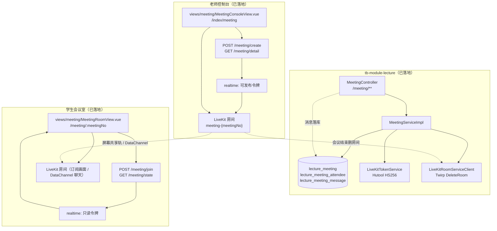

# doc-lecture · 智能课堂业务逻辑

> 项目：TrueBuddy ｜ 规范入口：[doc.md](./doc.md) ｜ 最近核对代码现状：2026-11-13
> 适用范围：**模拟会议（§3–§11，已落地）+ PPT 讲稿优化（§12，已落地）+ 数字人语音播报（§5.7，已落地：放映页本页播放并驱动口型）**；放映/会议 × 照读/AI 现场讲词的演讲体系为**规划**（§13，未落地）
> 实时通道实现：**自托管 LiveKit**（部署在仓库外的 `D:\ctf\livekit`），媒体与聊天都不经过本服务
> 相关：[doc-api.md](./doc-api.md)（会议/讲稿接口）、[doc-conventions.md](./doc-conventions.md)、[doc-integration.md](./doc-integration.md)（LiveKit / TTS 集成）、[doc-devops.md](./doc-devops.md)（LiveKit 部署）、[adr/](./adr/)（0001–0004）

---

## 1. 背景与目标

### 1.1 需求来源

| # | 需求原话（摘要） | 处置 |
| --- | --- | --- |
| 1 | 备注区 `remark` 优化：依据 PPT 数据做 AI 演讲稿优化 | **移到后续阶段**（见 §1.3） |
| 2 | AI 数字人：添加 AI 语音返回以及对口型 | **移到后续阶段**（见 §1.3） |
| 3 | 模拟会议：开启会议、生成会议链接、学生入会并可发消息提问 | **本期范围** |

### 1.2 本期范围（会议 MVP）

| 端 | 功能 |
| --- | --- |
| PPT 页（`/index/ppt`） | **创建会议（填标题）**：建会后本页进入放映——学生看到的就是这一屏，控制台另开一个标签页（见 §5.6） |
| 老师控制台（`/index/meeting?meetid=`） | 结束会议、复制入会链接、在线学生名单、学生聊天、**共享屏幕**、数字人播报 |
| 学生端 | 入会（点链接 → 弹窗输名字）、观看老师共享的画面、右侧聊天框、在线人数、会议结束提示 |
| 实时能力 | 一条 **LiveKit 房间连接**同时承载「屏幕共享视频轨」与「聊天 DataChannel」；成员与在线数取自房间事件 |
| 持久化 | 会议、参会人、消息落库；房间内的实时状态不落库（以 LiveKit 为准） |

### 1.3 后续阶段（本期不做，但已被确认要做的）

| 阶段 | 能力 | 与本期关系 |
| --- | --- | --- |
| 后续一 | PPT 演讲稿优化 —— **已落地，见 §12**（口径有调整：不做 pptx 上传与 `ppt_page` 落库，讲稿**就是页面的 `remark`**，接口无状态） | 已实现 |
| 后续二 | AI 数字人：TTS 配音 + Live2D 口型 + 会议内播报 + 数字人挂 `@Tool` 工具（翻页 / 播报 / 开关语音答疑 / 读学生反馈） | **依赖本期**的 LiveKit 房间；数字人语音可直接发布为 LiveKit 音频轨（不必再走 PCM over WS）。（**历史注记**：曾据此引入 Node worker 发布音频轨的方案，该方案已于 2026-10-10 整体废弃并删除——现行链路是放映页本页播报、声音随屏幕共享轨到学生端，见 §5.7） |

### 1.4 范围外（本期明确不做）

| 能力 | 不做的理由 |
| --- | --- |
| 共享音频（老师麦克风 / 系统声音） | 本期只做屏幕共享。数字人语音已落地（见 §5.7），但老师麦克风与系统声音仍不做：它与数字人轨会在同一条 `AudioSource` 上混播，且要改浏览器手势与权限动线 |
| 学生自主翻页 / 老师屏幕标注 | 学生看的是老师共享的画面，翻页天然跟随；标注按需再加 |
| 会中语音提问（ASR） | 学生端默认无语音能力；随数字人阶段一起做 |
| 会议录制回放 / 字幕导出 | 属会议产品完整形态；LiveKit 的 egress 本期不启用 |
| 踢人 / 禁言 / 主持转让 | 单机小规模演示场景，收益低 |

### 1.5 已确认决策

> 本表是后续设计与实现的约束。带「已作废」的条目表示被更晚的决策取代，避免按旧口径实现。

| 编号 | 议题 | 决策 |
| --- | --- | --- |
| Q8（首轮） | 参会方式 | 学生点链接后**弹窗输入名字**即入会，**免登录匿名** |
| Q14（首轮） | 学生端形态 | 同屏画面 + 右侧聊天框；**默认无语音能力** |
| Q19 / Q31（首轮） | 同屏方式 | **真·同屏**（同步老师画面），不做「只同步页码」 |
| Q22（首轮） | 老师端形态 | 老师**不参会**，是**控制台**：创建/结束会议、复制链接、在线名单、看聊天、发起共享 |
| Q30（首轮） | 模块落点 | 新建 `tb-module-lecture`，本期只实现其 `meeting` 包 |
| Q1（LiveKit） | 替换范围 | **媒体 + 聊天 + 成员状态全部搬到 LiveKit**；后端退化为「落库 + 签发令牌 + 删房间」 |
| Q2（LiveKit） | 部署形态 | **自托管 Docker**（`livekit/livekit-server`），不用 LiveKit Cloud（要求 wss + 外网） |
| Q3（LiveKit） | 演示网络 | **手机热点**（教师机 IP 每次可能变，因此地址一律运行时推导） |
| Q4（LiveKit） | 旧实现 | **删除**自建 WebSocket 媒体 / 聊天链路，不做双通道 |
| Q5（LiveKit） | 音频 | **先只做屏幕共享**；音频轨留给后续数字人阶段 |
| Q6（LiveKit） | 令牌签发 | 用项目已有的 Hutool **手写 HS256 JWT**，不引入官方 Kotlin SDK |
| Q7（LiveKit） | 房间与权限 | `room = meeting-{meetingNo}`；identity = `host` / `attendee-{id}`；老师 `canPublish=true`、学生 `false`、双方 `canPublishData=true`（**权限在服务端强制**） |
| Q8（LiveKit） | 聊天落库 | **前端双写**：DataChannel 负责实时，`POST /meeting/message` 负责历史 |
| Q9（LiveKit） | 成员/在线真相 | **以 LiveKit 房间事件为准**；DB 的 `online` 字段退化为历史，仅入会时置真、结束会议时统一置假 |
| Q10（LiveKit） | 结束会议 | 后端调 **`RoomService/DeleteRoom`** 删房间 → 房间内客户端立刻 `Disconnected`；学生端 10s 轮询 `/meeting/state` 兜底 |
| Q11（LiveKit） | 地址与令牌下发 | 新增配置 `tb.lecture.meeting.livekit-url`（留空按局域网 IP 推导）；`join`、`detail`、`state` **都返回** `realtime: { livekitUrl, livekitToken }`；令牌 6 小时、**不续期** |
| Q12（LiveKit） | 测试资产 | 删除三条自研分片断言；新增**后端 JUnit** 令牌签发回归（前端 `tests/` 不适合承载 JWT 逻辑） |
| Q13（LiveKit） | 部署落地 | 部署文件放仓库外的 `D:\ctf\livekit`；`node_ip` 走 `.env` 注入；UDP 收敛 `50000-50100`；镜像**钉版本** |
| Q14（LiveKit） | 可用性风险 | **接受**「会议全部实时能力押在 LiveKit 上」，但要求 ①动手前先过 5 分钟可行性试验 ②保留 `/meeting/state` 轮询作为降级残留 |
| ~~Q4（首轮）~~ | 同屏技术形态 | 已作废（被 LiveKit 取代） |
| ~~Q15（首轮）~~ | 模块命名 | 已作废（以 Q30 为准） |
| Q1（讲稿） | 范围 | 后端**无状态接口** + 前端两个按钮；**不做** pptx 上传解析与 `ppt_document` / `ppt_page` 落库 |
| Q2（讲稿） | 结果落点 | AI 结果**写回页面的 `remark`**（讲稿即备注）。早先设定的 `ppt_page.speech_script` + `source` 双模式**作废** |
| Q3 / Q12（讲稿） | 输入口径 | 每页送 `title` + 正文纯文本 + 现有备注；**全篇大纲**由后端从各页 `title` 拼；字段名沿用 `index` / `text` / `remark`，页码 1 基 |
| Q5 / Q9 / Q18（讲稿） | 请求形态 | **一次请求整篇**（`pages` 长度 1 即本页）；后端内部按 `batch-size` 分批调用模型——模型输出有 token 上限，整篇一次问会被截断 |
| Q4 / Q10 / Q20（讲稿） | 结果形态 | **对比弹窗**（左原 / 右新），不做直接覆盖、不做流式；整篇弹窗内**逐页勾选、默认全选** |
| Q6（讲稿） | 全量确认与回滚 | 跑之前确认一次；采纳后页面顶部给「**撤销本次优化**」入口（快照存内存，关闭提示即放弃撤销） |
| Q7 / Q15（讲稿） | 时长约束 | 工具栏「本场时长（分钟）」；后端按 `chars-per-second`（4.0 字/秒）与页数均摊出每页目标字数（换算**只在后端一处**） |
| Q8 / Q21（讲稿） | 按钮落点 | 备注区**右上角常显星形 AI 按钮**（本页）+ 工具栏「AI 优化全部备注」 |
| Q11 / Q13（讲稿） | 失败语义 | 部分失败**不报错**：响应带 `failedIndexes`；缺失页自动补跑一轮；仍失败可「只重试失败页」；仅全失败才整体报错 |
| Q14（讲稿） | 结构化输出 | prompt 内给死 JSON schema + 后端容错解析（剥代码块 / 定位数组），**不用** `response_format` |
| Q16（讲稿） | 并发与中止 | 跑批期间两个按钮 disabled；离开 PPT 页 `AbortController` 中止等待（**后端仍会把当前批次跑完**，无状态接口的固有代价） |
| Q17（讲稿） | 来源标记 | **不做** `remarkSource` 标记；单页弹窗内可「重新生成」，弹窗内保留原备注对照 |
| ~~Q9（LiveKit）~~ | 成员/在线真相 | **已被 ADR-0002 取代**：原口径是「DB `online` 退化为历史但保留列」；实际它同时被入会闸门和 `onlineCount` 读，两处都在谎报。现已**删掉 `online` 列**，参会表退化为纯台账（`join_time` / `leave_time`），在线只认房间事件 |
| Q1（生命周期修复） | 入会上限 | **作废** `max-attendees` 闸门与错误码 `1_007_000_005`（编号不复用），见 [ADR-0001](adr/0001-入会人数上限闸门作废.md)。不补心跳、不改问 LiveKit：单机演示场景收益低于其机制成本 |
| Q2（生命周期修复） | 主持人凭据找回 | **不提供**重签接口，见 [ADR-0003](adr/0003-主持人凭据不提供重新签发路径.md)：`/meeting/**` 免登录，任何按会议号重签都等于开放会议接管。同理**不做** `GET /meeting/list` |
| Q1（合并动线，2026-10-10） | 会议与 PPT 页的落点 | **合并在「动线层」，不是「页面层」**：建会入口搬到 PPT 页（工具栏「创建会议」），建会后**本页就是被共享的那一屏**（进会议总是从头讲）；控制台退化成「随会议一起打开的另一个标签页」，**自己不再建会**。依据：① 被共享的那个标签页装不下控制台——`.ppt-screen-view` 是 `z-index:9999` 的全屏覆盖层，同页的侧栏一定会被学生看到；② 改造前「控制台建会 → 新开放映页」这条路本身是坏的——`slides` 只活在当前标签页的内存里（`stores/slides.js` 初值 `mock/slides`，导入只 `setSlides` 到内存），新标签页放的是示例 PPT |
| Q2（放映页联动，2026-10-10） | 放映页与会议怎么联动（数字人口型） | **放映页以独立的只读身份 `presenter` 进房间**（`GET /meeting/present` 用主持人凭据换令牌）：口型由**同一条**数字人音频轨驱动——学生的声音就来自那条轨，只有同源才可能同步；**不**让控制台把响度广播过来（那要求控制台标签页始终不被浏览器节流）。**本轮不做翻页遥控**（那要先把页码回传通道用起来）；「开始演讲」只是一个**开始信号**，本轮内容固定 mock，详见 §5.7 |

---

## 2. 现状盘点

### 2.1 可复用资产

| 资产 | 位置（现状） | 用途 |
| --- | --- | --- |
| 统一返回与异常 | `tb-framework/tb-common` 的 `CommonResult<T>`、`ServiceExceptionUtil.exception(...)` | 全部 REST 接口 |
| 鉴权与放行 | `tb-spring-boot-starter-security`；`application.yml` 的 `tb.security.permit-all-urls` | 学生入会页与会议接口免登录 |
| 工具库 | `tb-common` 依赖 `cn.hutool:hutool-all` 5.8.47（含 `cn.hutool.jwt.JWT`） | 手写 LiveKit 令牌、Twirp HTTP 调用 |
| 前端 axios 层 | `frontend/src/api/index.js`（`baseURL: /api`、自动解包 `CommonResult`） | `api/meeting.js` |
| 前端布局与菜单 | `views/IndexView.vue` 的 `menuGroups`、`views/index/components/SidebarIcon.vue` | 控制台入口与图标 |
| 前端路由 | `src/router/index.js` | `/index/meeting`、`/meeting/:meetingNo` |
| 数据库规范 | `sql/` 一表一脚本、注解 Mapper 无 XML | 三张会议表 |
| **LiveKit 部署** | 仓库外 `D:\ctf\livekit`（`docker-compose.yml` / `livekit.yaml.template` / `start.ps1` / `make-token.mjs` / `gate/` 验证页） | 实时通道运行时 |

### 2.2 缺口矩阵

| 能力 | 现状 | 缺口 |
| --- | --- | --- |
| 会议模型 | 三张表 + 6 个接口已落地 | 无 |
| 访问令牌签发 | `livekit/LiveKitTokenService`（Hutool HS256） | 无（9 条 JUnit 用例锁定） |
| 房间管理 | `livekit/LiveKitRoomServiceClient`（Twirp `DeleteRoom`） | 无（已在真实服务端验证） |
| 屏幕共享 | 老师端 `setScreenShareEnabled` / 学生端订阅 attach（`hooks/useLiveKitRoom`） | **尚未在真实浏览器联调**（见 §9.1 状态列） |
| 聊天实时 | LiveKit DataChannel（RELIABLE） | 同上 |
| 聊天历史 | `POST /meeting/message` + 双写重试一次 | 前后不一致只影响历史（已知取舍） |
| 学生端「会议已结束」 | 房间被删 → `Disconnected` + 10s 轮询 `/meeting/state` | 无 |

### 2.3 现状 / 规范要求 / 待整改

| # | 位置 | 现状 | 规范要求 | 待整改动作 |
| --- | --- | --- | --- | --- |
| 1 | 错误码分段 | `1_001`–`1_006` 已占用；`1_004` 被 `homework` 与 `doctemplate` 重复使用 | 各模块独占分段 | 本模块取 `1_007_000_xxx`；`1_004` 冲突作为既有问题记录，不在本期修 |
| 2 | 前端路由守卫 | `docs/06` §4 规划了 `meta.requiresAuth`，代码未落地 | 同左 | 学生入会页 `/meeting/:meetingNo` 必须免登录；引入守卫时需把它列入白名单 |
| 3 | 前端数字人描述 | `frontend/AGENT` §12 记为「源码尚未接入，数字人为占位」 | 同左 | 与实际不符（`views/ppt/index.vue` 已初始化 Live2D）；属后续阶段 |
| 4 | `/test2/read-pptx` | 硬编码本地路径的验证接口 | 无 | 属后续「演讲稿」阶段：迁到 `tb-module-lecture` 的 `ppt/` 包 |
| 5 | 明文密钥 | 对话 / 向量化 `api-key` 仍为明文默认值 | `docs/08` §1.1 | 既有待整改项；本次新增的 `LIVEKIT_*` 一律 `${VAR}` 注入，不引入新明文 |

---

## 3. 总体架构

> 下图是当前形态。**后端不参与实时转发**：媒质与聊天都在 LiveKit 上，后端只签发令牌与删房间。



---

## 4. 数据模型

| 表 | 关键字段 | 说明 |
| --- | --- | --- |
| `lecture_meeting` | `id` / `meeting_no`(6 位，唯一) / `title` / `host_token` / `status`(1 进行中 / 2 已结束) / `start_time` / `end_time` / `planned_minutes`(空列) / `document_id`(空列) / 公共列 | 后两列为后续演讲稿阶段预留 |
| `lecture_meeting_attendee` | `id` / `meeting_id` / `nickname` / `attendee_token` / `role` / `join_time` / `leave_time` / 公共列 | **累计入会台账**，`online` 列已删；`leave_time IS NULL` 只表示「尚未显式离开」，不得当作在线（ADR-0002） |
| `lecture_meeting_message` | `id` / `meeting_id` / `attendee_id` / `nickname` / `role` / `content` / `kind`(1 文字) / 公共列 | `kind` 为后续语音转写 / 数字人发言预留 |

脚本：`sql/lecture_meeting.sql`、`sql/lecture_meeting_attendee.sql`、`sql/lecture_meeting_message.sql`（需手工执行）。

---

## 5. LiveKit 集成

### 5.1 部署（仓库外 `D:\ctf\livekit`）

| 文件 | 作用 |
| --- | --- |
| `.env` | `LIVEKIT_API_KEY` / `LIVEKIT_API_SECRET`（**必须与仓库根 `.env` 同一对**）、`LAN_IP`（可留空自动探测）、`LIVEKIT_IMAGE`、`GATE_PORT` |
| `livekit.yaml.template` | 配置模板：`rtc.node_ip` 显式注入、`use_external_ip: false`、UDP 收敛 `50000-50100`、TCP 兜底 `7881`、`room.auto_create/empty_timeout=300/max_participants=20` |
| `start.ps1` | 读 `.env` → 探测 WLAN 网卡 IP（排除 WSL/VMware 虚拟网卡）→ 生成 `livekit.generated.yaml`（**无 BOM**，否则 YAML 解析失败）→ `docker compose up -d` → 打印手机访问地址；`-Stop` 停止。**已知缺陷：容器已在跑时 `up -d` 不会重启它，而 LiveKit 只在启动时读配置 —— 换了 IP 必须再执行 `docker compose restart` 才生效（待整改：脚本内检测到 `node_ip` 变化时自动 restart）** |
| `docker-compose.yml` | `livekit-server:v1.9.12`（**钉版本**；Docker Hub 直连不可用，镜像走 `docker.m.daocloud.io`） |
| `make-token.mjs` | 手动签发令牌（Node 内置模块），**同时是后端 Java 实现的参照口径** |
| `gate/` | 5 分钟可行性验证页（老师共享 / 手机观看）与一个静态服务器（`serve.mjs`，含 `/token` 代签端点） |

> 演示前必做：重跑 `start.ps1`（热点 IP 每次可能变），它会把新的手机访问地址打印出来。**并且必须紧跟 `docker compose restart`**，否则容器仍在用旧的 `node_ip`。核对方式：`docker logs livekit-server | grep starting` 里的 `nodeIP` 应等于当前 WLAN 地址——2026-10-09 就出现过 `node_ip` 停留在已失效的 `172.16.209.195`、而客户端连的是新 IP，结果是信令 200、媒体连不通（黑屏）。

### 5.2 访问令牌（后端签发）

`livekit/LiveKitTokenService`（Hutool `JWT.create()` 手写 HS256），claims 口径：

| claim | 值 | 说明 |
| --- | --- | --- |
| `iss` / `sub` / `jti` | API Key / 身份 / 身份 | 身份为 `host`、`attendee-{id}`、`server` |
| `name` | 昵称 | LiveKit 的显示名，前端直接可用 |
| `metadata` | `{"role":1\|2,"nickname":"…"}` | 前端据此区分师生 |
| `nbf` / `exp` | 当前 −10s / +6h | 允许时钟偏差；**不续期** |
| `video` | `roomJoin` / `room` / `canPublish` / `canSubscribe` / `canPublishData` | 老师可发布、学生只能订阅；聊天需 `canPublishData` |
| `video`（服务端令牌） | `roomAdmin` / `roomList` / `roomCreate` | 供 `DeleteRoom`（`roomList` 用于诊断） |

**已在真实服务端验证**：`ListRooms` + Java 令牌 → 200；`DeleteRoom` + Java 令牌 → 404（房间不存在，非 401，说明授权通过）；学生级令牌调 `ListRooms` → 401。

### 5.3 接口与响应变化

| 方法 | 路径 | 变化 |
| --- | --- | --- |
| `POST` | `/meeting/create` | 不变（返回会议号、入会链接、主持人凭据） |
| `POST` | `/meeting/join` | 新增 `realtime`（学生只读令牌）；**LiveKit 未配置时直接拒绝**（错误码 `1_007_000_010`） |
| `GET` | `/meeting/detail` | 新增 `realtime`（老师可发布令牌）；未配置时为 `null`（控制台仍可看历史） |
| `GET` | `/meeting/state` | 新增 `realtime`（学生只读令牌）——刷新后仍能连上房间 |
| `POST` | `/meeting/message` | **新增**：聊天落库（`meetingNo` + `attendeeToken`/`hostToken` + `content`） |
| `GET` | `/meeting/present` | **新增**：放映页实时接入（`meetingNo` + `hostToken`）→ 只读的 `presenter` 令牌，供被共享的那一屏订阅数字人音频轨驱动口型（见 §5.7）；LiveKit 未配置时抛 `1_007_000_010` |
| `POST` | `/meeting/close` | 行为扩展：置为已结束 → **删 LiveKit 房间**（best-effort，404 视为成功） |

### 5.4 前端房间客户端

`views/meeting/hooks/useLiveKitRoom.js`（控制台 / 学生会议室 / 放映页三处共用，差异在令牌与两个开关 `omitHost` / `muteAgentAudio`）：

| 能力 | 实现 |
| --- | --- |
| 连接 | `connect(realtime)` → `new Room({adaptiveStream, dynacast})` + `room.connect(url, token)` |
| 屏幕共享（老师） | `localParticipant.setScreenShareEnabled(true, { audio: false, selfBrowserSurface: 'exclude', surfaceSwitching: 'include' })`；本端预览由 `LocalTrackPublished` attach。共享由**控制台**发起，`selfBrowserSurface: 'exclude'` 把控制台自己从候选里去掉，共享目标收敛到老师创建会议的那个 PPT 放映页（见 §5.6） |
| 观看（学生） | `TrackSubscribed`（source = ScreenShare）→ `track.attach(videoEl)`；`TrackUnsubscribed` → `detach()` |
| 聊天 | `publishData(bytes, { reliable: true })`；接收 `DataReceived` → 归一化事件；**发送方本地先渲染**（DataChannel 不回包给自己） |
| 成员与在线 | `ParticipantConnected/Disconnected/MetadataChanged` → 由 `remoteParticipants` 重建名单；**控制台带 `omitHost`**，老师自己不进名单也不计入人数（Q22） |
| 事件契约 | **与旧自建通道同名**（`chat.message` / `attendee.joined` / `attendee.left` / `screen.start` / `screen.stop`），因此 `stores/meeting.js` 的 `applyEvent` 与展示组件未改动 |

聊天**双写**：`sendChat()` 对两条路**各自记账**，返回 `{ delivered, persisted }`；DataChannel 广播失败（房间没连上 / 数据通道未就绪）**不再吞成静默失败**，照旧尝试 `POST /meeting/message` 落库（失败重试一次），由两页共用的 `describeChatSend()` 译成一句提示。历史落库失败只提示「未写入历史」，不影响实时。

### 5.5 结束会议的通知路径

1. 老师点「结束会议」→ `POST /meeting/close` → 后端置 `status=2` 并 `DeleteRoom`；
2. 房间被删 → 房间内所有学生立刻收到 `Disconnected`；
3. 兜底：学生端每 10s 轮询 `GET /meeting/state`，`status=2` 即展示「会议已结束」。

**学生端这条轮询的取用口径**（它不是聊天通道，聊天走 DataChannel）：

| 情况 | 行为 |
| --- | --- |
| 老师端 | **不轮询**：会议是老师自己结束的；万一被别处结束，房间被删后客户端会收到 `Disconnected`，此时 `syncEndedState()` 调一次 `/meeting/detail` 确认 |
| 学生端 / 实时通道在线 | 轮询只读 `meeting.status` 兜底「已结束」；**不**用返回值覆盖成员与消息（那是 LiveKit 的事实），也不触发 `loading`（否则聊天面板每 10s 闪一次骨架） |
| 学生端 / 实时通道不在线 | 轮询只降级成**聊天**通道：把库里的最近消息铺回来。宁可晚 10s 看到，也不要「什么都不更新」。**成员名单不铺**——台账含「尚未显式离开」的崩溃残留，列出来就是谎报，改为直接说明「暂时拿不到在线成员」 |
| 学生端 / 轮询失败 | **不静默**：页面顶部给出「会议状态同步失败」提示（静默失败会让现象变成「聊天不更新且没有结束提示」，无从排查） |

### 5.6 共享动线：PPT 页建会 → 本页进放映 → 控制台另开标签页 → 老师手点共享

老师端的角色分工是「PPT 页放 + 控制台讲」，因此**创建会议这一步发生在 PPT 页**：

1. 老师在 `/index/ppt` 导入 PPT、用 AI 优化好讲稿，点工具栏「创建会议」→ 弹窗填标题（这一步点击是整条动线里**唯一一次用户手势**）；
2. 点「创建并开始」时，在**点击的同步流程里**先 `window.open('about:blank', '_blank')` 占位一个空闲页签（`await` 之后再 `window.open` 会被浏览器弹窗拦截器拦掉）；已存在的控制台页签直接复用；
3. `POST /meeting/create` 成功后依次做三件事：把 `{ ...created, title }` 写进 `localStorage`（`tb-meeting-host:{会议号}`，见 `src/utils/hostSession.js`）→ 本页 `document.title` 改成「PPT 放映页」并 `enterScreeningFromStart()`（固定从第一页开始，与「进会议总是从头讲」一致）→ 把占位页签导航到 `/index/meeting?meetid={会议号}&credential=1`；
4. 浏览器会把新开的控制台标签页切到前台：老师在那里看到**「请保存主持人凭据」提示条**（`credential=1` 只用于这一次提示，控制台读完参数即把它从地址栏摘掉）与「开始共享」按钮；
5. 老师点「开始共享」→ 在选择框里选中「PPT 放映页」标签页 → 学生端订阅到屏幕共享轨后 attach 到 `<video>`。

**为什么被共享的是 PPT 页，而不是控制台**：

- 控制台要显示名单与聊天，而 `.ppt-screen-view` 是 `z-index:9999` 的全屏覆盖层 —— 两者放同一个标签页，学生一定会看到控制台 UI；
- 反过来（改造前：控制台建会 → 新开 `/index/ppt?screen=1`）也不行：放映页是**另一个 JS 上下文**，`slides` 只活在当前标签页的内存里（`stores/slides.js` 初值是 `mock/slides`，导入只 `setSlides` 到内存、全仓无持久化），共享出去的其实是示例 PPT。

**硬约束（不要试图绕过）**：

- 浏览器规定 `getDisplayMedia` 必须由**用户手势**触发，而第 2 步的 `window.open` 已经用掉一次手势 → 建会流程**不再尝试自动共享**（`tryAutoShare` 已删除），「开始共享」必然是一次真实点击；且「选择共享源」在任何浏览器里都不能由脚本代选。
- 放映页进入放映时同样没有用户手势 → **自动全屏也会被拒绝**（`enterFullscreen` 已吞掉该 Promise 拒绝），需要真全屏时点放映工具条上的全屏按钮或按 F11。
- 若共享的是**整个屏幕**而不是放映页标签页，学生看到的会带上控制台/桌面；因此控制台的占位提示写明「选中『PPT 放映页』标签页」。
- `selfBrowserSurface: 'exclude'` **必须保留**（不要改成 `'include'` 或加 `preferCurrentTab`）：共享是从控制台发起的，这条正好把控制台自己从候选里去掉，让老师只能选到放映页。
- 控制台标签页被浏览器拦掉时**整件事失败**（本页不进放映）：否则提示会压在覆盖层下面，老师什么也看不到。

### 5.7 讲稿播报：声音随共享轨，口型由本页播放驱动

**一句话**：后端把讲稿合成为 PCM，以 SSE 流回**放映页本页**；本页播放它，并用**正在播的这条音频**驱动口型。这一页正被屏幕共享，**学生听到的声音就是共享轨里的声音** —— 声画同源，不存在「两条独立链路对不齐」。

```text
PPT 页(放映态) --POST /ppt/speech/speak--> tb-module-lecture
      ^                                        │ CosyVoice 流式合成（48kHz/单声道/16bit）
      └── SSE: status / chunk(base64 PCM) / error ┘
      │
      ├─ 播放：WebAudio 逐片排期（views/ppt/utils/speech-player.js）
      ├─ 口型：同一 AudioContext 上取逐帧响度 → ParamMouthOpenY
      └─ 被屏幕共享（audio: true）──> 学生端 <audio>（screen_share_audio 轨）
```

| 项 | 口径 |
| --- | --- |
| 接口 | `POST /ppt/speech/speak`（与讲稿生成同控制器、同口径：`/ppt/**` 免登录）。事件 `status`（started/done）、`chunk`（base64 的 48kHz 单声道 16bit PCM）、`error`；事件流建立前校验失败时返回普通 JSON 错误体 |
| 播放 | `views/ppt/utils/speech-player.js`：`AudioContext({ sampleRate: 48000 })` + 逐片排期的 `AudioBufferSourceNode`；分片切在采样中间时留一个字节进位；`stop()` 掐掉已排期与队列里的全部音源 |
| 口型 | 同一个 AudioContext 上取**逐帧瞬时响度** → `mouthLevel` → `writeMouthOpen`。口型跟的就是学生正在听的那条音频，**不可能不同步** |
| 声音怎么到学生端 | 屏幕共享开 `audio: true`（共享**这一页的声音**）；学生端把 `screen_share_audio` 轨 attach 到隐藏 `<audio>`。**共享框里音频勾选被取消 = 学生听不到**，只能重新共享一次 |
| 触发 | ① 控制台「开始演讲 / 停止演讲」→ `BroadcastChannel('tb-meeting:{会议号}')` **单向**发指令（控制台 → 放映页）；② 本页工具栏「试听本页」（彩排用，不需要会议，念的是备注区草稿）。**翻页仍由本页自己说了算**（页面真相只有一个） |
| 取消 | 「停止」= 前端 `AbortController.abort()`：请求一断，后端写入失败 → 合成侧 `streamingCancel()`，本页同时安静。**不需要** `say/cancel` 这类额外接口 |
| 落库 | 请求带齐 `meetingNo + hostToken`（本页从 `?meetid=` 与 `localStorage` 取）时，内容以数字人身份落 `lecture_meeting_message`（`kind=2`）；彩排试听不落库 |
| 名单 | 房间里**不再有**数字人 / 放映页这类非人身份，名单与人数就是房间成员（`utils/attendees.js` 只做 `omitHost`） |
| 彩排 vs 开会 | 同一段代码、同一个接口，差别只在「那一页有没有被共享」：共享了，声音就到学生端 |

**为什么删掉 worker 中继那一套**（此前版本：`presenter` 身份 + `GET /meeting/present` + Node `digital-human-worker/`）：

1. **声音的终点本来就该是被共享的那一页**：中继一圈（后端 → worker → 房间音频轨）多一个进程、多一份要同步的配置、多一条会挂的链路 —— 而「进程没跟上配置」正是那条链路上最典型的一类故障。
2. **口型与声音不可能对不上**：口型不再依赖「订到同一条远端轨」，而是直接量本页正在播的音频。
3. **取消变得免费**：断流即取消合成，不再需要 `DELETE /say/{id}` 与 worker 的 `clearQueue`。
4. **代价**：① 共享时必须带上「这一页的声音」（浏览器默认勾选，脚本不能代选）；② 学生端不再有一个独立的数字人形象 —— 形象只存在于老师共享的画面里；③ 后端同时活跃的播报数上限沿用 `max-concurrent-speak`（超出的排队）；④ **播放需要那一页被用户激活过**：浏览器规定 `AudioContext` 在页面拿到过用户手势前只能挂起，因此**刷新过放映页之后**要先在该页点一下任意处，否则控制台发来的播报会「念了但没声音」（本轮不加 UI 提示，看到学生没声音先想起来这一条）。

**控制台的「开始演讲」仍是开始信号**：本轮内容固定为 mock（`MOCK_LECTURE_TEXT = '你好'`），下一轮换成「放映页念当前页 `remark`」（§13 A 段）或 AI 现场讲词（B 段）—— **信号本身不变**，只换取文本那一步。控制台的「数字人播报」手输框保留，作为多源 / 长文本入口。

**放映页怎么知道会议号**：建会成功时把地址写成 `/index/ppt?screen=1&meetid={会议号}`（`router.replace`），刷新与重新打开这条链接都能恢复；本页据此挂上这一场的播报总线。会议号不是秘密；`hostToken` 仍只落在 `localStorage`（`src/utils/hostSession.js`），**永不进 URL**。

---

## 6. 屏幕共享：为什么是 LiveKit

原先评估过三种自研传输方案（WebRTC 点对点 / MediaRecorder+WS 中转+MSE / 逐帧抓图），并实现过第二种。实测结论：**自研链路在「分片顺序」与「延迟」上都要自己兜**（分片必须严格按序交付，否则花屏；播放器要主动追平直播边缘，否则延迟越积越大）。

改用 LiveKit（Apache-2.0 SFU）后：

| 项 | 自研（已删除） | LiveKit |
| --- | --- | --- |
| 传输 | WS 二进制帧 + 服务端转发 + 初始化段缓存 | SFU 转发（UDP/TCP 自适应） |
| 顺序 | 自己保证（交付链 FIFO） | 框架保证 |
| 延迟 | 需三档追边（微加速 / 跳帧） | 百毫秒级，无需干预 |
| 权限 | 前端自觉 | **令牌在服务端强制**（学生 `canPublish=false`） |
| 音频 | 未做 | 加一条轨即可（后续数字人复用） |
| 代价 | 零新增依赖 | 多一个运行时进程（Docker）+ 依赖 UDP 可达 |

**换来的删除量**：前端 `utils/meeting-ws.js`、`utils/screen-share.js`（约 150 行）与后端 WebSocket 四件套 + `spring-boot-starter-websocket`（约 40 行），以及全部三档延迟调参。

---

## 7. 前端落点

| 落点 | 说明 |
| --- | --- |
| `views/ppt/index.vue` | PPT 编辑器 / 放映页，**也是会议入口**：工具栏「创建会议」（弹标题）→ 建会 → 地址写成 `?screen=1&meetid={会议号}` → **本页进入放映**（`document.title` 改成「PPT 放映页」）→ 控制台另开标签页（`handleCreateMeeting` / `consoleUrl`，详见 §5.6）。放映态下用 `usePresenterRoom` 进房间、把 `mouthLevel` 写进本页 Live2D（`writeMouthOpen`，见 §5.7）。同页还有 `?screen=1` 的一次性进放映入口与 AI 备注优化 |
| `views/meeting/MeetingConsoleView.vue` | 老师控制台（`/index/meeting?meetid={会议号}`）：复制链接、成员、聊天、共享、数字人播报、结束会议。**它是「创建会议才有的」页面**：不带 `?meetid=` 是空态（提示去 PPT 页创建 + 列出本机还留着凭据的会议），**自己不建会、也不开放映页**。刷新 / 复制 / 另开标签页都能恢复（`watch` + `restoreFromQuery`）。代价是**同一场会议不要同时开两个控制台标签页**——LiveKit identity 相同，后连的会把前一个踢掉 |
| `src/utils/hostSession.js` | 主持人会话的本地存取（`tb-meeting-host:{会议号}`，**结束会议即删**；旧键 `sessionStorage:tb-meeting-host` 在首次进入控制台时一次性迁移）。放在 `src/utils/` 而不是某个模块目录下，因为它是 **PPT 页（建会时写）与控制台（打开时读）共用**的 |
| `views/meeting/MeetingRoomView.vue` | 学生会议室（`/meeting/:meetingNo`，独立路由、无布局、免登录）：弹窗输名字入会、看画面、右侧聊天；10s 轮询兜底会议结束 |
| `views/meeting/hooks/useLiveKitRoom.js` | 房间客户端（见 §5.4） |
| `views/meeting/hooks/usePresenterRoom.js` | 放映页的房间客户端：presenter 身份、静音订阅数字人音频轨、只暴露口型响度（见 §5.7） |
| `views/meeting/components/` | `NicknameDialog`、`AttendeeList`、`ChatPanel`、`ScreenStage`（纯展示 + `defineExpose({videoRef})`，轨的 attach 由 hook 驱动） |
| `views/meeting/stores/meeting.js` | Pinia store：会议信息、成员、消息、共享与连接状态、`applyEvent` |
| `src/api/meeting.js` | REST 封装（含 `sendMeetingMessage`） |
| 路由与菜单 | `src/router/index.js` 两条路由；`views/IndexView.vue` 菜单「模拟会议」；`SidebarIcon` 的 `meeting` 图标 |

---

## 8. 影响面与文档同步清单

### 8.1 代码影响面

| 改动点 | 内容 |
| --- | --- |
| `backend/pom.xml` / `tb-server/pom.xml` | 新增 `tb-module-lecture` |
| `application.yml` | 白名单加 `/meeting/**`；新增 `tb.lecture.meeting.*`（含 LiveKit 四项）；**不引入** WebSocket starter |
| 仓库根 `.env` / `.env.example` | 新增 `LIVEKIT_API_KEY` / `LIVEKIT_API_SECRET`（与 `D:\ctf\livekit\.env` 同一对） |
| 前端依赖 | 新增 `livekit-client`（cnpm 安装）；`vite.config.js` 的 `optimizeDeps.include` 同步加入 |
| 前端路由 / 菜单 / 图标 | 2 条路由、1 个菜单项、1 个图标 |
| 删除 | 后端 WebSocket 四件套 + `MeetingWebSocketConfig`；前端 `utils/meeting-ws.js`、`utils/screen-share.js`；`tests/repro-meeting-screen-share-order.test.js` |

### 8.2 文档同步清单（本次已执行）

| 变更 | 已同步 |
| --- | --- |
| 接口增删与白名单 | [doc-api.md](./doc-api.md)（接口清单、放行规则、前端 API 层表） |
| 路由与安全对应 | [doc-conventions.md](./doc-conventions.md)（路由表、映射前缀、安全对应） |
| 模块与目录 | [doc-conventions.md](./doc-conventions.md)（模块表、前端目录） |
| 环境变量 | [doc.md](./doc.md) §4（实时通信改为 LiveKit）、根 `.env.example` |
| 依赖 | [doc.md](./doc.md) §4（前端加 `livekit-client`；后端实时通道一行改写） |
| 子规约 | [../backend/AGENT - 后端技术规约.md](../backend/AGENT%20-%20后端技术规约.md)（技术栈、模块、接口表、实时通信） |

---

## 9. 落地情况

### 9.1 本期四步

| 步骤 | 内容 | 状态 |
| --- | --- | --- |
| 门禁 | `D:\ctf\livekit` 起服务 + 手机连上看到画面 | **已通过**（实测：手机热点下画面正常，延迟可接受） |
| M1 | 新模块 + 三张表 + `create/join/detail/state/close` 五个 REST + 错误码 + 白名单 | 已落地，待联调（需先执行建表脚本） |
| M2 | LiveKit 令牌签发 + 房间管理（`DeleteRoom`）+ `/meeting/message` | 已落地；**令牌与房间管理已在真实服务端验证** |
| M3 | 前端房间客户端、屏幕共享、聊天 DataChannel、成员取自房间事件 | 已落地，**待真实浏览器联调** |
| M4 | 删除自建 WS / MSE 链路与过时测试 | 已完成（14 模块编译通过、后端 9/9 测试通过、前端 ESLint 干净） |
| M5 | 生命周期修复：入会上限作废、`/meeting/leave`、删 `online` 列、在线只认房间事件、预留列清理 | 已落地（`./mvnw -pl tb-module-lecture -am test` **35/35**、前端 `attendees.test.js` 5/5、oxlint + eslint 干净、`vite build` 通过）；**在线名单实时性仍需真实浏览器联调** |
| M6 | 会议两页 UI 与错误修复：抽 `MeetingTopBar`、连接态色调统一、控制台名单不含老师、降级不列名单、会议室 `100dvh` + 小屏分段切换、Token 违规清零 | 已落地（`attendees.test.js` **6/6**、oxlint + eslint 干净、`vite build` 通过）；**小屏与共享态仍需真机/真实浏览器验收** |
| M7 | **会议入口搬进 PPT 页**（§5.6）：`/index/ppt` 工具栏「创建会议」→ 建会后本页进放映（被共享的就是这一屏）→ 控制台另开一个标签页并带 `?meetid=&credential=1`；控制台交出建会权、删掉 `reserveScreeningTab` / `openScreeningTab` / `tryAutoShare`，空态改为「会议在 PPT 页创建」+ 本机还留着凭据的会议列表；主持人会话存取抽到 `src/utils/hostSession.js` | 已落地（前端 **174/174**、ESLint + oxlint 干净、`vite build` 通过）；**共享动线仍需真实浏览器验收**，见 §11.2 |
| M8 | **放映页联动数字人口型**（原 §5.7）：后端 `presenter` 身份 + `GET /meeting/present`；前端 `hooks/usePresenterRoom.js` + `useLiveKitRoom` 的 `muteAgentAudio`；PPT 页放映态进房间并把 `mouthLevel` 写进本页 Live2D | **已被 M9 取代并回滚**：`presenter` 令牌、放映页进房间、订阅远端音频轨这一整套随 worker 一起删除 |
| M9 | **讲稿播报改成「本页播放 + 共享带声音」**（§5.7）：后端新增 `POST /ppt/speech/speak`（SSE、`chunk` 为 base64 PCM、断连即取消合成），删除 Node `digital-human-worker/` 与 `say` / `present` / `status` 的 worker 探测；前端新增 `views/ppt/utils/speech-player.js`（WebAudio 排期播放 + 逐帧响度驱动口型），PPT 页接 `BroadcastChannel` 播报总线并加「试听本页」，控制台改为「开始/停止演讲」发指令，共享开 `audio: true`、学生端 attach `screen_share_audio`；`utils/agentAudio.js`、`hooks/usePresenterRoom.js`、`components/DigitalHumanAvatar.vue` 删除，`utils/workflow-sse.js` 收成通用 `utils/event-stream.js` | 已落地（后端 **47/47**、前端 **178/178**、ESLint + oxlint 干净、`vite build` 通过）；**声音与口型必须真机验收**，见 §11.2 |

### 9.2 后端测试

- `LiveKitTokenServiceTest`（9 条）：JWT 结构（三段 / base64url 无 padding / HS256 头）、**用独立实现的 HMAC 复算签名**、老师/学生/服务端三类令牌的字段级断言、有效期与时钟偏差、未配置时的行为、信令地址推导；另有 `-DlivekitProbe=true` 探针用于对着真实服务端验收。
- `LanAddressUtilsTest`（6 条）：局域网 IPv4 探测（热点换 IP 时信令地址跟着走）。
- **`MeetingServiceImplTest`（7 条，M5 新增）**：Mockito mock 三个 mapper，**不启 Spring 上下文、不连库** —— 全仓没有独立测试库，而 [doc-conventions.md](./doc-conventions.md) §2.2 禁止污染 `tb` 生产库。锁的行为：台账 25 行仍可入会（闸门回归锁）、离会幂等与两类凭据错误、`close` 走 `markAllLeft`、响应 VO 里 `online` / `onlineCount` 字段已消失。
  **已知盲区（必须知道）**：mock 掉 mapper 意味着 **SQL 文本本身没被测过** —— `WHERE leave_time IS NULL`、`deleted = FALSE`、删列后的建表脚本都只由 §11.2 的手工联调 + 逐字 review 兜住。

```bash
cd backend && ./mvnw.cmd -o -pl tb-module-lecture -am test   # 35/35
cd frontend && node --test tests/attendees.test.js            # 6/6（在线名单取值：不含老师、降级不列）
cd frontend && npm test                                       # 159/160（1 条既有 workflow 用例失败，与本期无关）
```

### 9.3 后续阶段（语音链路现状见 §5.7；演讲体系规划见 §13）

| 阶段 | 目标 | 状态 |
| --- | --- | --- |
| ~~后续一~~ | ~~PPT 演讲稿优化~~ | **已落地，见 §12** |
| 后续二 · 语音链路 | CosyVoice 流式合成 PCM → `POST /ppt/speech/speak`（SSE）→ 放映页本页播放并驱动口型，声音随屏幕共享轨到学生端（原 Node worker 方案已废弃删除） | **已落地（2026-10-10 重构）**，见 §5.7 |
| 后续二 · 跟页播报 | 放映 / 会议两种形态 × 照读 / AI 现场讲词四种组合；页码总线、串行播报队列、可取消、试听通路 | **规划中，工程化设计见本文 §13**（本文 §1.4 的「共享音频」一项已被它细化为「画面继续走屏幕共享 + 数字人轨出声」） |
| 后续二 · `@Tool` 编排 | LLM 决定翻页 / 播报 / 开关答疑 | 规划（§13 D 段，需先出 ADR） |

---

## 10. 风险与降级策略

| # | 风险 | 影响 | 降级 / 缓解 |
| --- | --- | --- | --- |
| 1 | **手机热点开客户端隔离** | 学生与教师机互相不可达 → 整个实时能力失效 | 已过门禁试验（当前热点可用）；换环境需重跑 `gate/` 验证页 |
| 2 | **热点 IP 变化** | 学生打开的链接与 LiveKit 地址失效 | 地址一律运行时推导；演示前重跑 `start.ps1`（会打印新地址） |
| 3 | **Windows 防火墙未放行 UDP 50000-50100** | 连上信令但黑屏 | 以管理员执行 `New-NetFirewallRule`（命令见 `start.ps1` 输出）；`7881/TCP` 为兜底 |
| 4 | Docker Desktop 的 WSL2 NAT 转发 UDP 异常 | 同上 | 退路：改用 GitHub 的 Windows 原生二进制（`livekit_1.13.9_windows_amd64.zip`）直接跑，绕开容器网络 |
| 5 | `getDisplayMedia` 需安全上下文 | 老师端无法共享 | 老师端固定用 `http://localhost` 打开控制台（学生端只订阅，不受限） |
| 6 | LiveKit 未启动 / Key 不匹配 | 入会被明确拒绝（`1_007_000_010`）或连不上房间 | 错误码与日志给出原因；`.env` 两处凭据必须同值 |
| 7 | `DeleteRoom` 失败 | 学生端不会立刻收到结束通知 | best-effort + 10s 轮询 `/meeting/state` 兜底；房间也会被 `empty_timeout` 回收 |
| 8 | 聊天双写不一致 | 实时看到但历史缺一条 | 失败重试一次 + 页面提示；历史以 `state` 为准 |
| 9 | 令牌 6 小时过期、不续期 | 长会议中途断连 | 本场景不存在；`state` / `detail` 每次返回新令牌 |
| 10 | 学生昵称重名 | 名单混乱 | 后端同会议内自动加后缀 `(2)`；LiveKit identity 用 `attendee-{id}` 保证唯一 |
| 11 | 消息表增长 | 单库体积与查询变慢 | 消息随会议删除级联；历史条数有上限 |

---

## 11. 验收方式

### 11.1 质量门禁

```bash
cd backend && ./mvnw.cmd clean install          # 全模块编译打包
cd backend && ./mvnw.cmd -pl tb-module-lecture test
cd frontend && npm run lint                     # 注意：既有 tests/repro-iteration-reattach.test.js 有一条未使用变量告警
```

### 11.2 手工联调步骤

| # | 步骤 | 通过标准 |
| --- | --- | --- |
| 0 | **（已建过库的机器先执行）** `ALTER TABLE lecture_meeting DROP COLUMN IF EXISTS planned_minutes, DROP COLUMN IF EXISTS document_id;` `ALTER TABLE lecture_meeting_attendee DROP COLUMN IF EXISTS online;` `DROP INDEX IF EXISTS idx_lecture_meeting_create_time;` —— 全仓无 flyway/liquibase，建表脚本只对新库生效 | 各条语句均返回 `DROP`/`NOTICE`，无报错 |
| 0 | 执行三张建表脚本；启动 LiveKit（`D:\ctf\livekit\start.ps1`）；启动后端与前端（学生端需局域网可达，`npm run dev -- --host`） | LiveKit 日志显示 `nodeIP` 为本机 WLAN 地址 |
| 1 | 老师登录 → `/index/ppt` 导入 PPT → 点工具栏「创建会议」→ 填标题 → 「创建并开始」 | 返回 6 位会议号；`lecture_meeting` 落库；**本页进入放映**（标签页标题变「PPT 放映页」）；控制台在**另一个标签页**打开并显示「请保存主持人凭据」提示条；控制台顶栏连接状态变「已连接」 |
| 2 | 在控制台点「开始共享」→ 选择框里选「PPT 放映页」 | 控制台有本地预览；学生端看到的是**老师导入并优化过的那份 PPT**，不是示例页 |
| 3 | 手机打开入会链接 → 输名字 → 进入 | 左侧看到老师画面 |
| 4 | 手机再开一个窗口用另一个名字入会 | 成员列表实时增加（**不再有人数上限**，见 ADR-0001） |
| 5 | 双方各发一条消息 | 双向实时到达；刷新后从历史仍能看到（双写生效） |
| 6 | 学生刷新页面 | 自动重新入会并看到画面（`state` 下发了新令牌） |
| 7 | 老师停止共享 | 学生端回到「等待主持人开始共享」占位 |
| 8 | 老师结束会议（控制台） | 学生端立即提示「会议已结束」；`lecture_meeting.status = 2`；房间被删除；控制台回到空态、本机凭据被删除。**放映页不会自动退出**：回到「PPT 放映页」按 ESC 即可（共享轨随 `room.disconnect()` 一并停止） |
| 9 | 未配置 `LIVEKIT_API_KEY` 时启动后端再入会 | 返回可读错误（错误码 `1_007_000_010`），不是 500 |
| 10 | **（M5）** 反复用同一入会链接进会议室、每次直接关标签页，累计 25 次后再开第 26 个 | 仍能入会；不再出现「人数已满」（`1_007_000_005` 已作废，ADR-0001） |
| 11 | **（M5）** 老师控制台开着，学生进出会议室 | 在线人数**立即**跟着房间事件变化；静置 30s（跨过两次 10s 轮询）数字**不会被打回旧值**（ADR-0002） |
| 12 | **（M5）** 学生用 SPA 内导航离开会议室（非刷新） | `lecture_meeting_attendee` 该行 `leave_time` 被写入；刷新**不会**写（否则会记下"已离开但其实还在"的假事实） |
| 13 | **（M7）** 不带参数直接打开 `/index/meeting`；再清掉浏览器存储后带着 `?meetid=` 打开 | 前者显示空态「会议在 PPT 页创建」+「去 PPT 页创建会议」+ 本机会议列表；后者显示「本浏览器没有会议 X 的主持人凭据」与同一个出口。都不白屏、无未捕获异常（ADR-0003） |
| 14 | **（M7）** 在 PPT 页点「创建会议」建一场 | 控制台标签页出现「请保存主持人凭据」提示条，含完整 `hostToken` 与「复制凭据」按钮，并写明「丢失无法找回」；刷新控制台后提示条不再出现（`credential=1` 已被摘掉） |
| 15 | **（M6）** 老师控制台看着 2 个学生进出 | 人数是 **2**（不是把自己算进去的 3），名单里没有「老师」这一格 |
| 16 | **（M6）** 关掉 LiveKit 再进会议室 | 顶栏只有「连接已断开」红色 chip，**没有**在线人数、**没有**成员名单；名单区显示「暂时拿不到在线成员」 |
| 17 | **（M6）** 老师结束会议 | 学生端顶栏 chip 变「会议已结束」（灰色中性），**不再**叠加显示"连接已断开"；结束页盖在内容之上但不压住弹层 |
| 18 | **（M6）** 手机（宽 ≤820px）打开入会链接 | 顶栏下方出现「画面 / 成员与聊天」分段切换；切到聊天后**输入框贴在屏幕底部**，键盘弹出不被顶出可视区 |
| 19 | **（M9）** 建会进入放映（地址为 `?screen=1&meetid=`）后，控制台点「开始演讲」 | 声音**从放映页那一标签页**出来（不是控制台）；那一页的数字人张嘴；**学生端**听到同一段声音；控制台在线人数**不含**放映页 |
| 20 | **（M9）** 播报中点「停止演讲」 | 声音立刻停（播放器清空已排期音频），后端日志显示合成被取消（不再向厂商要音频） |
| 21 | **（M9）** 在 PPT 页点「试听本页」 | 不需要开会就能念出备注区当前内容（含未保存的改动）；备注为空时提示先写备注，不报错 |
| 22 | **（M9）** 共享时**取消勾选**「分享标签页音频」（或共享整个屏幕而不是这一页） | 学生端看得到画面但听不到声音；重新共享并保留音频勾选后恢复。本轮**不检测**这件事，靠现象排查（见 §5.7 代价①） |

### 11.3 回归重点

- 现有模块（`test` / `test2` / `infra` / `knowledgebase` / `doctemplate` / `homework` / `workflow`）接口不受影响。
- `tb.security.permit-all-urls` 新增项不得覆盖既有路径语义（`/ws/meeting` 已随自建通道一并移除）。
- 前端 `npm run lint`（除上述既有告警）与后端 `./mvnw clean install` 必须通过。

---

## 12. AI 备注优化（讲稿生成）

### 12.1 目标与范围

在 `/index/ppt` 上加两个按钮，把「演讲者备注」改写成可直接照念的讲稿：

| 按钮 | 位置 | 行为 |
| --- | --- | --- |
| AI 优化本页备注（星形图标） | 备注区**右上角常显** | 只送当前页，结果进单页对比弹窗 |
| AI 优化全部备注 | 顶部工具栏（含「本场时长」输入） | 一次请求整篇，结果进整篇对比弹窗（逐页勾选） |

**口径与最初设想的差异**（以 §1.5 的 Q1/Q2（讲稿）为准）：

- **不做 pptx 上传与 `ppt_document` / `ppt_page` 落库**：前端 PPT 数据来自本地导入（`pptx-to-pptist`），服务端不持有文档，因此接口**无状态**；
- **讲稿就是页面的 `remark`**：AI 结果写回 `remark`（复用备注区已有的编辑/保存交互），早先设计的 `speech_script` + `source` 双模式作废；
- 备注区原有的 `remarkToPlainText` 与新增的正文提取**共用** `utils/slide-text.js` 一份实现。

### 12.2 接口

`POST /api/ppt/speech/optimize`（`/ppt/**` 已在白名单，见 `application.yml`）

```jsonc
// 请求
{
  "targetSeconds": 480,                 // 可空：本场目标总时长（秒）
  "pages": [
    { "index": 1, "title": "封面", "text": "<正文纯文本>", "remark": "<现有备注>" }
  ]
}
// 响应（部分失败不报错，见 Q11/Q13（讲稿））
{
  "pages": [ { "index": 1, "remark": "<讲稿>", "chars": 236, "seconds": 59 } ],
  "failedIndexes": [7]
}
```

- `pages` 长度 1 = 本页，长度 N = 全部；`title` / `text` / `remark` 字段名对齐 test2 的 `PptxPage`；
- 全篇大纲由后端从各页 `title` 拼（前端不必另传）；
- 后端按 `tb.lecture.ppt.batch-size`（默认 8 页）分批调用模型；失败的页补跑一轮，仍未成功才进 `failedIndexes`；**全部失败**才返回错误码。

### 12.3 提示词与结构化输出

- system：讲稿要口语化可照念、保留原意与专业术语、**不得编造正文里没有的事实**；只输出 `[{"index":n,"remark":"…"}]`；
- user：目标总时长与每页目标字数 + 全篇大纲 + 本批每页的标题/正文/现有备注（**换行先压平**，否则会撑坏分页边界）；
- 解析：`SpeechScriptUtils.extractJsonArray`（取首个 `[` 到末个 `]`，剥 ```json 包裹），与 doctemplate 的 `extractJson` 同手法；**不用** `response_format`。

### 12.4 配置与错误码

| 配置（`tb.lecture.ppt.*`） | 默认 | 说明 |
| --- | --- | --- |
| `chars-per-second` | `4.0` | 时长 → 字数换算的语速常数（4.0 ≈ 240 字/分钟） |
| `batch-size` | `8` | 每次模型调用的页数（模型输出有 token 上限） |
| `max-pages` | `200` | 单次请求页数安全上限 |
| `max-remark-chars` | `1500` | 单页讲稿字数硬上限 |
| `max-page-input-chars` | `1200` | 单页正文/备注进 prompt 的字符上限 |

| 错误码（`1_008_000_xxx`） | 文案 |
| --- | --- |
| `1_008_000_000` | 请提供需要优化的页面 |
| `1_008_000_001` | 单次最多优化 {} 页，请分多次进行 |
| `1_008_000_002` | 讲稿生成失败，请稍后重试（**仅全部页都失败**） |

### 12.5 前端落点与状态机

| 文件 | 作用 |
| --- | --- |
| `src/api/ppt.js` | `optimizeSpeech(payload, signal)` |
| `views/ppt/utils/slide-text.js` | `extractSlideText` / `extractSlideTitle` / `buildSpeechPages` / `htmlToPlainText`（`text` / `shape` / `table` / `chart` 四类按 `top,left` 排序） |
| `views/ppt/components/ai/AiSparkIcon.vue` | 星形 AI 图标（内联 SVG） |
| `views/ppt/components/ai/AiRemarkDialog.vue` | 单页对比弹窗（原 / 新 + 采纳 / 放弃 / 重新生成） |
| `views/ppt/components/ai/AiRemarkBatchDialog.vue` | 整篇对比弹窗（逐页勾选默认全选 + 失败页标红 + 只重试失败页） |
| `views/ppt/stores/slides.js` | 新增 `updateSlideById`：整篇回填要写到**任意页**，而 `updateSlide` 只改当前页 |
| `views/ppt/index.vue` | 两个 AI 按钮、本场时长输入、跑批状态机、采纳后的「撤销本次优化」提示；**另有工具栏「创建会议」**（建会后本页进放映，见 §5.6） |

| 状态 | 表现 |
| --- | --- |
| idle | 两个按钮可用 |
| running | 两个按钮 disabled（工具栏按钮转圈、星形按钮呼吸），**不谎报进度**（一次请求拿不到分批进度） |
| success | 弹对比窗；采纳后写回 `remark` 并给「撤销本次优化」入口（快照存内存） |
| partial | 弹窗内失败页标红，可「只重试失败页」（只重发这些页） |
| aborted | 离开 `/index/ppt` 时 `AbortController.abort()` 丢弃结果 |

### 12.6 手工验证

| # | 步骤 | 通过标准 |
| --- | --- | --- |
| 1 | 导入一份 pptx（含备注）→ 点备注区星形按钮 | 几秒后弹对比窗；「采纳并写入备注」后备注区文本更新，可点「撤销本次优化」还原 |
| 2 | 点「重新生成」 | 弹窗右侧换成另一版讲稿，左侧原备注不变 |
| 3 | 填「本场时长」→ 点「AI 优化全部备注」→ 确认 | 一次请求返回全部页；弹窗内逐页可勾选，取消勾选的页采纳后仍是原备注 |
| 4 | 断网/改成错误 base-url 后再点 | 弹可读错误（不是静默失败）；整篇失败时页面不残留半套结果 |

### 12.7 已知风险

| # | 风险 | 影响 | 降级 / 缓解 |
| --- | --- | --- | --- |
| 1 | 整篇是**一次长请求**（几十页 ≈ 1–2 分钟） | 期间只有 loading；若 Vite 代理/Tomcat 长连接或模型重试超预期，前端会一直等 | 按钮 disabled + 呼吸提示；已知不稳时的退路是改 SSE 逐批回推（后端已有 workflow 的 SSE 范式） |
| 2 | 模型输出被 token 上限截断 | JSON 不完整、本批作废 | 后端分批（默认 8 页/批）+ 补跑一轮；`failedIndexes` 让前端可只重试失败页 |
| 3 | 关闭页面/切路由后请求仍在跑 | 后端白跑一次（结果丢弃） | 无状态接口的固有代价，本期接受；不为此引入任务表 |
| 4 | AI 讲稿覆盖了老师的手写备注 | 内容丢失 | 采纳前必须过对比弹窗；采纳后 30 秒内可一键撤销（快照存内存，关掉提示即放弃） |

---

---

## 13. 规划（未落地）：放映与会议演讲体系

> **本节整体为规划**：出现的接口、组件、配置一律是设计，不得据此写依赖代码；落地后需同步 [doc-api.md](./doc-api.md)、[doc-conventions.md](./doc-conventions.md) §1 与 [doc.md](./doc.md)。
> 前提已按实实施：①会议入口搬进 PPT 页（§5.6）；②编排层放前端；③语音链路已落地但形态是「本页播放」（§5.7）。因此本节历史上的 `digital-human-worker`、`POST /meeting/digital/say(/cancel)`、`presenter` 画法**一律作废**；仍未落地的是页码总线、编排状态机、翻页自动照读（A 段）、AI 现场讲词（B 段）与 `narrate`。

### 13.1 目标：四格组合共用一套播报编排

| 维度 | 取值 | 含义 |
| --- | --- | --- |
| 播放形态 | 放映 | 老师独自试听（≈ 彩排），画面不出房间 |
| 播放形态 | 会议 | 有学生：画面继续走 LiveKit 屏幕共享，声音走播报链路 |
| 讲述方式 | 照读 | 完全按本页 `remark` 逐字念（按句切段连续播） |
| 讲述方式 | AI 现场讲 | `remark` 只是资料，模型现场产出这一段口播文本，**一次性派生、不写回 `remark`** |

会议形态的 AI 讲述携带更多现场信息（会议标题、已进行时长、在线人数、当前页/总页）；放映形态支持同样两种讲法，只是「听众只有老师」。

### 13.2 设计要点

- **页面真相只有一个**（adr/0004 修订：页码写入方必须持有推进授权，模型永远不是页码写入方）：翻页由老师在放映页操作，编排层只跟随、不指挥（阶段 A）。
- **页码总线**：同源两标签页 `BroadcastChannel('tb-ppt-page')`，消息只带最小集 `{type:'page', index, total, title, remark}`；发布方是放映页翻页收敛点（`useExecPlay` 之后），订阅方是编排层。
- **讲述方式开关**：`mode = 'verbatim' | 'ai'` 只影响文本来源；ai 模式新增 `POST /ppt/speech/narrate`——与 `optimize` 明确分工：optimize 改写讲稿并写回 `remark`、分批；narrate 一次一页、额外接 `context`（由**前端随请求带上**，在线人数的真相只在房间事件，符合 adr/0002）。
- **取消与串行**：编排状态机 `idle → preparing → speaking(page N)`，翻页先取消当前段再入队；**取消必须穿透**（试听断流；会议侧需补取消端点）；一次演讲会话内同一时刻只有一段在响；形态切换不允许在 speaking 中发生。
- **预取**：播第 N 页期间并行准备第 N+1 页，失败降级为「到页再生成」（多等 1–2 秒），是体感「跟手」的验收重点。
- **分期**（每段可独立验收）：A 跟页照读 + 能停（总线 / 队列 / 试听端点 / 单飞闸门 / remark 按句切段）→ B AI 现场讲词（narrate + 上下文注入 + 预取）→ C 形象与口型统一为一份组件（放映页与会议室共用）→ D 会中 `@Tool` 编排（需先出 ADR：`@Tool` 触发翻页与「页面真相归老师」原则冲突）。
- **明确不做**：给学生同步页码 / 学生自主翻页、讲稿落库与版本历史、老师麦克风 / 系统声音入轨、ASR 与 barge-in、录制 / egress / 字幕导出。

### 13.3 待拍板问题（设计时的开放决策）

| # | 问题 | 推荐口径 |
| --- | --- | --- |
| Q1 | 试听怎么出声 | 后端 WAV 流回浏览器（不依赖 LiveKit、不占席位、worker/链路挂了也能彩排） |
| Q2 | AI 现场讲词是否写回 `remark` | 不写回（写回等于覆盖老师定稿） |
| Q3 | 现场信息由谁组装 | 前端随请求带（不给后端加 ListParticipants 依赖） |
| Q4 | 编排层放哪 | 前端（改动最小，页面真相天然在放映页） |
| Q5 | 翻页由谁驱动 | 先老师手动翻、数字人跟随；「念完自动翻页」作为后续小增量 |
| Q6 | `optimize` 的「整篇」入口 | 不动，`narrate` 只管单页现场讲述 |

---

> 本文件为**业务逻辑实录**：§3–§12 描述的是已落地实现，凡标「规划 / 未落地」（§13 及各处标注）者不得据以写依赖代码；改动时按 [doc-conventions.md](./doc-conventions.md) §11.4 同步受影响文件。
