# 替换内置「标准批改作业」工作流定义

日期：2026-10-14 ｜ 模块：`backend/tb-module-workflow`（`resources/workflow/`、`init/`）+ `frontend/src/views/workflow2/default-flow.js`
上游规范：[docs/12-工作流规范.md](../12-工作流规范.md) ｜ 需求草稿：`image/作业批改设计说明.txt` ｜ 相关：[docs/05-API规范.md](../05-API规范.md) §2.5、`frontend/src/views/homework/`

## 1. 一句话

把内置种子 `standard-grading.json` 从「开始 → 迭代（单份批改）→ 结束」的 **3 节点**定义，换成 **8 节点**（外层 6 + 迭代体 2）的「规划 → 人工确认 → 逐学生两段批改 → 成绩单汇总」，并让前端画布默认流程与它**逐字段同形**；批改的最小单元从「文件」改为「学生」。

## 2. 变更清单（已执行）

| # | 文件 | 变更 |
| --- | --- | --- |
| 1 | `backend/tb-module-workflow/src/main/resources/workflow/standard-grading.json` | 整体替换为新定义（8 节点 / 8 条边，含迭代体 `blocks` 与节点级 `edges`） |
| 2 | `frontend/src/views/workflow2/default-flow.js` | `DEFAULT_FLOW_DEFINITION` 同步为同一形状；顶层非迭代节点补齐 `blocks: []` / `edges: null`（与 `node-factory.js` 的既有约定一致） |
| 3 | `backend/tb-module-workflow/src/main/java/org/example/textflow/init/WorkflowDefinitionInitializer.java` | `BUILTIN_DESCRIPTION` 从「开始 → 逐份迭代（大模型评分与评语）→ 结束」改写为与新流程一致的六步描述（**只改这一行常量**，初始化逻辑未动） |

未改：`WorkflowConstants`（固定 id `1000000000000000001` 与种子路径 `workflow/standard-grading.json` 均未变）、任何节点执行器（`StartNode` / `LlmNode` / `IterateNode` / `HumanNode` / `EndNode`）、任何接口。

> 旧文件未落 `.bak`：两者都在 git 跟踪下且改前工作区干净，`git checkout -- <path>` 即可取回旧版。

## 3. 工作流结构

```mermaid
flowchart LR
    START["① 开始<br/>type=1 · id=100001"]
    PLAN["② 学生名单与批改方案规划<br/>type=3 · id=100002"]
    HUMAN["③ 教师确认名单与评分标准<br/>type=5 · id=100003"]

    subgraph ITER["④ 逐学生批改（迭代）<br/>type=4 · id=100004"]
        direction LR
        GRADE["⑤ 单份评分<br/>type=3 · id=100005"]
        COMMENT["⑥ 单份评语<br/>type=3 · id=100006"]
        GRADE -->|"score · grade · deductions · readFiles"| COMMENT
    end

    SUM["⑦ 生成成绩单与统计<br/>type=3 · id=100007"]
    END["⑧ 结束<br/>type=2 · id=900001"]

    START -->|"file_tree · description · rubric · fullScore · passScore"| PLAN
    PLAN -->|"student_list · plan"| HUMAN
    HUMAN -->|"student_list · plan（教师可编辑）"| ITER
    ITER -->|"record[]"| SUM
    SUM -->|"grade_sheet · average_score · fail_list · summary"| END
```



| # | 节点 | id | type | 输入（来源） | 输出 |
| --- | --- | --- | --- | --- | --- |
| ① | 开始 | `100001` | 1 | — | `file_tree` / `description` / `rubric` / `fullScore` / `passScore` / `know` |
| ② | 学生名单与批改方案规划 | `100002` | 3 | `file_tree`①、`description`①、`rubric`① | `student_list`(list)、`plan`(string) |
| ③ | 教师确认名单与评分标准 | `100003` | 5 | `student_list`②、`plan`②、`rubric`①、`fullScore`①、`passScore`① | 与输入**同名的五项**（卡片上只读回填，不是"待填写"） |
| ④ | 逐学生批改 | `100004` | 4 | 迭代源 `student_list`③；`variableParameters`：`plan`③、`rubric`①、`fullScore`①、`passScore`① | `record`(list) |
| ⑤ | 单份评分（迭代体内） | `100005` | 3 | `item`④、`plan`④、`rubric`④、`fullScore`④、`passScore`④ | `student`、`score`、`grade`、`deductions`(list)、`readFiles`(list) |
| ⑥ | 单份评语（迭代体内） | `100006` | 3 | `item`④、`rubric`④、⑤ 的 `student/score/grade/deductions` | `record`(object) |
| ⑦ | 生成成绩单与统计 | `100007` | 3 | `records`←④`record`、`rubric`①、`fullScore`①、`passScore`① | `grade_sheet`(list)、`average_score`、`highest_score`、`lowest_score`、`fail_list`(list)、`summary` |
| ⑧ | 结束 | `900001` | 2 | `grade_sheet`⑦、`average_score`⑦、`fail_list`⑦、`summary`⑦ | — |

连线：顶层 `e-100001-100002` / `e-100002-100003` / `e-100003-100004` / `e-100004-100007` / `e-100007-900001`；迭代体内 `e-100004-100005` / `e-100005-100006` / `e-100006-100004`。八条边共用同一命名空间且全图唯一（`WorkflowProcessLoader#validate` 的硬要求）。

四条由引擎实现决定的命名约束（写在 `default-flow.js` 的头部注释里，改动即坏）：

1. 迭代节点 `outputs` 的变量名必须与**出口子块**（没有出边的子块，这里是 `100006`）的产出变量名一致，此处都是 `record` —— `IterateNode#aggregate` 按同名聚合，不一致时汇总恒为空。
2. 迭代节点只收出口子块的产出，所以 `100006` 必须把 `100005` 的 `student` / `score` / `grade` / `deductions` **原样透传**进 `record`。
3. 迭代体不能引用容器外的节点，`plan` / `rubric` / `fullScore` / `passScore` 只能经迭代节点的 `variableParameters` 中转（中转名与子块 `input.name` 必须一致）；`item` / `index` 由引擎每轮注入。
4. 迭代源取 `inputs` 里**第一个 list 类型**的输入，因此 `student_list` 排在迭代节点 inputs 首位。
5. **人工确认节点的 `inputs` 与 `outputs` 必须同名成对**：`inputs` 决定卡片能回显（进而能回填）什么，`outputs` 决定要提交什么；前端对同名项做「只读 + 原值回填」（契约见 [docs/12](../12-工作流规范.md) §4.3）。这也是「中断点之后不引用中断点之前的节点」这条约束的落地方式（原因见 §7 第 1 条）。

## 4. 已定决策（不再翻案）

| # | 议题 | 决策 | 理由 |
| --- | --- | --- | --- |
| 1 | 交付范围 | 只替换工作流**定义**（前端默认流程同步），节点执行器与接口不动 | 先把编排水位定死；后端断点另列清单（§7） |
| 2 | 替换落点 | 后端种子 `standard-grading.json`（名字仍是「标准批改作业」，固定 id 不变）+ 前端 `default-flow.js` | 只换一处会出现「画布打开看到的一套、实际跑的是另一套」 |
| 3 | 批改单元 | **按学生**，不是按文件 | 最终产物是成绩单；一个学生常交多份文件，按文件迭代会让同一学生出现多行成绩 |
| 4 | 编排阶段 | 规划 → 人工确认 → 迭代 → 汇总（4 段），不合并 | 引擎**不支持条件边**，Dify / Coze 的「分类器 / 选择器 / 变量聚合器」在这里都不存在，只能靠串行节点表达 |
| 5 | 人工确认的形态 | **串行闸门**：只有「确认并继续」一条路，不做「驳回重规划」 | 无分支边可用；驳回需要回到规划节点，引擎不支持回边 |
| 6 | 迭代体内部 | **两段**：`单份评分` → `单份评语` | 评语有评分依据；同时把「迭代体内多节点 + 跨子块引用 + 出口透传」跑通 |
| 7 | 迭代聚合口径 | 收敛成**单个** `record`（list of object），不用 5 个平行数组 | 平行数组到汇总节点只能靠下标对齐，而这里没有代码节点可做 zip |
| 8 | 评分标准来源 | 开始节点的 `rubric` / `fullScore` / `passScore` 三个输入变量，等级阈值由 `plan` 承载 | 老师最想改的就是评分标准；等级与扣分强耦合，拆成两个变量会让老师填两遍 |
| 9 | 读文件约束 | 提示词强制「读完 `files` 里每个 `fileId` 才可评分」，失败文件计 0 分并在 `deductions` 标注，另产出 `readFiles` 供核对 | 「漏读一份就少扣一档分」是本场景最大的正确性风险 |
| 10 | `know` 变量 | 保留声明，但**不进入任何提示词** | 现值为 `List.of(1,2,3,4)`，喂给模型是纯噪声；RAG 真接入见 §7 |
| 11 | 谁把值送过中断点 | **前端**：卡片对同名项只读回填、提交时带上原值；后端 `HumanNode` 的空反馈透传**故意不做** | 只做一边。两边都做会造出「下游拿到的到底是前端提交的空值还是后端透传的原值」这种说不清的问题 |
| 12 | 老师在卡片上的编辑权 | **零**：同名项一律只读，卡片只剩「待确认数据 + 确定/取消」 | 要的就是「看一眼点确认」；结构化名单编辑器成本高，是独立一件事 |
| 13 | 卡片取值规则放哪 | 抽成 `views/workflow2/utils/card-fields.js` 纯函数 + `tests/card-fields.test.js` | 它是引擎契约（提交错值＝下游全空），必须被单测钉住，不能内联在组件里 |
| 14 | 必填拦截文案 | 分两种：「上游未提供取值，无法确认」vs「请先填写」 | 前者是状态缺失（挡下来是对的），混用会让人以为界面上有可填的控件 |
| 15 | 无来源的 `list` / `object` 字段 | 渲染只读提示，**不参与必填拦截** | 没有控件可填，拦了就是死锁 |
| 16 | 一期的模拟取值（`mock-card-values.js`） | **删除** | 真实上传已通；那批写死的「张三李四」路径会让下一个人误以为它是正经的文件选择器 |

## 5. 验证结果（实测）

| 项 | 命令 / 方式 | 结果 |
| --- | --- | --- |
| 种子 JSON 语法 | `node -e "JSON.parse(...)"` | 通过 |
| 节点 / 边 id 唯一 | 同上，统计 8 节点 + 8 边 | `ids unique: true`、`edge ids unique: true`（与 `WorkflowProcessLoader#validate` 同口径） |
| 前端定义结构断言 | `node --input-type=module` 导入 `default-flow.js` 后按 `IterateNode` 口径推算 | 迭代源 = `student_list`、出口子块 = `100006`、迭代 `outputs` 与出口子块 `outputs` 同名满足 |
| 边完整性 | 同上 | 悬空边 0 条（两端都落在已有节点或迭代子块上） |
| **前端运行前校验** | 按画布展开口径（`expandIteration`）把定义摊成 8 节点 / 8 边，跑 `runValidationErrors` | **干净**：无环、顶层开始与结束齐备、无断链、变量引用全部可取值（含迭代体经 `variableParameters` 取到 `plan` / `rubric` / `fullScore` / `passScore`、`100006` 取到 `100005` 的产出）、无未绑定取值的输入 |
| 前端 lint | `npx eslint src/views/workflow2/default-flow.js` | 干净（未跑全量 `npm run lint`，避免 `--fix` 波及其它文件） |
| **端到端真跑**（2026-10-14 22:05，实测） | `testfile/test` 三份教案经 `POST /homework/upload` 入库 → 覆盖库内定义 → `POST /api/chat`（含人工确认续跑） | 终态 **`conversation.chat.completed`**。规划节点正确识别 3 名学生（`天才` / `许小齐` / `华技术`，学号已剥离）→ 人工确认中断一次 → 迭代体**执行 3 轮**（每轮 `100005` → `100006`）→ 汇总产出成绩单：67 / 64 / 62 分，全部及格，平均 64.3。SSE 全帧与成绩单落盘在 `.repro/hw-e2e/` |
| 端到端暴露的缺陷 | 见 §7 带 ✅ 的三条 | ① 续跑丢状态（`100001` 整体消失，`rubric` / `fullScore` / `passScore` 落空）② `record` 落地成字符串而非对象 ③ 人工确认必须回填表单，否则全流程空转 |

**第二轮（人工确认卡片修复）的验证（2026-10-14 23:xx）**：

| 项 | 结果 |
| --- | --- |
| 前端 `npm test` | **189/189 通过**（原 178 例 + 新增 `card-fields.test.js` 11 例） |
| 前端 `npx eslint src/views/workflow2 tests` | 干净 |
| 两端定义同形 | 种子 `standard-grading.json` 与 `default-flow.js` **逐字段一致**（含 `position`） |
| 运行前校验 | 干净（展开后的 8 节点 / 8 边无告警） |
| **端到端复跑** | 卡片 `data=5 fields=5`（五个字段全部同名 → 前端全部只读回填）；续跑后 `state[100003]` 携带 `fullScore=100` / `passScore=60` / `rubric`(389 字) / 名单 3 人；迭代体的中转变量与汇总节点都取到了真实值；`summary` **不再出现「未提供满分与及格线信息」**，并写明「及格线 60 分，无人不及格」 |

> **上一轮的一处疏漏（已修）**：换 `default-flow.js` 时只跑了 `eslint` 没跑 `npm test`，
> 而 `tests/` 里有 7 个文件把默认流程**当夹具并硬编码了旧 id**（`132996` / `173594`）与节点数，
> 于是 39 例失败。本轮把它们改为**从定义派生** id / 名称 / 子块数（再换默认流程不会集体染红），
> 并补齐了新形状的期望值。

> 复跑的三份分数是 62 / 63 / 65（首跑是 67 / 64 / 62）：模型 `temperature=0.7`，同一定义两次运行分数不同属预期，不是回归。

**仍未做**：后端全量构建（`./mvnw clean install`）—— 本轮只动了资源 JSON、一行常量、`StartNode` 的模拟数据集与前端；正式提交前按 [docs/08](../08-通用约束.md) 的门禁补跑。

## 6. 生效方式（重要）

`WorkflowDefinitionInitializer` 的触发条件是「`workflow` 表内**没有任何未删除记录**」，因此**改种子文件不会自动更新已存在的库**。三条生效路径：

1. 清空 `workflow` 表中未删除记录后重启（初始化器重新写入新定义）；
2. 先起一个空库启动一次，再比对；
3. 在画布页按新定义另存一次（走 `POST /workflow/save` 覆盖那一行），此时 `schema_json` 立即生效（`getProcess` 读库路径每次都查库，不缓存）。

> `docs/15` §1 第 2 条记的「`workflow` 表已建表未接线」已过时：`WorkflowServiceImpl#getProcess`（第 60~68 行）对数字 id 是**读库**的，只有非数字 id（联调用的 `"text"`）才回落 classpath `text.json`。

## 7. 遗留断点（本轮只记录，未做）

定义本身已经跑得通（2026-10-14 端到端实测成功，见 §5），但下面这些仍然存在。带 ✅ 的是本轮实测**确认命中**的：

| 级别 | 断点 | 位置 | 后果 |
| --- | --- | --- | --- |
| 阻塞 ✅ | **中断续跑后，中断点之前各节点的产出从状态里消失** | 实测：续跑轮的状态顶层键只有 `100003` / `100004` / `100007` / `_graph_execution_id_` / `__human_feedback__`；中断前那轮里有的 `100001` / `100002` 已不在（中断前那轮的帧里两者都在，所以不是帧口径的问题） | 凡在中断点之后**直接引用中断点之前节点**的输入都取到 `null`、提示词渲染成空串。本次实测：`100004` 的 `variableParameters` 与 `100007` 的 inputs 所引用的 `100001/rubric`、`100001/fullScore`、`100001/passScore` 全部落空，汇总节点因此在 `summary` 里自己写明「未提供满分与及格线信息」。**规避（已落地）**：中断点之后要用到的变量改为经人工确认节点（`100003`）中转 —— 把 `rubric` / `fullScore` / `passScore` 也声明为它的 `inputs` + `outputs`，下游（`100004.variableParameters`、`100007.inputs`）改引 `100003`，前端对同名项只读回填。复跑已验证：续跑轮的状态顶层键仍只有 `100003`（`100001` 依旧不在），但五个变量都在 `100003` 上，迭代体与汇总节点都取到了真实值。**注意这条断点本身仍然存在，只是被定义绕过了**，任何"跨中断点直接引用"的新定义都会再踩一次 |
| 阻塞 ✅ | `StartNode` 是唯一输入通道，且输入是 Java 文件里的常量（已改写为本次数据集，但仍是常量） | `node/StartNode.java:32-85` | 换数据集要改 Java + 重编译 + 重启；`/chat` 首轮不接收业务输入，没有「按运行传参」的通道 |
| 阻塞 | `/homework/grade` 是桩：`workflowId` 只打日志，不触发执行、结果不落库 | `tb-module-homework/.../HomeworkServiceImpl.java:137-150` | 批改页点「开始批改」根本不跑工作流（本次是直接打 `/chat` 才跑起来的） |
| 阻塞 | `EndNode#apply` 返回 `Map.of()`，`// TODO 组装最终返回内容` | `node/EndNode.java:21-25` | SSE 最后一帧没有成绩单与统计（本次成绩单是从「汇总节点」的产出帧里取的，不是从结束帧） |
| 高风险 ✅ | `HumanNode#apply` 在空反馈时返回 `Map.of()` | `node/HumanNode.java:71-73` | 老师点「通过」而不提交表单 → `state[100003]` 缺失 → 迭代源为 `null`，**全流程空转**。本次是脚本把卡片 `data` 里回显的上游取值原样回填才跑通的，前端必须做同样的事 |
| 高风险 ✅ | 大模型「单输出变量」时，JSON 解析失败会**静默退化成裸文本** | `node/LlmNode.java:141-145`、`161-190` | 实测 `100006` 的 `record` 落成了**字符串**而不是对象（模型返回的 JSON 里带未转义的换行，`readJson` 原文与截取两次都失败 → 走 `content.trim()`）。本次成绩单仍然正确，是靠汇总节点把字符串再解析一遍兜住的，属侥幸 |
| 高风险 | 迭代单轮超时默认 120s（`tb.workflow.iterate.round-timeout-ms`） | `node/IterateNode.java:79` | 一轮内有 2 次 LLM 调用（评分节点还要多轮工具调用）。本次 3 名学生整轮 107s、单轮约 35s，**未触发**；班级稍大或提示词变长就会触发，需按实测调大并给出超时失败的可见提示 |
| 中 | 迭代轮数上限默认 50（`tb.workflow.iterate.max-rounds`） | `node/IterateNode.java:76` | 超过只记 WARN 并静默丢人 |
| 中 | 文件原文按 20000 字符截断（`maxChars` 默认值） | `tb-module-test2/.../tool/HomeworkFileTools.java` | 长报告丢关键内容，评分依据不完整 |
| 中 | 提示词占位符渲染走 `String.valueOf`，不是 JSON 序列化 | `node/LlmNode.java:215` | `{{item}}` / `{{deductions}}` 会渲染成 Java 的 `{k=v}` 形式（已在提示词措辞中规避，未改代码） |
| 中 ✅ | **大模型「多输出变量」时解析失败会整轮失败**（单变量时才退化成裸文本） | `node/LlmNode.java:147-154` | 第三轮实测：3 轮里有 **1 轮**因「模型返回的结构不符合声明的输出变量」（`code=1005000000`）整轮失败，`IterateNode` 按设计给该轮补 `null`、汇总按最短对齐后成绩单只剩 2 人。修法候选：多变量也加「只取能解析出的字段、其余 `null`」的降级。**本轮未改** |
| 低 | `know` 未接 RAG：工作流模块零检索引用，真实检索在 `KbDocumentService#searchBySpace`（当前只有文档模板在用） | `tb-module-knowledgebase/...` | 知识库选项目前对批改无影响 |

## 8. 文档不一致项

| # | 位置 | 现状 | 处理 |
| --- | --- | --- | --- |
| 1 | [docs/12-工作流规范.md](../12-工作流规范.md) §6.2 末条「与执行链路的关系」 | 写「`getProcess` 仍读 classpath `text.json`，保存的定义只用于编辑与展示」，与代码（数字 id 读库）不符 | **本轮已按 [docs/10](../10-文档规范.md) §2.4 第 2 条修正** |
| 2 | `service/WorkflowService.java` 接口 javadoc（第 15~16 行） | 同样写着「当前实现仍读 classpath `text.json`」 | 待整改：属代码注释，未在本轮改动范围内 |

## 9. 明确不做（含接受的代价）

- **`StartNode` 收真实输入**：开始节点的输入仍是 Java 文件里的常量（本次已改写为 `testfile/test` 那份数据集），没有按运行传参的通道（代价见 §7）。
- **跨中断点的变量引用**：已按 §7 第 1 条的规避落地（`100004` / `100007` 改引 `100003`）。**但根因未修** —— 中断点之前节点的产出在续跑后依然从状态里消失。
- **后端 `HumanNode` 的空反馈透传**：**故意不做**（见 §4 第 11 条）：前端已经负责回填，两边都做会让「下游拿到的是哪一份」说不清。
- **人工确认卡片上的编辑能力**：本轮为**零**（同名项全部只读）。要真能改名单 / 评分标准，需要结构化列表编辑器（可编辑的 `list` 控件已随 `mock-card-values.js` 一并删除），属独立一件事。
- **批改结果落库与导出**：无结果表，前端 `exportFormat` 与「成绩表导出」仍待批改接口接入后开放。
- **条件分支 / 驳回重规划**：引擎无分支边，人工确认只是串行闸门。
- **按文件维度的批改结果**：本定义只产学生维度的成绩单；若后续需要「逐文件」视图，需要另开一条链路。
- **知识库检索参与批改**：`know` 保持占位。

## 10. 文档同步清单（已执行）

- [docs/12-工作流规范.md](../12-工作流规范.md) §6.2：修正「运行时读取来源」的陈旧描述（§8 第 1 条）。
- [docs/12-工作流规范.md](../12-工作流规范.md) §4.3：补入两条引擎级契约 —— 「`outputs` 与 `inputs` 同名即只读回填」与「中断点之前节点的产出在续跑后不存在，跨中断点的变量必须由中断节点承载」；同时清掉已删除的 `mock-card-values.js` 引用。
- [docs/README.md](../README.md) §2 规范清单：`specs/` 一行补入本文件。

> 本轮未触发 [docs/10](../10-文档规范.md) §4.1 的其它同步项：节点类型集合、定义字段结构、接口清单均未变化。

---

## 11. 第三轮：输出节点与作业批改页接入（2026-10-14 晚）

### 11.1 决策

| # | 议题 | 决策 | 代价 / 理由 |
| --- | --- | --- | --- |
| 17 | 「输出节点」怎么实现 | **新增节点类型 `6`**（`OutputNode`），不复用「结束」 | 要动 `NodeActionFactory` / 前端 `NODE_META` / `nodeTypes` / 输出卡片组件 / [docs/12](../12-工作流规范.md) §4.1 共 5 处 |
| 18 | 它声明什么 | **只声明 `inputs`**：产出名就是这些变量名，执行时把取值原样透传 | 卡片上这些字段出现在「输出」那一栏，没有独立的 outputs 声明 |
| 19 | 放在哪、几个 | **可有多个、不强制唯一**；当前内置定义放在**迭代体内**（`评分 → 评语 → 输出`），声明"单份要展示什么" | 体内那份的产出不出现在父状态里，被 `IterateNode` 按同名聚合到迭代节点上 → **页面展示的是「迭代节点的输出列表」** |
| 20 | 页面展示什么 | **逐学生一条**（`student` / `score` / `grade` / `comment` / `deductions` / `readFiles` 六个具名参数）；左栏「提交的文件 + 模型已读」、右栏「分数 / 等级 / 扣分明细 / 评语」，顶部一条班级汇总 | 迭代体内改成**六个平行列表**，汇总节点只能靠**下标**对齐 —— 代价见 §11.3 |
| 21 | 输入从哪来 | 页面上只有**一个**「AI 描述说明」文本框（`ConfigPanel.vue` 的占位符已经这么用了）：`rubric` / `fullScore` / `passScore` 三个变量**删掉**，由规划节点从描述里解析进 `plan` | 满分与及格线靠模型从文本里读；规划提示词写死"没写就按 100 分制 / 60 分及格并在 plan 里写明" |
| 22 | 输入通道 | `ChatReqVO` 新增 `inputs`（首轮并入初始状态、续跑忽略），`StartNode` 改为**状态优先、缺失回落常量** | 要改 3 个 Java 文件并重编译重启；但顺手修掉了 §7 第 1 条那个阻塞断点 |
| 23 | 产出怎么送达页面 | **复用 verbose `node_finished` 帧**，页面按「数据来源节点」id 取 | `ChatSsePublisher.answer()` 仍未被调用（留给未来的纯文本答案） |
| 24 | 页面怎么找展示节点 | 前端解析 `schemaJson`，`resultContractOf` 找 `type === '6'`（顶层优先、其次迭代体内）；找不到**不提交执行**并提示 | 多一次 `GET /workflow/detail`；`result-contract.js` 刻意**零依赖**（`node:test` 不解析 `@/` 别名，否则用例要先注册 loader 钩子） |
| 25 | 结果落库 | **不落库**：只活在前端内存里，刷新即丢；历史与导出继续挂着 | 落库会牵出建表、旧批次清理、导出三件事 |
| 26 | 两个死项 | `recognizeImage` / `concurrency` 的**控件摘掉**，保留一句规划说明 | 需求草稿第 9 条仍在，只是不再用"摆了不生效"的开关表示 |
| 27 | 结束节点 | 仍是空壳（`Map.of()`），定位改为**「最终返回物」的声明位**（将来 Excel 导出从它长出来） | 页面展示不靠它 |
| 28 | 批改页的人工确认 | **按原值自动通过**，不弹卡片；若中断节点有"需要人填"的字段则**拒绝自动通过**并让用户去画布页试运行 | 卡片字段全来自上游（同名即只读回填），自动通过 = 老师点「确定」的那一次提交；静默送空值会变成"流程成功、下游全空" |

### 11.2 改动清单（已执行）

- **定义**：`standard-grading.json` + `default-flow.js` 逐字段同形 —— 开始节点收成 3 个 outputs；人工确认收成 2 个同名；迭代体改成 `评分 → 评语 → 输出`（新增 `100008`，`type: '6'`）；迭代节点 outputs 改成六个扁平字段；汇总节点输入改成四个平行列表 + `plan`。
- **引擎**：新增 `node/OutputNode.java`；`NodeActionFactory` 注册 `case "6"`；`ChatReqVO` 加 `inputs`；`ChatServiceImpl#initialState` 并入业务输入（忽略 `__` 前缀键）；`StartNode` 改为状态优先。
- **画布**：`node-meta.js` 登记 `'6'`；`WorkflowView.vue` 注册 `nodeTypes`；新增 `node/OutputNode.vue`。
- **页面**：新增 `views/homework/utils/result-contract.js`（零依赖纯函数）与 `utils/grading-run.js`（执行链路）；`HomeworkGradingView.vue` 接入 `/chat`、改「一学生一卡」、加班级汇总条；`ScoreCard.vue` 左栏改「提交的文件 + 模型已读」、右栏加扣分明细表；`ConfigPanel.vue` 摘掉两个死项。
- **测试**：新增 `tests/result-contract.test.js`（9 例）；修掉因定义变更而红的 3 例（`card-fields.test.js` 两例改为按定义派生、`node-factory.test.js` 的类型清单改为从 `NODE_META` 派生）。

### 11.3 验证结果（实测）

| 项 | 结果 |
| --- | --- |
| 前端 `npm test` | **198/198 通过** |
| `npx eslint src tests` | 干净（`views/system/SystemHomeView.vue` 有一条**既有**报错，属用户在建的改动，未动） |
| 两端定义同形 | 逐字段一致（含 `position`）；9 节点 / 9 边 id 唯一 |
| 运行前校验 | 干净（展开后 9 节点 / 9 边） |
| 端到端（23:38） | 终态 `completed`。`100008` 产出六个变量 ✔；迭代节点聚合出**六列且长度都等于轮数** ✔；`900001` 仍无产出 ✔（结束节点没被顺带实现） |
| **输入通道** | 单独验证：故意传「只 1 个学生 + 带标记的描述」→ 卡片回显 **1 人**、`plan` 里出现「10 分 / 5 分」→ 走的确实是请求里的 `inputs`，不是演示常量 ✔ |

> ⚠️ **本轮实测暴露的新问题（已记入 §7）**：把输出从「一个 `record` 对象」改成「六个扁平变量」后，
> `LlmNode` 走的是**多变量严格 JSON** 路径（解析不出合规 JSON 就抛异常），而单变量路径会退化成裸文本。
> 本次 3 轮里有 **1 轮**（许小齐）因此整轮失败（`code=1005000000`「模型返回的结构不符合声明的输出变量」），
> `aggregate` 按设计补 `null`、汇总按最短对齐后成绩单只剩 2 人。
> 即：**「展示结构显式」是拿「单轮更脆」换来的** —— 要不要给多变量也加降级，等确认。

## 12. 第四轮：批改页的交互节奏（2026-10-15）

### 12.1 触发与目标

批改页实测「卡片在上传完成后**立刻**铺满一屏」，与目标节奏不符。目标流程：

```
点「开始批改」→ 上传 → 规划名单 → ★弹「确认批改列表」卡片 → 点确定 → 逐份出成绩（每完成一份上一张）
```

同时要求**先不展示班级汇总条**。

### 12.2 决策

| # | 决策 | 理由 |
| --- | --- | --- |
| 1 | 上传后**不再铺占位卡**，画布留空 | 那时还没有任何成绩，铺出来只是一叠「待批改」空壳，也让「确认→逐份」的节奏看不出来 |
| 2 | 人工确认**交给用户**（弹窗），不再自动通过 | 卡片本身就是「看一眼、点确认」的形态（§11 的 `100003` 五个字段全来自上游 ⇒ 下半段不渲染）。关掉弹窗＝**取消本次批改**（执行链路随之中止，提示是 info 不是 error）。无 `onConfirm` 的脚本/无界面调用仍走「只读回填原值自动通过」 |
| 3 | 流式上牌挂在**迭代体出口子块（输出节点）那一帧**上 | 后端每轮把子块产出写进该轮局部状态：`state[输出节点id]` 就是这一轮那一个学生的记录、`state[迭代节点id].index` 是轮次下标（0 起）。迭代节点的**汇总帧**里没有出口子块产出，天然不会重复上牌 |
| 4 | **暂不展示班级汇总条** | `runGradingWorkflow` 仍返回 `statistics`，样式也留着；恢复只需把模板改回来 |
| 5 | 流式份数比最终记录少时**显式提示**少了几份 | 逐份上牌时"整轮失败"的那一份根本不会出现，不能静默消失 |

### 12.3 改动清单（已执行）

| 文件 | 改动 |
| --- | --- |
| `frontend/src/views/homework/utils/round-record.js` | **新增**：`roundRecordOf(contract, payload)` —— 纯函数，判"这一帧是不是某轮刚完成"并取出 `{record, index}`；单独成文件是为了能在 `node:test` 里直连（`grading-run.js` 要 import api 层） |
| `frontend/src/views/homework/utils/grading-run.js` | 新增 `onRecord`（流式上牌，按轮次下标去重）与 `onConfirm`（弹窗确认）；`runOnce` 增加逐帧旁路 `onNode`；源节点拿不到产出时抛**可定位**的错误（带本次登记到的节点 id） |
| `frontend/src/views/homework/HomeworkGradingView.vue` | 接上 `HumanCardDialog`（`askConfirm` / `handleConfirmSubmit`，关窗即取消）；删除上传后的占位卡映射 `toRecord`；批改阶段与上传阶段分别给文案；**移除班级汇总条**（模板） |
| `frontend/src/views/homework/components/ScoreCard.vue` | 三个列表字段全部 `?? []` 兜底（见 §12.4） |
| `frontend/src/views/workflow2/utils/run-state.js` | 导出 `nodePayloadOf`：帧结构只留一处知识，流式上牌复用它 |
| `frontend/tests/grading-round-record.test.js` | **新增 8 例**：出口子块帧才上牌、更早的子块帧不算、汇总帧不重复上牌、卡片帧/非节点帧不算、非迭代工作流不流式、产出退化形态（数组/标量/空）不算、下标缺失时退回 null、按真实帧序列走一遍得到两份且顺序正确 |
| `frontend/tests/homework-card-fields.test.js` | **新增 3 例**（见 §12.4） |

### 12.4 顺带修掉的真缺陷：卡堆整块不渲染

**症状**：批改页面只有班级汇总条，卡堆完全不出现。

**根因**：`ScoreCard` 改成「一学生一卡」后开始读 `record.files` / `readFiles` / `deductions`（取 `.length`、`v-for`），
而页面上**上传后那张占位卡**的映射函数没跟着改 ⇒ 占位卡一进 `records` 就在渲染期抛 `TypeError`；
卡堆是 `v-for` 渲染的，一抛就是**整棵子树不挂载**，而汇总条是它在模板里的前一个兄弟节点，已经先渲染出来了。

**证据**（都是实测，不是推断）：

| 证据 | 结论 |
| --- | --- |
| 后端日志 23:45:49 中断 → 立即续跑 → `23:45:50 / 23:46:23 / 23:46:52` **三次读 MinIO** | 迭代体**跑了 3 轮**，批改本身是好的 |
| 把 E2E 抓到的真实 SSE 帧喂给 `applyRunEvent` 离线复算（`.repro/hw-e2e/replay-reducer.mjs`） | `state.nodes['100004'].result` 六个键齐全，**records = 3** |
| 对着库内真实定义跑 `resultContractOf` | `sourceNodeId=100004`、`fields` 六个、`summaryNodeId=100007`，全对 |

**修法与防线**：占位卡的三个列表字段补齐（本轮随「不再铺占位卡」整体删除）；
`ScoreCard` 对三个列表字段做 `?? []` 兜底（以后即使又漏，也只是那一格空着，不会整块不挂载）；
新增 `tests/homework-card-fields.test.js` 用**源码比对**钉住「`ScoreCard` 读到的每个 `record.xxx`，卡片映射函数都必须提供」——
该用例当场又抓出两处同类遗漏（占位卡缺 `model`/`kbName`、成绩卡缺 `fileUrl`）。

### 12.5 验证结果（实测）

| 项 | 结果 |
| --- | --- |
| 前端 `npm test` | **209/209 通过**（§11 的 198 + 本轮新增 11） |
| `npx eslint src/views/homework src/views/workflow2 tests` | 干净 |
| `npm run build` | ✔ |
| 流式口径的依据 | 真实帧 dump：一轮顺序为 `100005 → 100006 → 100008`；`100008` 帧的 `state['100008']` 就是该轮那一个学生的完整记录、`state['100004'].index` 为 0 起轮次下标 ✔ |

**未做**：本轮改的是交互与前端链路，**没有重跑端到端**（真跑一次约 2 分钟 + 若干次模型调用）。
流式上牌的依据取自既有抓包，逻辑本身由 §12.3 的 8 例钉住；端到端复跑等下一轮一起做。

## 13. 深挖：帧为什么"一次性到"——根因在 `ChatServiceImpl#chat` 同步跑图（2026-10-15）

### 13.1 结论先说

**`/chat` 的 SSE 帧不是边跑边发的**：整张图在**请求线程上同步执行**，`chat()` 直到执行结束（或中断）才把 `SseEmitter` 返回给 Spring MVC。
在那之前每次 `emitter.send()` 都落进 Spring `ResponseBodyEmitter` 的 **`earlySendAttempts` 缓冲**，在 `return emitter` 那一刻被**一次性 replay** —— 所以客户端看到的是"跑完才一起出来"。

**这一条推翻了 §12.4 末段"卡堆整块不渲染/呈现问题"对同一现象的解释**：那次修的是另一个真缺陷（`ScoreCard` 读 `record.files` 而占位卡没给），但"三份一起出现"是**传输层**问题，不是呈现问题。

### 13.2 复现（最小、可重复，且不依赖人眼）

```bash
cd .repro/hw-e2e
node sse-probe.mjs              # 快检（约 15~25 秒，只跑到人工确认前）：测传输层
node sse-probe.mjs --full       # 完整（约 1.5~2.5 分钟）：另测迭代体每份产出的到达节奏
node sse-probe.mjs --direct     # 直连 8086，绕过 Vite 代理（用于排除代理）
```

脚本逐帧打印**相对请求发出的偏移**与**墙钟时刻**，并给出机器判定（不靠人眼）：

- 传输层：首帧到达 ≤ 2 秒、且存在 ≥ 3 秒的静默段 ⇒ 逐事件返回；否则 ⇒ 攒批；
- 逐份：相邻两份 `100008` 的到达间隔 ≥ 3 秒 ⇒ 每份一帧；都挤在末尾 0.5 秒内 ⇒ 跑完一次性返回。

浏览器侧的一半证据在页面里：`onRecord` 每份到达打一行 `[批改] 第 N 份到达 · 姓名 · HH:MM:SS`，卡片头另有「完成 HH:MM:SS」小标。

### 13.3 实测（2026-10-15 00:37~00:41）

| 客户端 / 路径 | 结果 |
| --- | --- |
| 探针经 Vite 代理（`localhost:5173/api`，与浏览器同路径） | 8 帧**全部**在 `+10.693s` 到达，**首帧 `created` 也不例外**；最大静默段 0.0s ⇒ 攒批 |
| 探针直连 `127.0.0.1:8086/api` | 8 帧**全部**在 `+13.065s` 到达 ⇒ 与代理无关 |
| E2E 脚本（`run-grading.mjs`，直连）历史日志 | phase1 起于 15:36:38、帧到在 15:36:47；phase2 起于 15:36:47、**15 帧全部到在 15:38:37**（迟 110 秒） |
| 后端日志的线程名 | 三轮迭代的读文件**全在同一个 `nio-8086-exec-2`**（00:19:24 / 00:19:59 / 00:20:24）⇒ 图确实跑在请求线程上 |

### 13.4 根因代码

```151:184:backend/tb-module-workflow/src/main/java/org/example/textflow/service/ChatServiceImpl.java
        SseEmitter emitter = new SseEmitter(0L);
        ChatSsePublisher publisher = new ChatSsePublisher(...);
        publisher.created(conversation.getWorkflowId());   // 先 send，再返回 emitter
        publisher.inProgress();
        ...
            graph.stream(input, configBuilder.build()).subscribe(...);   // 请求线程上同步跑完
        ...
        return emitter;                                     // 直到这里 Spring 才拿到 handler
```

### 13.5 影响面（不止批改页）

凡是消费 `/chat` 事件的界面都受影响：批改页的"每批完一份上一张"、画布页的节点实时高亮与迭代进度、人工确认卡片的**到达时机**（卡片也是在执行中断那一刻才被 flush 出来）。
`/ppt/speech/speak` 是另一套 SseEmitter 实现，不受此处影响。

### 13.6 修复（已执行 2026-10-15）

改动**只在一个文件**：`backend/tb-module-workflow/src/main/java/org/example/textflow/service/ChatServiceImpl.java`

| 位置 | 改动 |
| --- | --- |
| 常量 + 字段 | 新增 `GRAPH_MAX_CONCURRENT = 4` 与 `private final ExecutorService graphExecutor`（守护线程 `workflow-graph`，固定容量；一次执行独占一线程 1.5~2.5 分钟，故按"同时跑几条"定容） |
| 构造函数 / `@PreDestroy` | 建池；`shutdownNow()` 收尾 |
| `chat()` | **建图与执行挪到池子里**：`graphExecutor.execute(() -> runGraph(...)); return emitter;` —— 方法和以前一样先发 `created` / `inProgress`，但那两帧会在 `return` 那一刻被 Spring 立即补发 |
| 新增 `runGraph(...)` | 原 try 块整体搬进来（建图 → 组 config → `stream().subscribe(...)` → 失败走 `failRun`），只在**独立线程**上跑 |

对齐的是项目自己已有的写法 —— 讲稿播报的 `DigitalHumanServiceImpl#speak` 正是「先发一帧、`synthExecutor.execute(...)`、立刻 `return emitter`」，所以 `/ppt/speech/speak` 的流式一直是好的，`/chat` 漏了这一步（见 13.5）。

**改动前确认过的三件事**：

1. **图执行链路不读请求上下文**：全后端只有框架的 `SecurityFrameworkUtils` 用到 `SecurityContextHolder`；工作流模块里唯一的读取点是 `ChatServiceImpl#currentUserId()`，只被 `createConversation` / `newRun` 调用 —— 两者都发生在**请求线程上、且在 `runGraph` 之前** ✔。所以跨线程不需要传递 SecurityContext / 租户上下文。
2. `emitter.send()` 从非请求线程调用是 `SseEmitter` 的正常用法 ✔。
3. `SecurityConfig` 早已 `dispatcherTypeMatchers(ASYNC).permitAll()` ✔。

**验收方式**（后端起好后）：

```bash
cd .repro/hw-e2e
node sse-probe.mjs         # 期望：首帧 ≤ 2s 到，且出现 ≥3s 的静默段（规划节点在调模型）⇒ 逐事件返回
node sse-probe.mjs --full  # 期望：三份 100008 的到达间隔接近 25~35s ⇒ 每批完一份就返回一份
```

页面上同步可见：每份到达会立刻多一张成绩卡，卡头「完成 HH:MM:SS」三个时刻应当一张一个。

**验证结果（2026-10-15 00:52，重启后端后实测）**：

| 判据 | 改之前 | 改之后 |
| --- | --- | --- |
| 首帧到达（快检，经代理） | +10693 ms | **+194 ms** |
| 最大静默段（快检） | 0.0 s | **12.8 s**（规划节点调模型那段真的空着） |
| 首帧到达（完整，直连） | +92611 ms | **+19 ms** |
| 三份 `100008` 的到达间隔 | 0.0 / 0.0 s（全挤在末尾） | **24.8 s / 27.9 s** |
| 机器判定 | 攒批 · 迭代节点结束才一次性返回 | **逐事件返回 · 每批完一份就返回一份** |

完整模式那次的三份到达时刻：`00:52:50.758`（天才）→ `00:53:15.534`（许小齐）→ `00:53:43.411`（华技术），与后端每轮的耗时对得上。

⇒ **前端一行都不用改**：`roundRecordOf` / `onRecord` 的挂点本来就是对的（每轮确实各有一帧 `100008`），此前只是被传输层憋到最后；修完之后批改页"每完成一份立刻上一张卡"随之生效，卡头的「完成 HH:MM:SS」三张会差二三十秒。

> 遗留（与本 bug 无关）：新卡仍落在**堆顶那张的背后**（扇形只偏 ~10px + 角上一点旋转）。若希望"最新那份直接占满视野"，那是 §12/上一轮 Q1 那个呈现取向的改动，尚未拍板。

